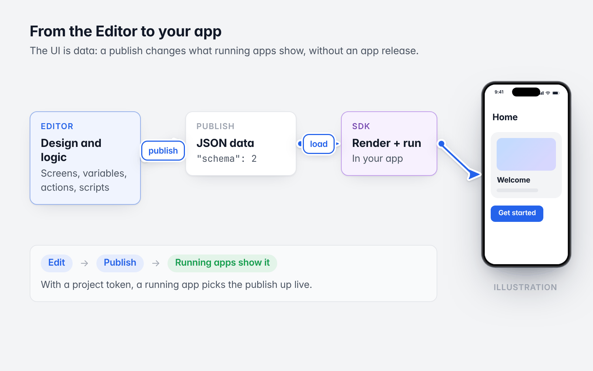
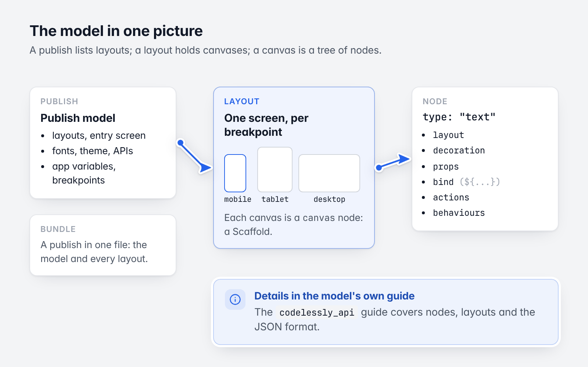
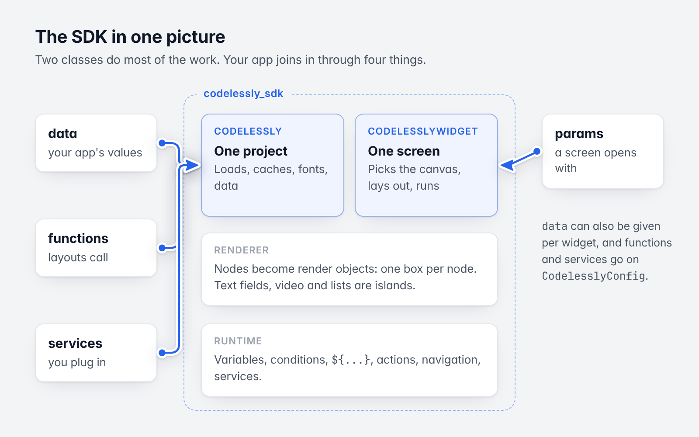

# 1. Introduction and concepts

[Guide](README.md) · Next: [Quickstart](02-quickstart.md)



*A publish changes what running apps show, without an app release.*

## What Codelessly is

Codelessly is a canvas editor, like Figma, whose canvas nodes are Flutter widgets. What you design is a real
Flutter layout: rows, columns, stacks, text, buttons, lists, inputs. The Editor saves it as data, and the SDK turns
that data back into Flutter UI inside your app.

```
Codelessly Editor ──publish──▶ published project ──load──▶ Codelessly SDK ──▶ Flutter UI in your app
 (design, logic)               (JSON, "schema": 2)         (render + run)
```

Because the UI is data, a publish changes what running apps show without an app release.

## The pieces

| Piece | Package | What it does |
|---|---|---|
| **Editor** | (web app) | Where screens, variables, conditions, actions, scripts and APIs are made, and published. |
| **Model** | [`codelessly_api`](https://pub.dev/packages/codelessly_api) | Flutter's widget vocabulary as immutable data with a JSON format. Pure Dart: no Flutter, no network. |
| **SDK** | [`codelessly_sdk`](https://pub.dev/packages/codelessly_sdk) | Loads a published project, renders its nodes as Flutter render objects, and runs its logic. |
| **Script engine** | [`codelessly_quickjs`](https://pub.dev/packages/codelessly_quickjs) | QuickJS, for projects that use scripts, on Android, iOS, macOS and Linux. The web needs nothing. |

The SDK exports the model, so most apps only depend on `codelessly_sdk`.

## The model in one page



*A publish lists layouts; a layout holds canvases; a canvas is a tree of nodes.*

- A **node** is one widget: a `type` (`row`, `text`, `filledButton`, ...), a `layout` (how it sizes and sits in its
  parent), a `decoration` (fills, strokes, radius, shadows), the widget's own `props` (Flutter's parameter names
  and defaults), bindings (`bind`), reactions (`actions`) and behaviors (motion, transitions, gestures).
- A **canvas** is a node of type `canvas`: one screen, a `Scaffold`.
- A **layout** is a document of one or more canvases. When it has several, each is the design for one breakpoint
  (mobile, tablet, desktop), and the SDK shows the one for the width it is given.
- A **publish** is a project's published state: a *publish model* (the list of layouts, the entry screen, fonts,
  theme, APIs, app variables, breakpoints) and each *layout*. A **bundle** is a publish in one file.

The model's own guide has the details:
[codelessly_api guide](https://github.com/Codelessly/CodelesslyAPI/tree/master/docs/guide).

## The SDK in one page



*Two classes, two layers, and the four ways your app joins in.*

Two classes do most of the work:

- **`Codelessly`** is one published project in your app: it loads the publish model and the layouts, caches them,
  registers their fonts, and holds the data layouts read. You create it; nothing is global unless you ask
  (`Codelessly.setDefault`).
- **`CodelesslyWidget`** shows one screen of a `Codelessly`. It picks the canvas for its width, lays it out, and
  runs it.

Inside, the SDK has two layers:

| Layer | What it does |
|---|---|
| **Renderer** | Nodes become Flutter render objects directly (one box per node, no widget per node). Widgets that need an element tree, such as text fields, video and scrolling lists, are hosted as islands. |
| **Runtime** | Variables and conditions, `${...}` expressions and formulas, actions and their triggers, navigation, and the services they use: HTTP APIs, storage, accounts, cloud data, files, analytics, purchases, sound, speech, links, scripts. |

Every part of the runtime is a plugin on `CodelesslyConfig`. The defaults run everything and need no backend
(memory storage, signed out, HTTP for APIs). Firebase is only imported by
`package:codelessly_sdk/firebase.dart`.

## What a layout can do

A published layout is more than a picture:

- **Variables** hold a screen's state; **app variables** are shared by every screen; some persist on the device.
- **Expressions**: `${name}` reads a value, `${= formula}` computes one. Any property can be bound to one.
- **Conditions** set properties by `if / else if / else` branches.
- **Reactions**: a trigger (tap, load, change, timer, key, scroll, ...) runs a chain of **actions** (navigate, set
  a variable, call an API, read cloud data, show a toast, call one of *your* functions, run a script, ...).
- **Scripts**: sandboxed JavaScript for logic that formulas and actions express badly.

Your app joins in through four things: **data** you pass in, **params** a screen opens with, **functions** layouts
call, and **services** you plug in. The rest of this guide is about those.

## The publish format

The Editor publishes in the format `"schema": 2`, and the SDK reads that format. A document without it fails to load
with a clear error ([Troubleshooting](15-troubleshooting.md)).

Next: [Quickstart](02-quickstart.md)
