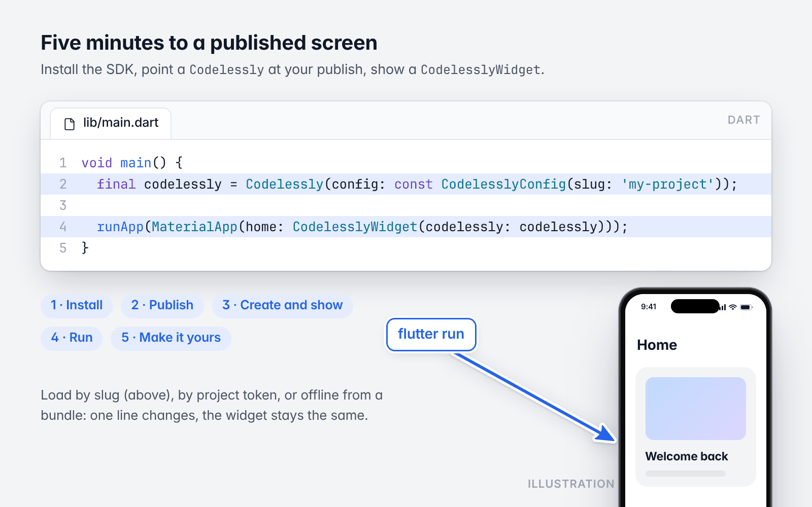
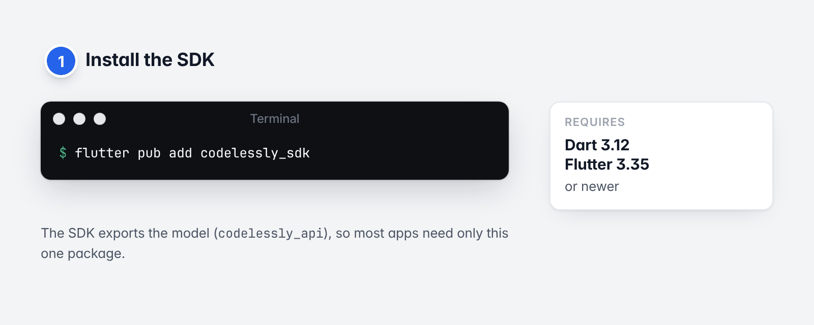
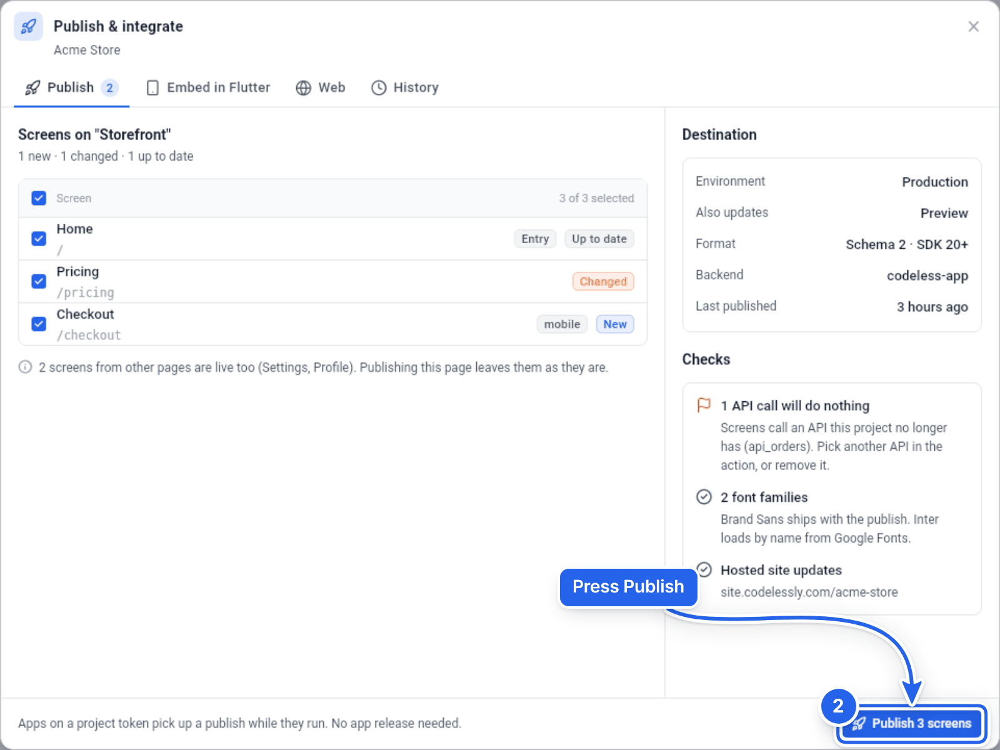
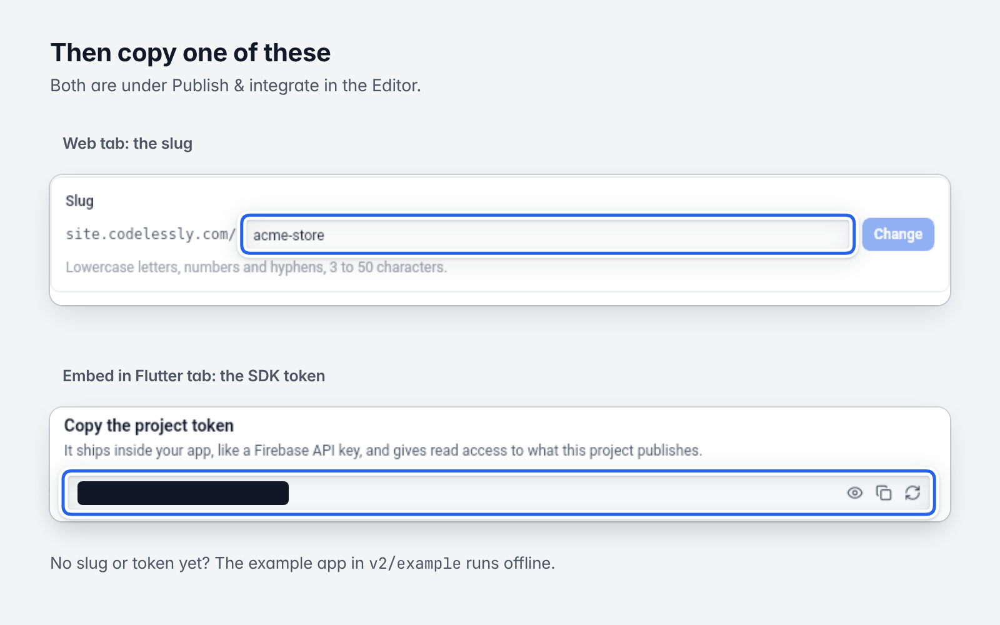
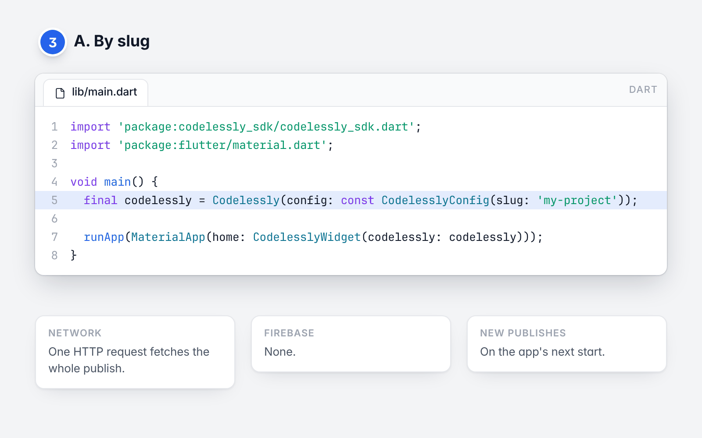
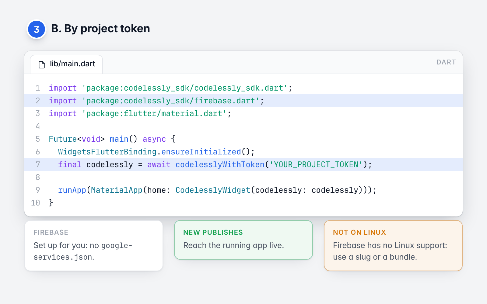
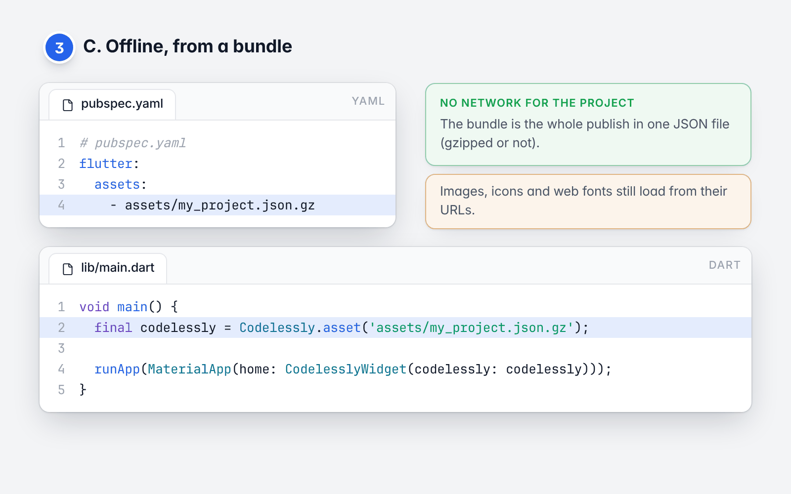
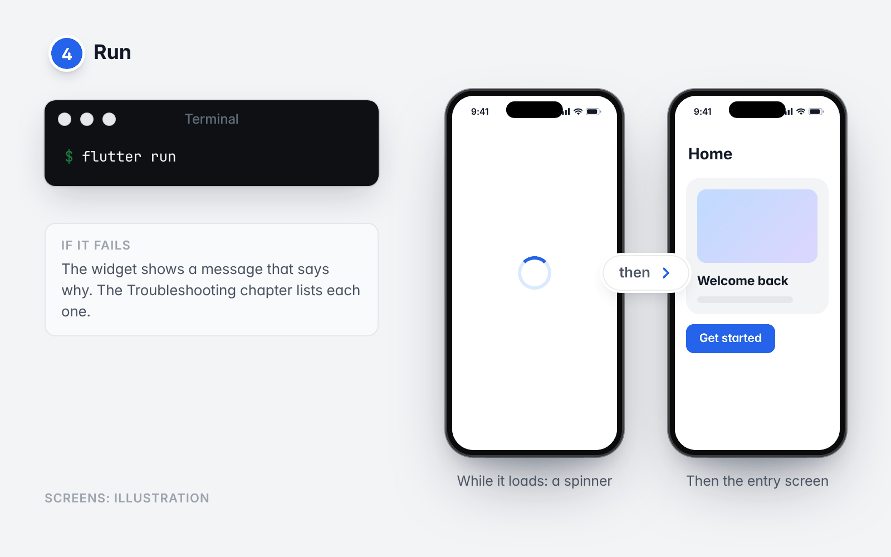
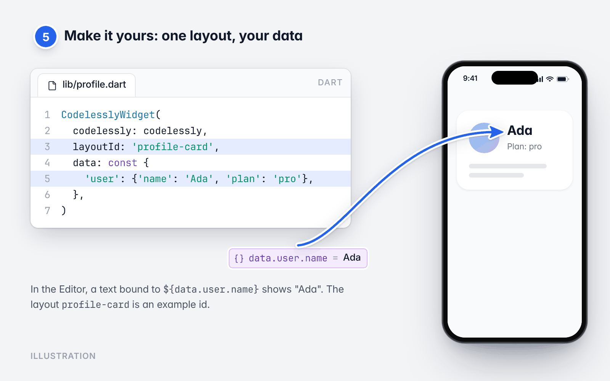
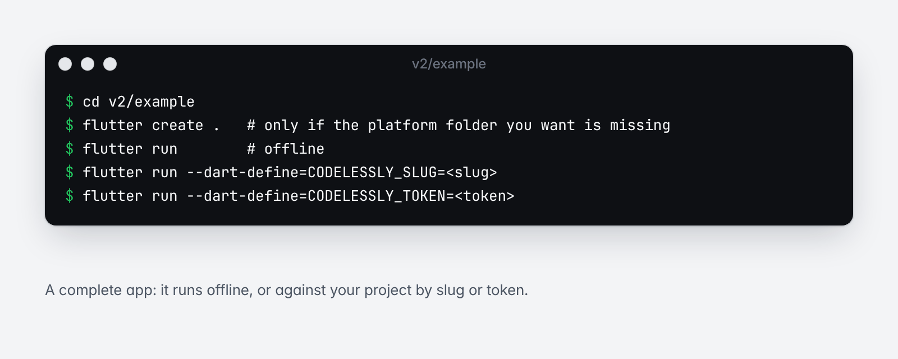

# 2. Quickstart

[Guide](README.md) · Previous: [Introduction](01-introduction.md) · Next: [Embedding and sizing](03-embedding-and-sizing.md)

Five minutes to a published screen running in a Flutter app.



*The whole quickstart: one config line and one widget. The screen is an illustration.*

## 1. Install



*Step 1: add the SDK.*

```sh
flutter pub add codelessly_sdk
```

Dart 3.12 and Flutter 3.35 or newer.

## 2. Publish a project



*Step 2: Publish & integrate → Publish, then press the publish button.*

In the Codelessly Editor, open a project and press **Publish**. You then need one of:

- the project's **slug**, if it has a public site (`site.codelessly.com/<slug>`); or
- the project's **SDK token**; or
- nothing, to try the SDK first with [the example app](../../example), which runs offline.



*Where the slug and the SDK token are. The token is redacted here.*

[Publishing and environments](13-publishing-and-environments.md) says more about each.

## 3. Create a `Codelessly` and show a `CodelesslyWidget`

Pick one of the three.

### A. By slug



*Step 3, option A: load by slug.*

```dart
import 'package:codelessly_sdk/codelessly_sdk.dart';
import 'package:flutter/material.dart';

void main() {
  final codelessly = Codelessly(config: const CodelesslyConfig(slug: 'my-project'));

  runApp(MaterialApp(home: CodelesslyWidget(codelessly: codelessly)));
}
```

One HTTP request fetches the whole publish. No Firebase. The app gets a new publish the next time it starts.

### B. By project token



*Step 3, option B: load by project token.*

```dart
import 'package:codelessly_sdk/codelessly_sdk.dart';
import 'package:codelessly_sdk/firebase.dart';
import 'package:flutter/material.dart';

Future<void> main() async {
  WidgetsFlutterBinding.ensureInitialized();
  final codelessly = await codelesslyWithToken('YOUR_PROJECT_TOKEN');

  runApp(MaterialApp(home: CodelesslyWidget(codelessly: codelessly)));
}
```

The token is all you provide. `codelesslyWithToken` creates a secondary Firebase app for Codelessly's backend from
options that ship with the SDK, so you don't add `google-services.json` or run `flutterfire configure`, and an
existing Firebase project of yours is unaffected. When the first widget builds, the SDK signs in anonymously,
exchanges the token for access to its project, reads the publish from Cloud Firestore, and then follows it: each
new publish reaches the running app.

Platform notes:

- **Linux desktop**: Firebase has no Linux support. `codelesslyWithToken` throws an `UnsupportedError` there; use a
  slug or a bundle.
- **iOS and macOS**: the Firebase plugins need a minimum deployment target (see the
  [FlutterFire docs](https://firebase.google.com/docs/flutter/setup)); raise it in your Podfile if `pod install`
  asks you to.
- **macOS**: the app needs the *Outgoing Connections (Client)* entitlement (`com.apple.security.network.client`),
  as any app that uses the network does.

### C. Offline, from a bundle



*Step 3, option C: ship a bundle and load it offline.*

```yaml
# pubspec.yaml
flutter:
  assets:
    - assets/my_project.json.gz
```

```dart
void main() {
  final codelessly = Codelessly.asset('assets/my_project.json.gz');

  runApp(MaterialApp(home: CodelesslyWidget(codelessly: codelessly)));
}
```

The project loads with no network. (Images, icons and web fonts that its layouts use still come from their URLs;
see [Theming and fonts](11-theming-and-fonts.md).) [Loading modes](04-loading-and-caching.md#where-a-bundle-file-comes-from) says where the file
comes from.

## 4. Run



*Step 4: a spinner while it loads, then the entry screen. Screens are illustrations.*

```sh
flutter run
```

You should see the project's entry screen. While it loads there is a spinner; if it fails there is a message that
says why ([Troubleshooting](15-troubleshooting.md)).

## 5. Make it yours



*Step 5: your data in a layout. The profile card is an illustration.*

Show one particular layout, with your data, and react to what it does:

```dart
CodelesslyWidget(
  codelessly: codelessly,
  layoutId: 'profile-card',
  data: const {
    'user': {'name': 'Ada', 'plan': 'pro'},
  },
)
```

In the Editor, a text bound to `${data.user.name}` shows "Ada".

Where next:

- [Embedding and sizing](03-embedding-and-sizing.md): a layout inside your own screen.
- [Data and variables](05-data-and-variables.md): pass data in.
- [Actions and functions](06-actions-and-functions.md): have a button in the layout call your code.
- [Navigation](07-navigation.md): a whole project as your app.

## The example app



*The example app, offline or against your project.*

[`example`](../../example) is a complete app:

```sh
cd example
flutter create .   # only if the platform folder you want is missing
flutter run        # offline
flutter run --dart-define=CODELESSLY_SLUG=<slug>
flutter run --dart-define=CODELESSLY_TOKEN=<token>
```

Next: [Embedding and sizing](03-embedding-and-sizing.md)
