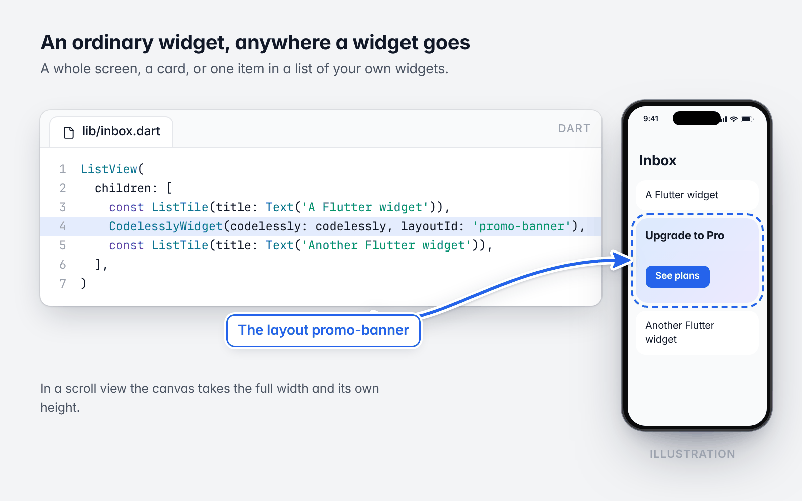
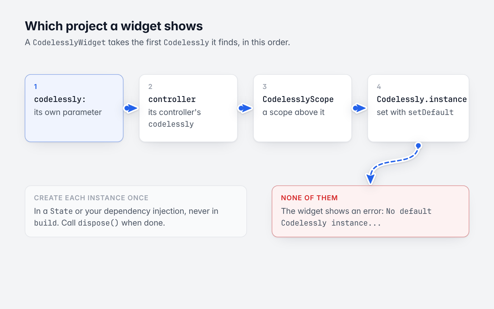
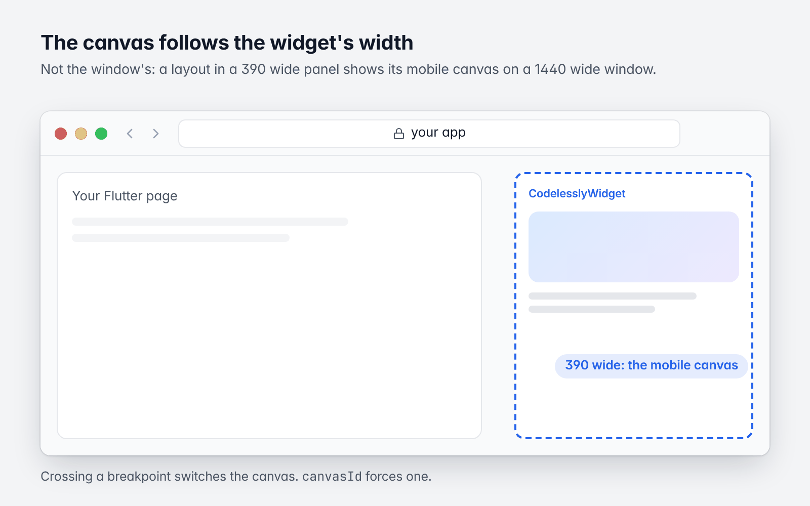
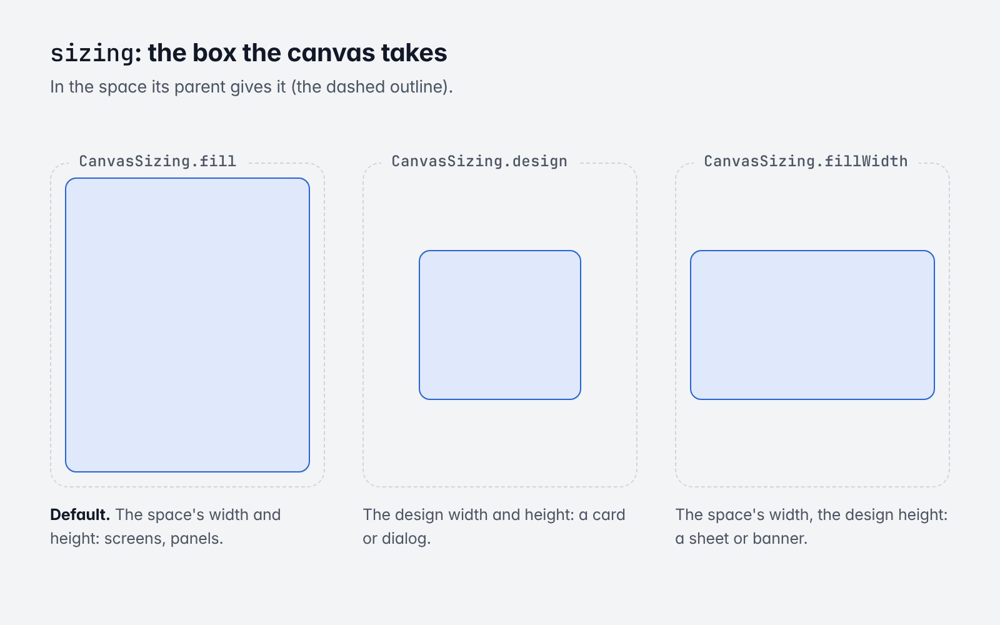
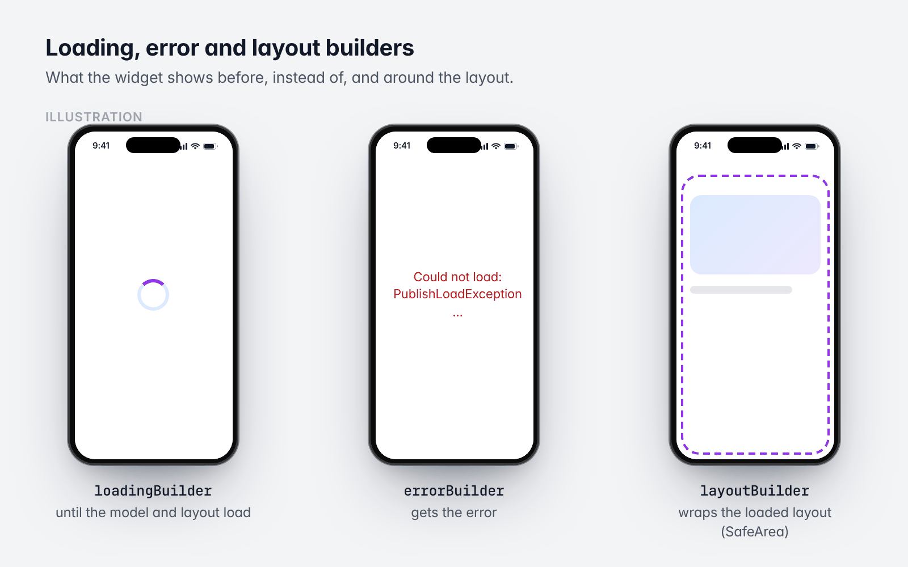
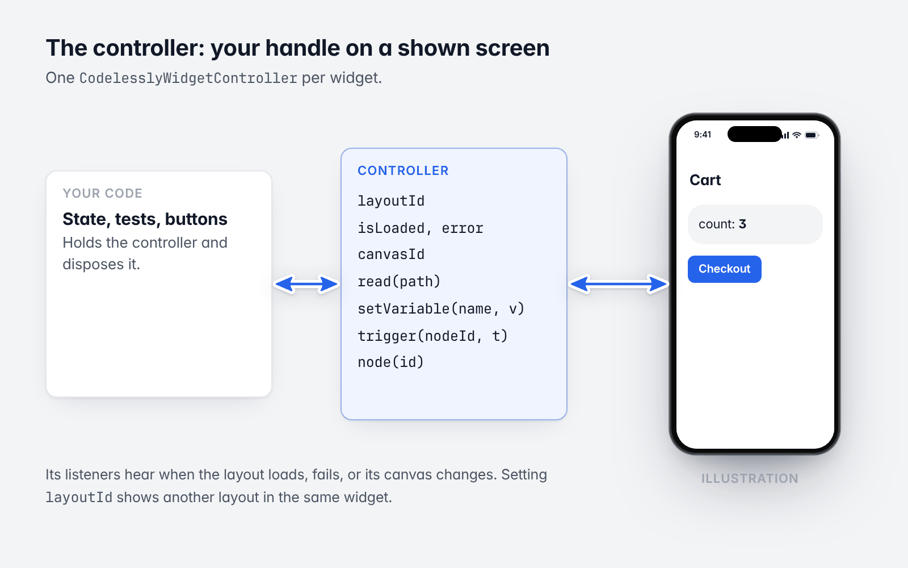

# 3. Embedding and sizing

[Guide](README.md) · Previous: [Quickstart](02-quickstart.md) · Next: [Loading modes and caching](04-loading-and-caching.md)

`CodelesslyWidget` is an ordinary widget. Put it anywhere a widget goes: as a whole screen, in a card, in a list.



*A layout among your own widgets. The screen is an illustration.*

## Which project



*The first Codelessly found wins.*

A `CodelesslyWidget` finds its `Codelessly` in this order:

1. its `codelessly` parameter;
2. its controller's `codelessly`;
3. a `CodelesslyScope` above it;
4. `Codelessly.instance`, the default you set with `Codelessly.setDefault`.

With none of them it shows an error ("No default Codelessly instance...").

```dart
// Explicit.
CodelesslyWidget(codelessly: codelessly, layoutId: 'profile-card')
```

```dart
// A scope: every CodelesslyWidget below uses it.
CodelesslyScope(
  codelessly: codelessly,
  child: const Column(
    children: [
      Expanded(child: CodelesslyWidget(layoutId: 'header')),
      Expanded(child: CodelesslyWidget(layoutId: 'feed')),
    ],
  ),
)
```

```dart
// A default, for apps with one project.
Codelessly.setDefault(codelessly);

runApp(const MaterialApp(home: CodelesslyWidget(layoutId: 'home')));
```

An app can hold several `Codelessly` instances (several projects, or a publish and its preview). Create each once,
for example in a `State` or your dependency injection, and call `dispose()` when you're done with it. Don't create
one inside `build`.

## Which screen

| Parameter | Value | Shows |
|---|---|---|
| `layoutId` | A layout id | That layout. |
| `layoutId` | A custom id (`PublishModel.layoutIDMap`) | The layout it names. |
| `layoutId` | A canvas id | The layout that holds that canvas (the canvas for the current width still shows; see `canvasId`). |
| `canvasId` | A canvas id of the layout | Exactly that canvas, whatever the width. |
| `initialScreen` | `'/guide/42'`, `'guide/42?tab=map'` | The screen whose URL path matches; path and query params become `route` params. |
| `initialScreen` | A layout or canvas id, or a screen name | That screen. Names match loosely: `'record-form'` opens "Record form". |
| (none) | | The project's entry screen. |

`layoutId` wins over the controller's `layoutId`, which wins over `initialScreen`. An `initialScreen` that names
nothing opens the entry screen. A `layoutId` that names nothing is an error (`PublishLoadException: No layout
[...]`).

You can see a project's layout and canvas ids on the loaded model:

```dart
await codelessly.initialize();
for (final layout in codelessly.publishModel!.layouts.values) {
  debugPrint('${layout.id}: ${[for (final c in layout.canvases) '${c.name} (${c.id}, path ${c.path})']}');
}
```

## Canvases and breakpoints



*The widget's width picks the canvas, not the window's.*

A layout can hold several canvases, one per project breakpoint. The widget shows the canvas for **the width it is
laid out in**, not the window's: a layout in a 390 wide panel of a 1440 wide window shows its mobile canvas. When
the width crosses a breakpoint, the canvas switches. See [Conditions and breakpoints](08-conditions-and-breakpoints.md).

## Sizing



*The three CanvasSizing values.*

`sizing` decides the box the canvas takes in the space its parent gives it:

| `CanvasSizing` | Width | Height | Use for |
|---|---|---|---|
| `fill` (default) | The space's width | The space's height | A screen, a panel, anything that should fill its box |
| `design` | The canvas's design width | Its design height | A card or dialog at the size it was designed |
| `fillWidth` | The space's width | Its design height | A sheet or banner |

Details that matter:

- **Unbounded space** (in a `ListView`, a `Column` inside a scroll view): with `fill`, the canvas takes its design
  size on the unbounded axis. A canvas whose height hugs its content takes its content's height.
- **Bounded space smaller than the design**: `design` and `fillWidth` never exceed the space.
- **Scale mode**, set on the canvas in the Editor. A *responsive* canvas lays out at the box's size. An *auto
  scale* canvas lays out at its design width and is scaled to fit the box's width.

```dart
// A card at its design size.
Center(
  child: CodelesslyWidget(
    codelessly: codelessly,
    layoutId: 'upgrade-dialog',
    sizing: CanvasSizing.design,
  ),
)
```

```dart
// In a fixed box: the canvas is picked by the box's width.
SizedBox(
  width: 390,
  height: 240,
  child: CodelesslyWidget(codelessly: codelessly, layoutId: 'promo-banner'),
)
```

```dart
// In a scroll view: full width, its own height.
ListView(
  children: [
    const ListTile(title: Text('A Flutter widget')),
    CodelesslyWidget(codelessly: codelessly, layoutId: 'promo-banner'),
    const ListTile(title: Text('Another Flutter widget')),
  ],
)
```

## Loading, error and layout builders



*What each builder shows. Screens are illustrations.*

```dart
CodelesslyWidget(
  codelessly: codelessly,
  layoutId: 'profile-card',
  loadingBuilder: (context) => const Center(child: CircularProgressIndicator()),
  errorBuilder: (context, error) => Center(child: Text('Could not load: $error')),
  layoutBuilder: (context, layout) => SafeArea(child: layout),
)
```

- `loadingBuilder` shows until the publish model and the layout are loaded. Default: `CodelesslyLoadingScreen`, a
  centered `CircularProgressIndicator`.
- `errorBuilder` gets the error, usually a `PublishLoadException`. Default: `CodelesslyErrorScreen`, a short
  message. In production, give your own.
- `layoutBuilder` wraps the loaded layout.

To drive your own loading UI from the instance, listen to it:

```dart
ListenableBuilder(
  listenable: codelessly,
  builder: (context, _) => switch (codelessly.status) {
    CEmpty() || CLoading() => const LinearProgressIndicator(),
    CLoaded() => const SizedBox.shrink(),
    CError(:final message) => Text(message),
  },
)
```

## The controller



*A controller is your handle on one shown screen.*

A `CodelesslyWidgetController` is your handle on a shown screen.

```dart
class Cart extends StatefulWidget {
  const Cart({super.key, required this.codelessly});

  final Codelessly codelessly;

  @override
  State<Cart> createState() => _CartState();
}

class _CartState extends State<Cart> {
  final controller = CodelesslyWidgetController(layoutId: 'cart');

  @override
  void initState() {
    super.initState();
    // Notifies when the layout loads, fails, or its canvas changes.
    controller.addListener(() => debugPrint('loaded: ${controller.isLoaded}, canvas: ${controller.canvasId}'));
  }

  @override
  void dispose() {
    controller.dispose();
    super.dispose();
  }

  @override
  Widget build(BuildContext context) => CodelesslyWidget(codelessly: widget.codelessly, controller: controller);
}
```

| Member | What |
|---|---|
| `layoutId` (get, set) | The layout to show. Setting it shows another layout in the same widget. |
| `isLoaded`, `error` | Whether a layout is shown, or why it isn't. |
| `layout`, `canvasId` | The `PublishLayout` shown and its current canvas. |
| `read(path)` | A value of the screen: `'count'`, `'route.id'`, `'data.user.name'`. |
| `setVariable(name, value)` | Sets a variable of the screen (or a path into one: `'draft.title'`). |
| `trigger(nodeId, trigger)` | Runs a node's reactions, as a tap (`'click'`) would. |
| `node(id)` | A node as rendered, bindings applied. |
| `scope`, `actionContext`, `tree` | The screen's value scope, action context and render tree, for advanced use. |

The controller can also carry `codelessly`, `params`, `data` and the builders, so a screen built in one place can
be shown in another. Use one controller per widget.

## Rebuilding

`CodelesslyWidget` keeps its screen's state across rebuilds. Changing `data` updates the screen in place.
Changing `layoutId`, `initialScreen` or `codelessly` loads the new screen with fresh state. `params` are read when
the screen opens.

Next: [Loading modes and caching](04-loading-and-caching.md)
