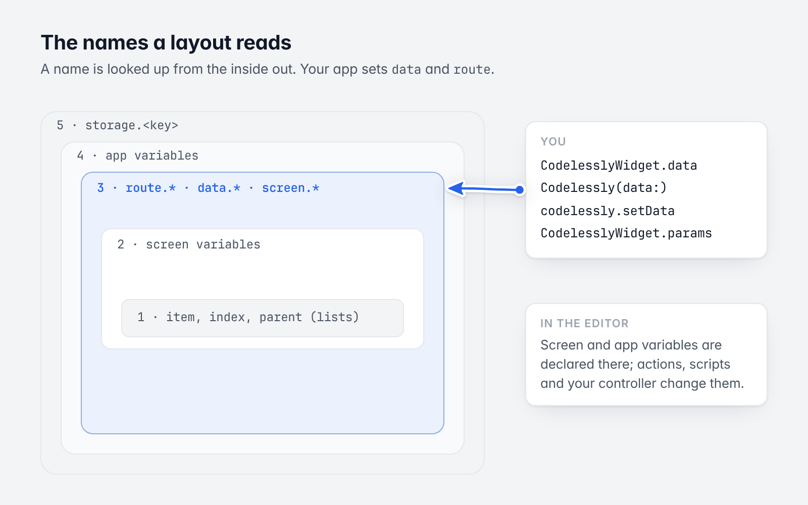
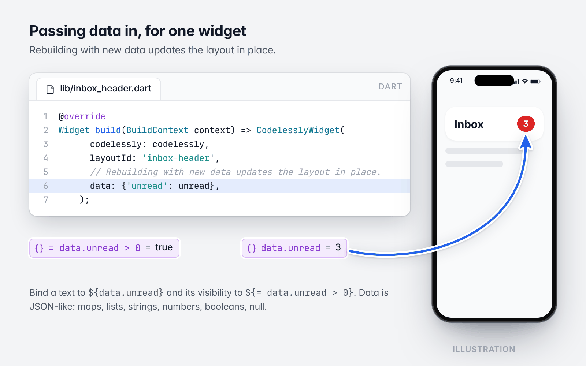
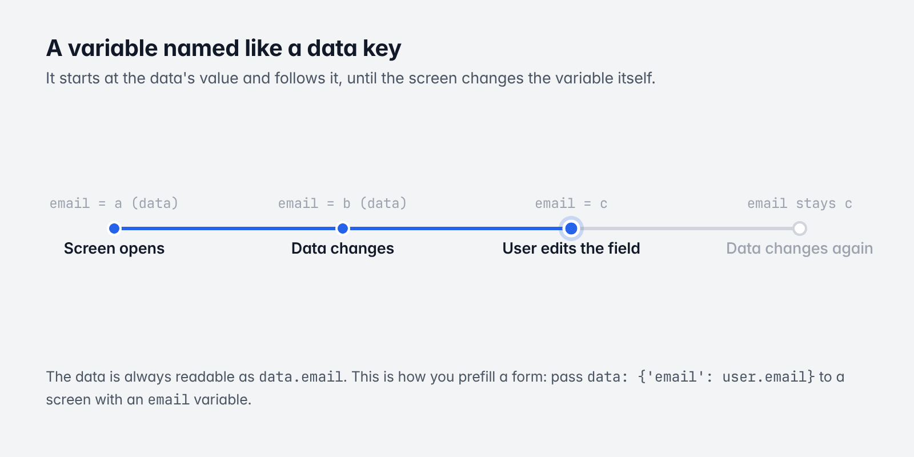

# 5. Data and variables

[Guide](README.md) · Previous: [Loading modes and caching](04-loading-and-caching.md) · Next: [Actions and functions](06-actions-and-functions.md)

Layouts read values with expressions: `${name}` reads one, `${= formula}` computes one. This chapter is about the
names a layout can read, and which of them your app controls.



*A name is looked up from the inside out.*

## The names a layout reads

| Name | What it is | Who sets it |
|---|---|---|
| `data.<key>` | Your app's data | You: `CodelesslyWidget.data`, `Codelessly(data:)`, `codelessly.setData` |
| `route.<name>` | The params the screen was opened with | You (`CodelesslyWidget.params`), or the navigation action that opened it |
| `<variable>` | A screen variable | Declared in the Editor; changed by actions, scripts, and your controller |
| `<app variable>` | A variable shared by every screen | Declared in the Editor; changed by actions |
| `storage.<key>` | Values the app keeps on the device | "Set storage" actions |
| `screen.*` | Size, breakpoint, orientation, brightness | The SDK ([chapter 8](08-conditions-and-breakpoints.md)) |
| `theme.*` | The project's theme for the current light or dark mode: colors, text styles, `isDark` | The project's styles; the SDK picks the mode ([chapter 11](11-theming-and-fonts.md#the-theme-in-expressions)) |
| `item`, `index`, `parent` | The current list item | Lists |
| `result` | What the previous action of a chain gave | Actions ([chapter 6](06-actions-and-functions.md)) |

A name is looked up from the inside out: the list item, then the screen's variables, then `route`, `data`,
`screen` and `theme`, then the app's variables, then `storage`.

## Passing data in

### For one widget



*Data passed to one widget, read as ${data.unread}. The screen is an illustration.*

```dart
class InboxHeader extends StatelessWidget {
  const InboxHeader({super.key, required this.codelessly, required this.unread});

  final Codelessly codelessly;
  final int unread;

  @override
  Widget build(BuildContext context) => CodelesslyWidget(
        codelessly: codelessly,
        layoutId: 'inbox-header',
        // Rebuilding with new data updates the layout in place.
        data: {'unread': unread},
      );
}
```

In the Editor, bind a text to `${data.unread}` or a visibility to `${= data.unread > 0}`.

Data is JSON-like: maps, lists, strings, numbers, booleans and null. Paths reach into it: `${data.user.name}`,
`${data.cart[0].title}`, `${data.cart.length}`. A list bound to a list widget's data builds one item per element,
read inside the item as `${item.title}`.

### For every screen of the instance

```dart
final codelessly = Codelessly(
  config: const CodelesslyConfig(slug: 'my-project'),
  data: const {
    'user': {'name': 'Ada'},
  },
);

// Later: the screens that read `data.cart` update.
codelessly.setData('cart', [
  {'title': 'Tea', 'price': 4.5},
]);
```

A widget's `data` is merged over the instance's, key by key at the top level. A screen whose widget has its own
`data` takes the instance's data as it is when the screen opens and when the widget's `data` next changes; a screen
without its own `data` follows `setData` live. If a screen needs both, pass everything it reads through the
widget's `data`.

### Data and variables of the same name



*A variable named like a data key follows it until the screen changes it.*

If a screen declares a variable with the same name as a data key, the variable **starts at the data's value and
follows it** when the data changes, until the screen changes the variable itself (an input the user edits, a "set
variable" action). After that the screen's value stays. The data is always readable as `data.<key>` as well.

This is how you prefill a form: pass `data: {'email': user.email}` to a screen with an `email` variable bound to
a text field.

## Params

`params` are what a screen is opened with, read as `${route.<name>}`:

```dart
CodelesslyWidget(
  codelessly: codelessly,
  layoutId: 'product',
  params: const {'id': 'sku_123'},
)
```

A screen variable with the same name as a param starts at the param's value. Params are read once, when the screen
opens. A navigation action passes its own params to the screen it opens, and a screen opened by URL path gets the
path's params (`item/:id`) and the query's ([Navigation](07-navigation.md)).

## Reading and changing a screen from your app

```dart
final controller = CodelesslyWidgetController();

// ... CodelesslyWidget(controller: controller, ...)

controller.read('count');            // a variable
controller.read('route.id');         // a param
controller.read('data.user.name');   // data
controller.setVariable('count', 0);  // the screen updates
```

`setVariable` sets a variable the screen (or the app) declares. A [function](06-actions-and-functions.md) your app
registers can do the same through its `ActionContext`.

To be told when something in a screen changes, have the layout call one of your functions from a reaction (a
"value changed" trigger on the variable, or the control's own "changed" trigger).

## Variables

Variables are declared in the Editor and published with the layout.

| Kind | Scope | Notes |
|---|---|---|
| Screen variable | One screen (canvas) | Fresh each time the screen opens. |
| App variable | Every screen of the instance | Lives as long as the `Codelessly`. |
| Computed variable | Either | Has a formula instead of a value; read-only; updates when what it reads changes. With parameters it is a function formulas call by name. |
| Persisted variable | Either | Starts from its last value and saves every change, in the app's `LocalStorage`. |

Types: `integer`, `decimal`, `text`, `boolean`, `color`, `list`, `map`, `image`, `choice`.

### Values every screen shares

An app variable is one value for the whole `Codelessly` instance: every screen of every `CodelesslyWidget` showing
the project reads it, and a change on one screen shows on all of them, even on host screens of your own app (a
badge in your tab bar and a list on another tab are two widgets of one instance).

To keep live cloud data in one, give the layout's "Load cloud data" action the **app** scope
(`"scope": "app"`): the first load opens one live subscription, kept by the instance; every later load of the
same document or query, from any screen, shares it instead of opening another, and it stays live when the screen
that opened it goes. Declare its variable as an app variable (a screen variable of the same name would hide
it). See [chapter 9](09-cloud-data-and-services.md#live-data-every-screen-shares).

```dart
// Two widgets of one instance: the badge and the list read the same `cards`,
// loaded once.
Widget sharedLiveData(Codelessly codelessly) => Scaffold(
      appBar: AppBar(actions: [
        SizedBox(width: 56, height: 56, child: CodelesslyWidget(codelessly: codelessly, layoutId: 'badge')),
      ]),
      body: CodelesslyWidget(codelessly: codelessly, layoutId: 'list'),
    );
```

### Keeping values between runs

Persisted variables and `storage.<key>` live in `Services.storage`. **The default is in memory**, so they reset
when the app restarts. Give the instance a storage that persists:

```dart
final storage = await PreferencesLocalStorage.open(prefix: 'codelessly.my-project.');
final codelessly = Codelessly(
  config: CodelesslyConfig(slug: 'my-project', services: Services(storage: storage)),
);
```

`PreferencesLocalStorage` uses the platform's preferences (`SharedPreferences`, `NSUserDefaults`, the browser's
`localStorage`). The `prefix` keeps several projects apart.

## The signed-in user

Auth actions (sign in, sign up, sign out) run through `Services.auth`. In 20.1 `CodelesslyWidget` does not put an
`auth` value in a screen's scope by itself. To let layouts read the user, mirror it into the instance's data:

```dart
final services = codelessly.services;
if (services is Services) {
  services.watchAuth().listen((auth) => codelessly.setData('auth', auth));
}
```

Layouts then read `${data.auth.isSignedIn}`, `${data.auth.email}`, `${data.auth.displayName}` and
`${data.auth.profile.<field>}`.

## Expressions, briefly

- `${path}` reads a value: `${user.name}`, `${cart[0].qty}`, `${title.length}`.
- `${= formula}` computes one: `${= price * qty}`, `${= money(sum(cart, 'price'))}`,
  `${= filter(tasks, t => !t.done)}`. The formula language has arithmetic, comparisons, ternaries, lambdas, and
  functions for text, numbers, lists, maps, colors and dates.
- A binding that is exactly one expression keeps the value's type (a list stays a list). Any other text with
  `${...}` in it is text.
- Values are read loosely where a property needs a type: `"12"` is a number, `"#F00F00"` a color.
- Time: `now()`, `today()`, `formatDate(date, 'MMM d')`, `diffMinutes`, `diffDays`, `addDays`, `isBefore`,
  `isAfter`, `isPast`, `isFuture`, `isToday`, `isSameDay`, and `timeAgo(date, style?, locale?, labels?)` for relative times: `now`,
  `5m`, `3h`, `Yesterday`, `3d`, then `Mar 4` (`5 minutes ago` with the `long` style; dates in the locale's words;
  `labels` gives the words in another language). Dates can be ISO text, epoch milliseconds or Firestore
  timestamps.
- What reads the clock stays current, as often as it can change and no more: a formula with `now()` every
  second, one with only `today()`, `timeAgo`, `isToday`, `isPast` or `isFuture` every minute, `nowMs()` every frame. That holds through
  your own functions too: a binding `${= ago(item.sentAt)}`, where `ago` is a function variable calling
  `timeAgo`, updates every minute. No timer runs while nothing on screen reads the clock. In tests, pin the time
  with `FormulaClock.pinned` and step it with `FormulaClock.minutes.tick()` (or pump past
  `FormulaClock.minuteInterval`).

To show layouts exactly as designed, without evaluating anything, use `NoopExpressionEngine`
([chapter 6](06-actions-and-functions.md#turning-the-runtime-down)).

Next: [Actions and functions](06-actions-and-functions.md)
