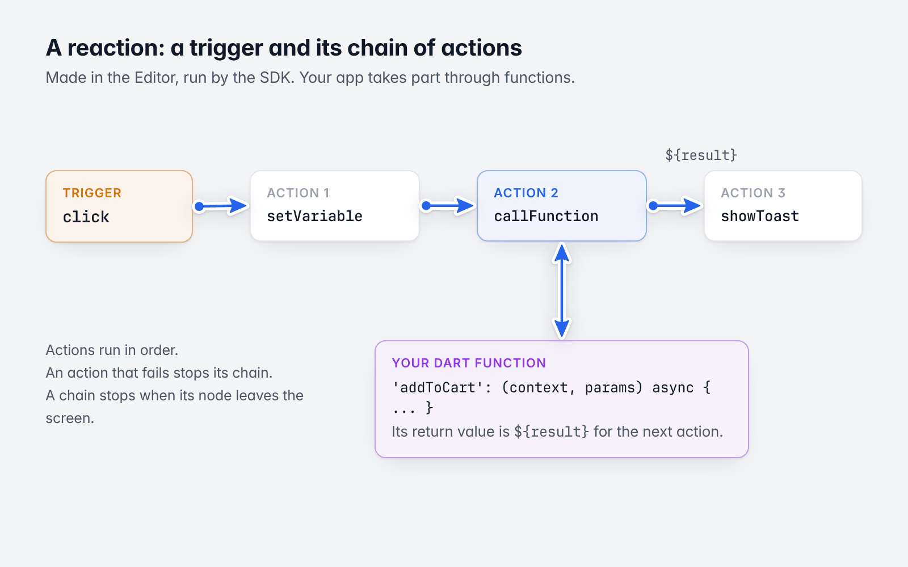
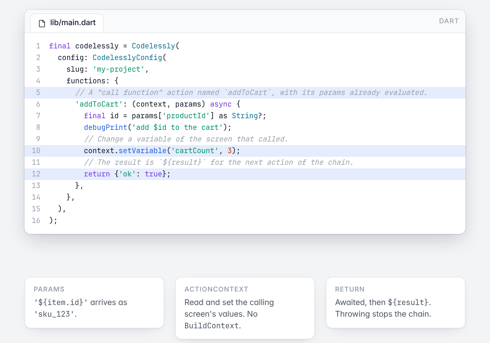
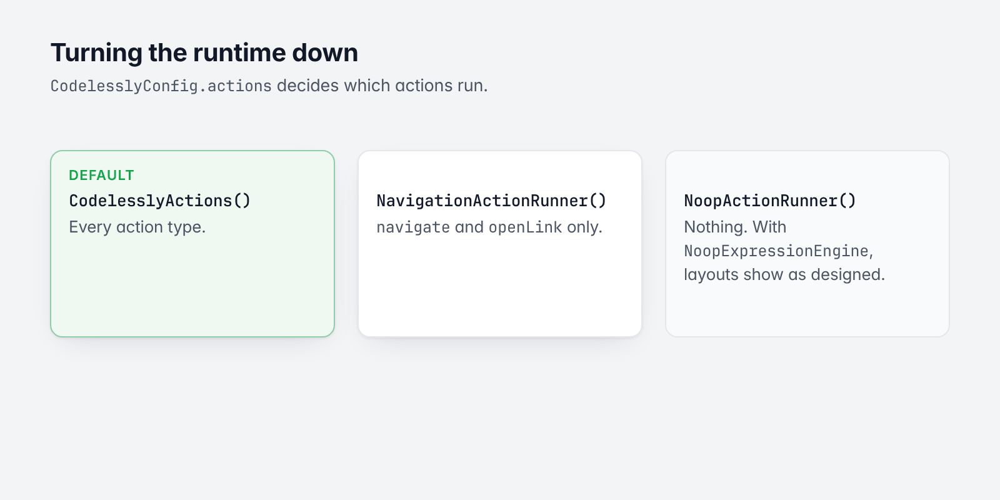

# 6. Actions and functions

[Guide](README.md) · Previous: [Data and variables](05-data-and-variables.md) · A layout reacts to things. A **reaction** is a **trigger** and the chain of **actions** it runs, in order. They
are made in the Editor and run by the SDK; your app takes part through **functions**.



*A reaction: a trigger and a chain of actions, with your function in it.*

## Triggers

| Group | Triggers |
|---|---|
| Pointer | `click`, `doubleTap`, `longPress`, `hold`, `secondaryClick`, `pointerDown`, `pointerUp`, `hover`, `cursorEnter`, `cursorExit`, `swipeLeft`, `swipeRight`, `swipeUp`, `swipeDown`, `drag`, `dragEnd`, `wheel`, `pinch` |
| Inputs | `changed`, `changeEnd`, `submitted`, `editingComplete`, `focusGained`, `focusLost` |
| Screen | `load`, `valueChanged` (a variable), `timer`, `clock`, `keyDown`, `keyUp`, `backPressed` |
| Scrolling | `scroll`, `scrollEnd`, `enterViewport`, `exitViewport` |
| Lists | `refresh`, `swipeAction`, `reorder` |
| Drag and drop | `dragStart`, `dragCancel`, `dragCompleted`, `drop`, `dragEnter`, `dragExit`, `dragHover`, `dropRejected`, `dropFull` |

## Actions

| Area | Actions |
|---|---|
| Navigation | `navigate` (push, pop, replace, reset), `openModal` (dialog, sheets, full screen, popover, banner), `closeModal`, `openLink` |
| State | `setVariable`, `animateVariable`, `setValue` (a node's properties), `setVariant`, `setStorage` |
| Flow | `if`, `forEach`, `delay`, `confirm` |
| Your code and the app | `callFunction`, `runScript`, `emitEvent` |
| Data | `callApi`, `loadCloudData`, `reloadCloudData`, `cloudData`, `cloudDocuments`, `cloudBatch`, `cloudFiles`, `paginate` |
| Accounts and purchases | `auth`, `paywall` |
| Feedback | `showToast`, `haptic`, `playSound`, `speak`, `copyToClipboard` |
| Inputs and motion | `submitForm`, `editText`, `focus`, `scrollTo`, `playAnimation`, `controlDrag` |
| Capture | `captureScreenshot` |

How a chain runs:

- Actions run in order. Each can read `${result}`: what the previous action gave. The first reads the trigger's
  event (a changed value, a pressed key).
- Text fields of an action are expressions.
- An action can be turned off, run without being waited for, or run only while a predicate holds.
- An action that fails stops its chain. The failure is reported to `Services.analytics` (printed in debug builds).
  `callApi` and `runScript` have their own `onError` actions.
- A chain stops when its node leaves the screen.
- A `navigate` push waits for the pushed screen to be popped; the pop's result is the next action's `${result}`.

## Functions: calling your code



*A function: evaluated params in, a ${result} out.*

A "call function" action names a function and gives it params. You provide the function:

```dart
final codelessly = Codelessly(
  config: CodelesslyConfig(
    slug: 'my-project',
    functions: {
      // A "call function" action named `addToCart`, with its params already evaluated.
      'addToCart': (context, params) async {
        final id = params['productId'] as String?;
        debugPrint('add $id to the cart');
        // Change a variable of the screen that called.
        context.setVariable('cartCount', 3);
        // The result is `${result}` for the next action of the chain.
        return {'ok': true};
      },
      // `appContext` is a BuildContext of your app, captured where this config is built.
      'signOut': (context, params) => Navigator.of(appContext).popUntil((route) => route.isFirst),
    },
  ),
);
```

The signature is `FutureOr<Object?> Function(ActionContext context, Map<String, Object?> params)`.

- `params` are the action's params with their expressions evaluated: `{'productId': '${item.id}'}` arrives as
  `{'productId': 'sku_123'}`.
- The return value (awaited, if a future) becomes `${result}` for the next action. Return JSON-like values.
  Because a returned future is awaited, don't return one that completes late by accident: `=> navigator.push(...)`
  makes the chain wait until that route is popped.
- Throwing stops the chain and reports the error.
- A function the layout names but you didn't register fails the chain with `No function named [name]`, unless
  the action is `optional` (then `${result}` is null and the chain goes on).
- `codelessly.registerFunction(name, function)` adds one later (from a widget that has what it needs); screens
  already shown see it. See [Presenting, automations and host features](17-presenting-and-automations.md).

`ActionContext` is what a function can do without a `BuildContext`:

| Member | What |
|---|---|
| `scope.read(path)` | Reads a value of the calling screen (`'count'`, `'route.id'`, `'item.title'`). |
| `setVariable(name, value)` | Sets a variable of the calling screen. |
| `services` | The instance's services (`callApi`, `openUrl`; cast to `Services` for the rest). |
| `expressions` | The expression engine, to evaluate `${...}` text yourself. |
| `navigate(action)` | Runs a navigate action from its JSON. |

There is no `BuildContext` in a function on purpose (the runtime also runs headless). To show UI or use your own
navigator, capture what you need when you build the config: a `GlobalKey<NavigatorState>`, a
`ScaffoldMessengerState`, your state management.

Functions are per instance (`codelessly.functions`: the registered ones over the config's). To give the same layout different handlers in different places, use different
instances, or dispatch inside the function on a param or on `context.scope.read('route.<name>')`.

## Reacting to navigation and links

- Navigation actions: `CodelesslyWidget.onNavigate` ([Navigation](07-navigation.md)).
- Links: `Services.links`, a `LinkOpener` ([Custom widgets and extending](12-custom-widgets.md#replacing-a-service)).

## Turning the runtime down



*The three action runners.*

Both halves of the runtime are plugins on `CodelesslyConfig`.

```dart
// Layouts shown as designed: no bindings, no actions.
final asDesigned = Codelessly(
  config: const CodelesslyConfig(
    slug: 'my-project',
    expressions: NoopExpressionEngine(),
    actions: NoopActionRunner(),
  ),
);
```

```dart
// Only navigation and links run.
final browseOnly = Codelessly(
  config: const CodelesslyConfig(slug: 'my-project', actions: NavigationActionRunner()),
);
```

| `actions` | Runs |
|---|---|
| `CodelesslyActions()` (default) | Every action type |
| `CoreActions()` | The core ones only (navigation, modals, variables, flow, focus, scroll, animation, scripts); no feature |
| `NavigationActionRunner()` | `navigate` and `openLink` only |
| `NoopActionRunner()` | Nothing |

You can also implement `ActionRunner` or `ExpressionEngine` yourself; that is rarely needed.

### Core and features

The runtime is a core and feature layers over it. The core is the renderer and core interactivity: navigation,
modals, toasts, variables, conditions and loops, focus and text editing, scrolling, animation, gestures, scripts.
Everything else is a feature, a `CodelesslyFeature` in its own folder under `lib/src/features`:

| Feature | Action types | Values | Functions |
|---|---|---|---|
| `authFeature` | `auth` | `auth` | |
| `dataFeature` | `callApi`, `setStorage`, `cloudData`, `cloudDocuments`, `cloudBatch`, `cloudFiles`, `loadCloudData`, `reloadCloudData`, `submitForm` | `storage` | |
| `commerceFeature` | `paywall` | `entitlements` | |
| `mediaFeature` | `speak`, `playSound`, `print`, `downloadFile` | `speech` | `media.probe`, `media.import`, `media.export`, `media.cancelExport` |
| `engageFeature` | | `usage` (automations) | |

`CodelesslyActions()` installs all five (`kFirstPartyFeatures`), so a default `Codelessly` runs everything.
`CoreActions()` installs none: the core never imports a feature (`test/feature_isolation_test.dart` checks it), so
an action of a feature that isn't installed stops its chain with an error that says so (`No handler for action
'paywall': the feature that runs it isn't installed`), and the feature's value reads as nothing.

```dart
// The renderer and core interactivity, plus cloud data and auth; no commerce, media or automations.
const CodelesslyConfig(
  slug: 'my-project',
  actions: CodelesslyActions(features: [authFeature, dataFeature]),
);
```

Your own feature is the same object ([Custom widgets](12-custom-widgets.md#your-own-node-and-action-types)).

Next: [Navigation](07-navigation.md)
