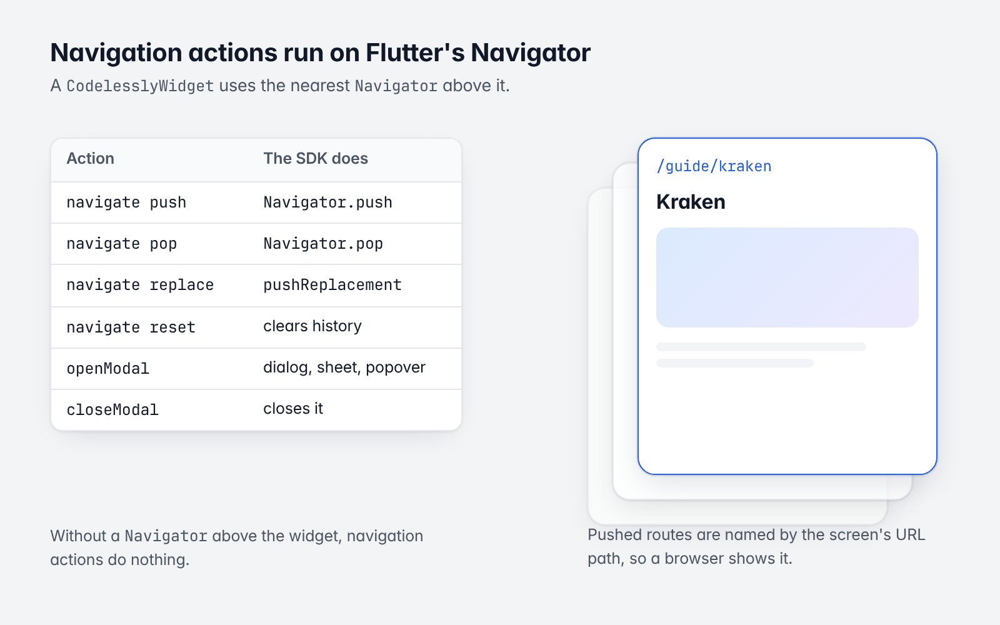
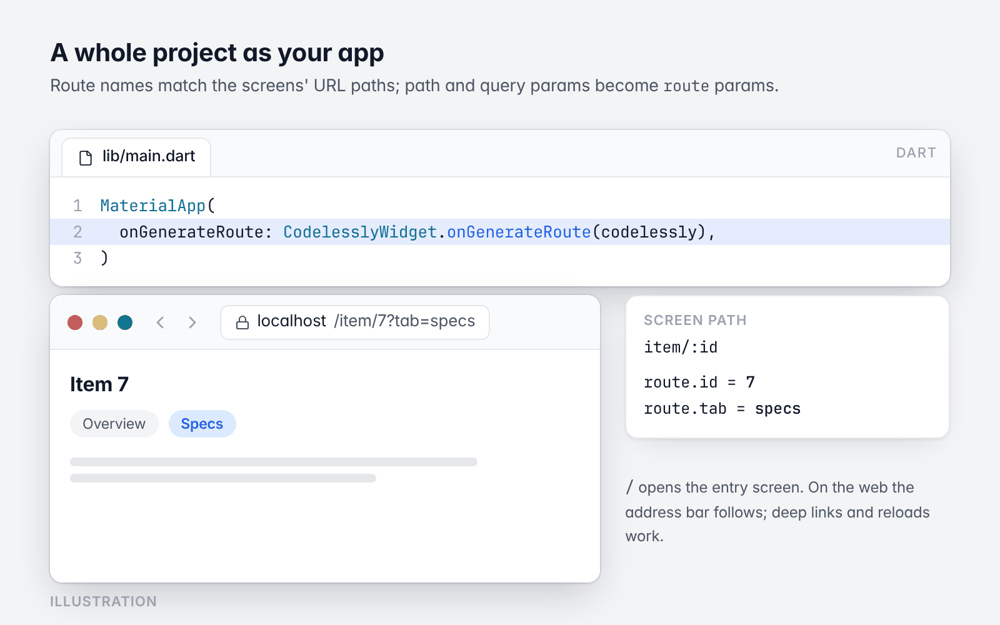
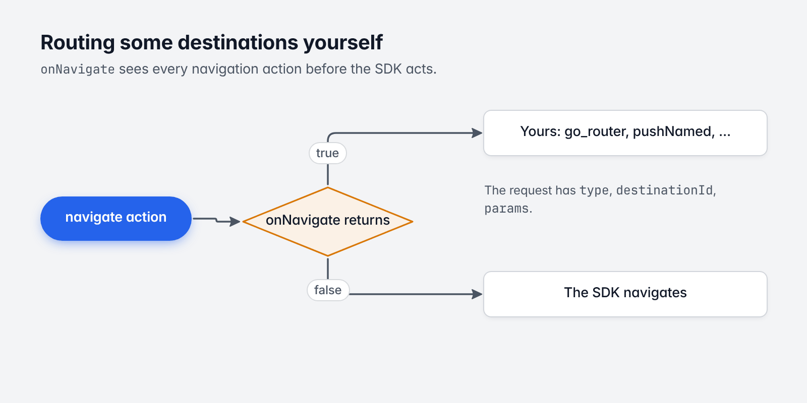

# 7. Navigation

[Guide](README.md) · Previous: [Actions and functions](06-actions-and-functions.md) · Next: [Conditions and breakpoints](08-conditions-and-breakpoints.md)

Layouts navigate with actions: `navigate` (push, pop, replace, reset), `openModal` and `closeModal`. The SDK runs
them on Flutter's `Navigator`, and you decide how much of the routing is yours.



*Navigation actions become Navigator calls.*

## How navigation actions run

A `CodelesslyWidget` uses the nearest `Navigator` above it:

| Action | What the SDK does |
|---|---|
| `navigate` push | `Navigator.push` of a route showing the destination screen with the action's params. |
| `navigate` pop | `Navigator.pop` with the action's params as the result. If there is nothing to pop and the action names a destination, it replaces the current screen with it. |
| `navigate` replace | `Navigator.pushReplacement`. |
| `navigate` reset | Clears the history and shows the destination, optionally over a base screen (so back goes there). |
| `openModal` | Shows the destination screen as a dialog, sheet, full-screen modal or popover, at its design size. |
| `closeModal` | Closes it; its result is the opener's `${result}`. |

The pushed routes are named by the screen's URL path (`/guide/kraken`), so a browser shows it. They use the
platform's page transition, or the one the action asks for (`fade`, `slideUp`, a custom route transition). On the
web the default is no transition.

Without a `Navigator` above the widget, navigation actions do nothing.

## A whole project as your app



*URL paths and query parameters become route params. The page is an illustration.*

Give the project's screens to `MaterialApp`:

```dart
MaterialApp(
  onGenerateRoute: CodelesslyWidget.onGenerateRoute(codelessly),
)
```

- `/` opens the project's entry screen.
- Any other route name is matched against the screens' URL paths (`/item/7` opens the screen with path `item/:id`
  with `route.id` = `7`), then against layout and canvas ids, then against screen names.
- Query parameters become params too: `/item/7?tab=specs`.
- On the web, the address bar follows; deep links and reloads work.

`template` passes builders and an `onNavigate` handler to every screen:

```dart
MaterialApp(
  onGenerateRoute: CodelesslyWidget.onGenerateRoute(
    codelessly,
    template: CodelesslyWidget(
      loadingBuilder: (_) => const Scaffold(body: CodelesslyLoadingScreen()),
      errorBuilder: (_, error) => Scaffold(body: CodelesslyErrorScreen(error: error)),
    ),
  ),
)
```

Screen paths are set per canvas in the Editor. Patterns: `guide/:id` (a param), `sheet/:id?` (an optional trailing
param), `docs/*path` (a catch-all). A screen without a path gets one from its name ("Log entry" is `log-entry`).

## A project inside your app

Give the project a `Navigator` of its own, so its screens push and pop inside one region (a tab, a panel) and your
app's navigator is untouched:

```dart
Navigator(
  onGenerateRoute: CodelesslyWidget.onGenerateRoute(
    codelessly,
    template: CodelesslyWidget(
      errorBuilder: (context, error) => Center(child: Text('$error')),
    ),
  ),
)
```

If you embed a single `CodelesslyWidget` in a page instead, its navigation actions push on your app's navigator:
full-screen routes showing Codelessly screens. That is often what you want for "open details" flows.

## Opening a Codelessly screen from your code

```dart
Navigator.of(context).push(
  CodelesslyWidget.route<void>(
    codelessly: codelessly,
    layoutId: 'product',
    params: const {'id': 'sku_123'},
  ),
);
```

Or build a `CodelesslyWidget` in a route of your own.

## Deep links into one widget

`initialScreen` opens a screen from a location, an id or a name:

```dart
CodelesslyWidget(
  codelessly: codelessly,
  initialScreen: '/guide/kraken?tab=habitat',
)
```

## Routing some destinations yourself



*onNavigate sees every navigation first.*

`onNavigate` sees every navigation action before the SDK acts. Return `true` when you handled it:

```dart
CodelesslyWidget(
  codelessly: codelessly,
  layoutId: 'home',
  onNavigate: (context, request) {
    if (request.type == NavigationType.push && request.destinationId == 'settings') {
      Navigator.of(context).pushNamed('/settings', arguments: request.params);
      return true; // Handled: the SDK does nothing more.
    }
    return false; // The SDK navigates.
  },
)
```

`NavigationRequest` has:

| Field | What |
|---|---|
| `type` | `NavigationType.push`, `pop`, `replace` or `reset` |
| `destinationId` | The destination: a canvas or layout id (empty for a plain pop) |
| `params` | The params, evaluated |
| `baseDestinationId`, `baseParams` | For `reset`: the screen left beneath |
| `transition`, `transitionMs`, `reverseTransitionMs`, `routeTransition` | The transition the action asks for |

The handler may be async. This is how you use `go_router` or another router: translate the request into your
router's call and return `true`. To turn a destination id into the screen's URL path, use
`CanvasLocation.locationOf(codelessly.publishModel!, request.destinationId, request.params)`.

Screens that navigation pushes inherit the handler (and the builders) of the widget that pushed them.

## Knowing where the user is

```dart
codelessly.route.addListener(() {
  final route = codelessly.route.value;
  debugPrint('now on ${route?.layoutId} (canvas ${route?.canvasId}) with ${route?.params}');
});
```

`codelessly.route` holds the screen shown last by any widget of the instance: use it for analytics or to sync
your own UI (a selected tab).

## Page transitions

A `navigate` action says how its screen comes in (`transition`, or a `routeTransition` of the animation system).
A screen opened with neither plays the project's page transition, which you set once:

```dart
// The platform's (the default): Android's fade forwards, iOS's slide with its back swipe, the desktop's zoom,
// none on the web.
CodelesslyConfig(pageTransitions: CodelesslyPageTransitions.platform)

// One of them on every platform.
CodelesslyConfig(pageTransitions: CodelesslyPageTransitions.cupertino)

// Any transition of the animation system: a preset, or your own enter and exit.
CodelesslyConfig(
  pageTransitions: CodelesslyPageTransitions.animated(
    RouteTransition(preset: RouteTransitionPreset.sharedAxisX, durationMs: 350),
  ),
)
```

The SDK does not read your app's `ThemeData.pageTransitionsTheme`. A Material app that wants its theme's
transitions for the project's screens gives them as a `CodelesslyPageTransitions` of its own:

```dart
class ThemePageTransitions extends CodelesslyPageTransitions {
  const ThemePageTransitions();

  @override
  Duration get duration => const Duration(milliseconds: 450); // your builders' longest

  @override
  Widget buildEntering(PageRoute<Object?> route, BuildContext context, Animation<double> animation, Widget child) =>
      Theme.of(context).pageTransitionsTheme.buildTransitions(route, context, animation, kAlwaysDismissedAnimation, child);

  @override
  Widget buildCovered(BuildContext context, Animation<double> secondaryAnimation, Widget child, {Color? fill}) {
    final theme = Theme.of(context);
    final covered = theme.pageTransitionsTheme.delegatedTransition(theme.platform);
    return covered?.call(context, kAlwaysCompleteAnimation, secondaryAnimation, true, child) ?? child;
  }
}

CodelesslyConfig(pageTransitions: const ThemePageTransitions())
```

## Back

- A screen can block back while a condition holds (the canvas's "block back", usually bound to "has unsaved
  changes"). The system back button, gesture or browser back then runs the screen's `backPressed` reactions
  instead; a `navigate` pop from the screen's own actions always goes through.
- A custom route transition can enable swipe back and drag to dismiss.

## Titles

On the web and desktop, `CodelesslyAppIdentityUpdater` keeps the tab or window title in step with the screen
([Publishing and environments](13-publishing-and-environments.md#app-identity)).

Next: [Conditions and breakpoints](08-conditions-and-breakpoints.md)
