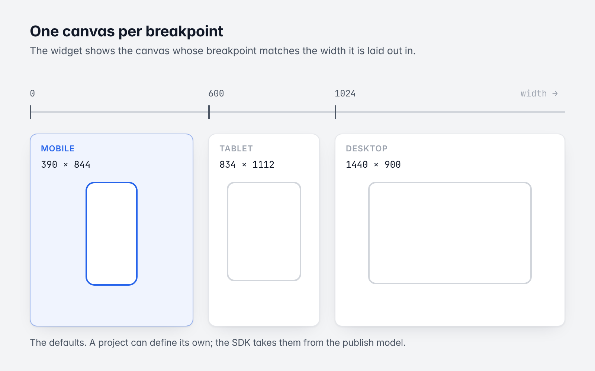
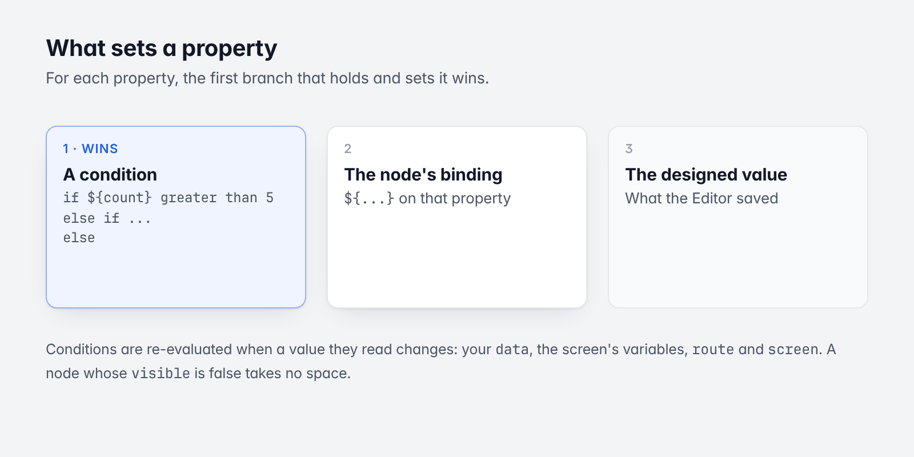
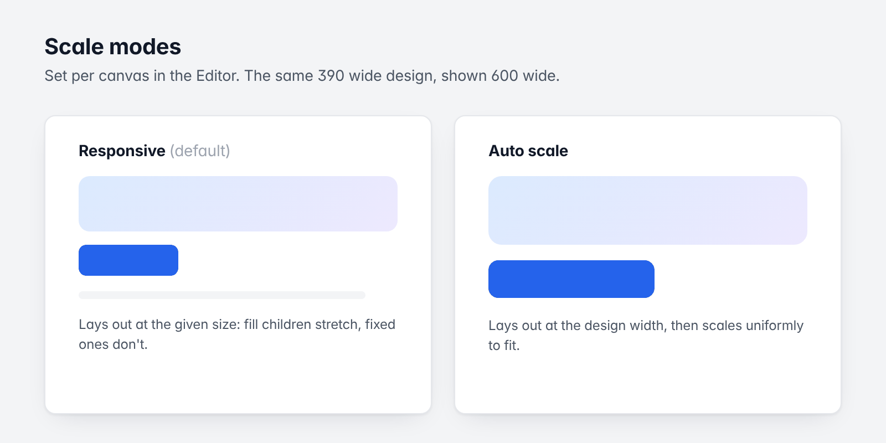

# 8. Conditions and responsive breakpoints

[Guide](README.md) · Previous: [Navigation](07-navigation.md) · Next: [Cloud data and services](09-cloud-data-and-services.md)

Both are authored in the Editor and need no code. This chapter explains what the SDK does with them, so you can
predict what a layout shows in your app.

*The default breakpoints, one canvas each.*

## Conditions

*What sets a property, in order.*

A condition is an ordered list of branches: `if`, `else if`, ..., `else`. Each branch has a test (a comparison such
as `${count} greater than 5`, or several joined by and/or) and a list of node properties it sets.

For each property, the first branch that holds and sets it wins. The order of precedence for a property is:

1. a condition that sets it;
2. the node's own binding (`${...}` on that property);
3. the node's designed value.

Conditions are re-evaluated when a value they read changes, so they follow your `data`, the screen's variables,
`route` params and `screen`. Comparisons read values loosely (`"12"` equals `12`).

A node whose `visible` is false takes no space.

Related, on a node: **interaction states** (hover, pressed, focused, selected, disabled) patch the node's
properties while the state holds, and **variants** (a `variance` node) switch between alternative subtrees, by
name or by breakpoint.

If you run with `NoopExpressionEngine`, neither bindings nor conditions are applied: layouts show as designed.

## Breakpoints

A project defines its breakpoints: named size classes with a minimum width. The defaults are:

| Id | From width | Design size |
|---|---|---|
| `mobile` | 0 | 390 × 844 |
| `tablet` | 600 | 834 × 1112 |
| `desktop` | 1024 | 1440 × 900 |

A project can define its own set; the SDK takes it from the publish model. Nothing in the SDK assumes these names
or widths.

### Which canvas shows

A layout with several canvases has one per breakpoint. `CodelesslyWidget` shows the canvas whose breakpoint
matches **the width the widget is laid out in**:

- A full-screen widget on a phone shows the mobile canvas; on a wide window, the desktop one.
- A widget in a 390 wide side panel shows the mobile canvas even on a 4K display.
- If the width is unbounded (inside a horizontal scroll view), the screen's width is used.
- When the width crosses a breakpoint (a window resize, a rotation), the canvas switches. The screen's variables
  are kept; they are declared once per canvas as each first shows.
- A layout with one canvas always shows it. A single canvas can still adapt, with fill sizes, wrapping and
  variants.
- A screen may move its own switch points (its tablet design starting at 768, say). That affects only that screen.

`canvasId` on the widget turns this off and shows one canvas at every width. `controller.canvasId` tells you which
canvas is showing.

### `${screen}`

Layouts read the size class in expressions:

| Value | Meaning |
|---|---|
| `screen.width`, `screen.height` | The window's size in logical pixels |
| `screen.breakpoint` | The current breakpoint's id (`"tablet"`) |
| `screen.breakpointName`, `screen.breakpointIndex` | Its name and position |
| `screen.is.<id>`, `screen.is<Id>` | Whether that breakpoint is current: `screen.is.mobile`, `screen.isMobile` |
| `screen.atLeast.<id>` | Whether the current breakpoint is that one or a wider one |
| `screen.orientation`, `screen.isPortrait`, `screen.isLandscape` | Orientation |
| `screen.brightness`, `screen.isDark` | The platform's brightness (`screen.dark` is the same as `screen.isDark`). For the mode the layout's colors follow, read `theme.isDark` ([chapter 11](11-theming-and-fonts.md#dark-mode)) |
| `screen.breakpoints` | The project's breakpoints: `[{id, name, minWidth}]` |
| `screen.modal`, `screen.sheet` | Whether the screen is shown as a modal (dialog or sheet), and as a bottom sheet: leave room for a sheet's drag handle with `${= screen.sheet ? 28 : 14}` |
| `screen.backdrop` | Whether the app draws backdrop screens right beneath this screen (`canvas.setRoute backdrop`): hide the screen's own background there with `${= !screen.backdrop}` and keep it for the design board |

Note the difference: the *canvas* is picked by the widget's width, while `${screen.width}` and
`${screen.breakpoint}` describe the window (the `MediaQuery`). For a full-screen widget they agree.

Modals (dialogs, sheets, popovers) opened by actions show at their design size and follow the device's
breakpoint.

## Scale modes

*Responsive and auto scale.*

Each canvas has a scale mode, set in the Editor:

| Mode | Behavior |
|---|---|
| Responsive (default) | The canvas lays out at the size it is given. Children with fill sizes stretch; fixed ones don't. |
| Auto scale | The canvas lays out at its design width and is scaled uniformly to fit the width it is given (up to its max width, if it has one). |

Auto scale suits fixed designs that should look the same on every phone. Responsive suits anything that should
reflow.

## Text scale

Layouts are designed at fixed sizes, so by default they ignore the platform's text size setting.
`CodelesslyConfig.maxTextScaleFactor` lets them follow it up to a limit
([Theming and fonts](11-theming-and-fonts.md#text-scale)).

Next: [Cloud data and services](09-cloud-data-and-services.md)
