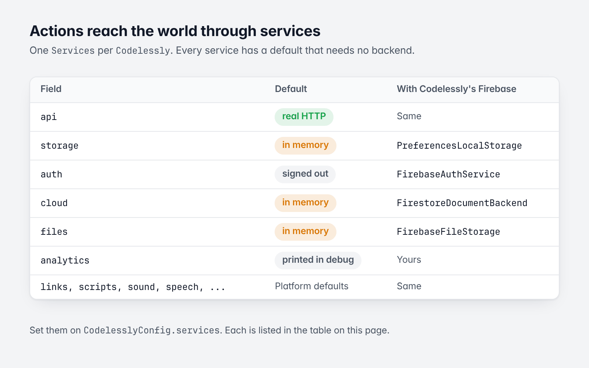
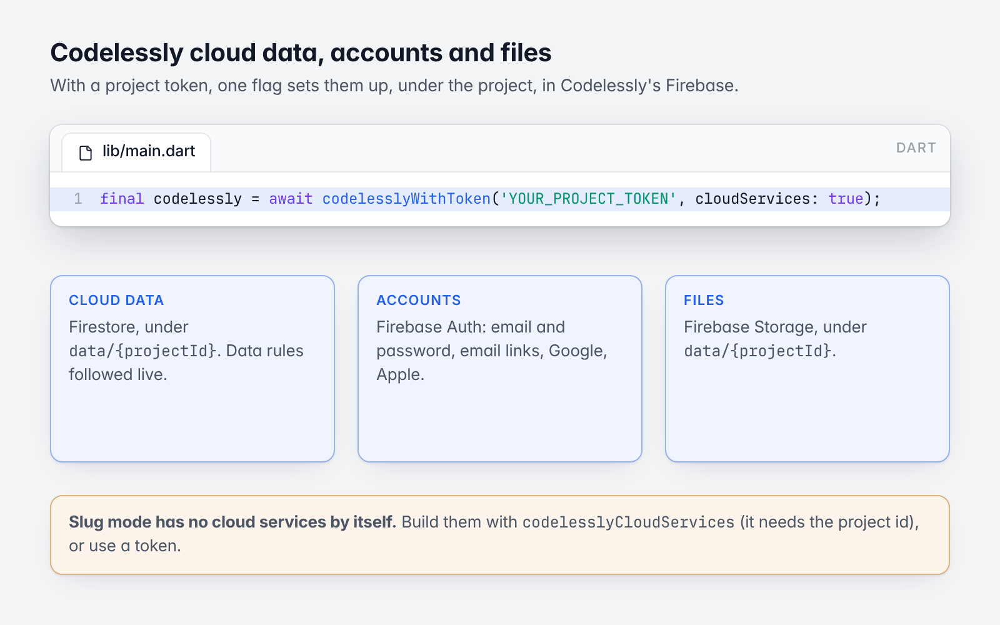
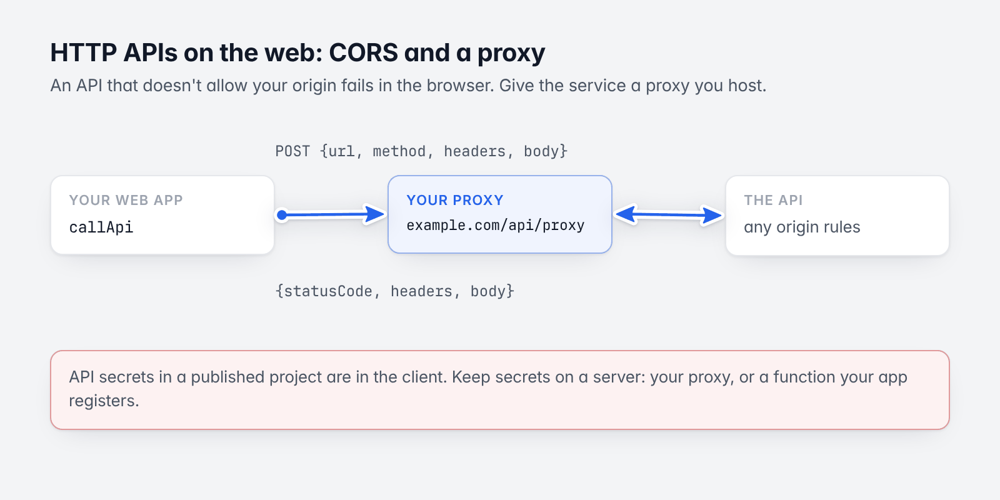

# 9. Cloud data and services

[Guide](README.md) · Previous: [Conditions and breakpoints](08-conditions-and-breakpoints.md) · Next: [Scripting](10-scripting.md)

Actions reach the outside world through **services**: one `Services` object per `Codelessly`, set on
`CodelesslyConfig.services`. Every service has a default that works with no backend, and each can be replaced.



*Every service has a default that needs no backend.*

## The services

| Field | Used by | Default | With Codelessly's Firebase |
|---|---|---|---|
| `api` | `callApi` actions, API-backed lists | `HttpApiService` (real HTTP) | Same |
| `storage` | `setStorage`, `${storage.*}`, persisted variables | In memory | `PreferencesLocalStorage` to keep values |
| `auth` | `auth` actions | Signed out; every operation fails | `FirebaseAuthService` |
| `cloud` | Cloud data actions, data-bound lists | In memory (`MemoryDocumentBackend`) | `FirestoreDocumentBackend` |
| `files` | `cloudFiles` (uploads) | In memory | `FirebaseFileStorage` |
| `analytics` | Screen views, events, errors | Printed in debug builds, dropped in release | Yours |
| `purchases`, `paywalls` | `paywall` actions, `codelessly.paywall` | None | `StorePurchaseService`, `FirebasePaywallBackend` |
| `sound` | `playSound` | The browser's audio on the web; silent elsewhere | Same |
| `speech` | `speak` | The browser's voice on the web; none elsewhere | Same |
| `links` | `openLink` | `url_launcher` | Same |
| `scripts` | `runScript`, `script.name()` | The platform's sandbox ([Scripting](10-scripting.md)) | Same |
| `cache`, `fileCache` | Internal caches | In memory | Same |

With no `services` at all, `Codelessly` uses `Services()`: APIs and links work, and everything stateful is in
memory.

## Codelessly cloud data, accounts and files



*One flag, three services.*

Projects that use Codelessly's cloud data ("Cloud data" actions, lists bound to a collection), app user accounts
or file uploads keep them in Codelessly's Firebase, under the project. With a project token, one flag sets them
up:

```dart
final codelessly = await codelesslyWithToken('YOUR_PROJECT_TOKEN', cloudServices: true);
```

That authenticates the token first (the project's id is needed), then builds the project's services with
`codelesslyCloudServices`. The same by hand, for when you want to change a piece (here: storage that persists):

```dart
final app = await codelesslyFirebaseApp();
final firestore = FirebaseFirestore.instanceFor(app: app);
final services = codelesslyCloudServices(
  projectId: projectId,
  firestore: firestore,
  auth: FirebaseAuth.instanceFor(app: app),
  storage: FirebaseStorage.instanceFor(app: app),
  localStorage: await PreferencesLocalStorage.open(prefix: 'codelessly.$projectId.'),
);
final codelessly = codelesslyOnFirebase(
  firestore: firestore,
  config: CodelesslyConfig(projectId: projectId, authToken: 'YOUR_PROJECT_TOKEN', services: services),
);
```

What that wires:

| Service | Where the data lives |
|---|---|
| Cloud data | Firestore, under the document `data/{projectId}`. The project's data rules (who may read and write each collection, schemas, indexes) are the document `data_rules/{projectId}`; the SDK follows them live and applies them. |
| Accounts | Firebase Auth on Codelessly's Firebase app: email and password, email links, Google and Apple. Signing out signs in anonymously again, because the publish is read as an anonymous user. |
| Files | Firebase Storage, under `data/{projectId}`. |

Things to know:

- **Slug mode has no cloud services by itself.** A slug loads the publish over HTTP; cloud data still needs
  Firebase and the project's access. Build the services as above (you need the project id; the loaded model has
  it: `codelessly.publishModel!.projectId`), or use a token.
- **Google and Apple sign-in** need the platform setup those providers require (URL schemes, entitlements) and
  that the provider is enabled for the backend. Email and password needs nothing.
- **Linux desktop** has no Firebase: use your own `AuthService`, `DocumentBackend` and `CloudFileStorage`, or the
  in-memory ones.
- **The signed-in user in layouts**: see [Data and variables](05-data-and-variables.md#the-signed-in-user).

### Live data every screen shares

A "Load cloud data" action streams a document or a query into a variable. By default the subscription is the
screen's: it ends when the screen goes, and each screen that loads opens its own. With the action's **app** scope
(`"scope": "app"` in the published JSON) the subscription is the `Codelessly` instance's:

- the first load opens it and waits for the first value; a load of the same source (the same collection,
  document or query, after expressions) from any screen or any `CodelesslyWidget` of the instance shares it and
  opens nothing;
- it writes `{status, isLoading, data, error}` into an **app variable** of that name (declared as a map if the
  project has none), so every screen reads the same live value;
- it lives until `codelessly.dispose()`, until a load for the same variable asks for another source (the old
  subscription closes), or until it fails (the next load opens it again; a failure after the first value is
  logged through `Services.analytics` and shows in the variable's `status` and `error`);
- when the signed-in user changes, it is opened again, so a collection the data rules keep to each user's own
  documents follows the new user.

Older SDKs ignore the scope and load per screen. `codelessly.appData` holds the shared sources
(`appData.close('cards')` closes one).

### Cloud data without a backend

The default cloud database is in memory: cloud data actions and data-bound lists work, and the data is gone when
the app closes. That is right for demos and tests:

```dart
final codelessly = Codelessly(
  config: CodelesslyConfig(
    slug: 'my-project',
    services: Services(cloud: BackendCloudDatabase(backend: MemoryDocumentBackend())),
  ),
);
```

To use your own database, implement `DocumentBackend` (get, watch, query, write documents) and give it to
`BackendCloudDatabase`, which adds the rules, owner stamps and relations on top.

## HTTP APIs



*A proxy you host gets past CORS on the web.*

A project's APIs (made in the Editor's API builder) are published with it. A `callApi` action names one and gives
its inputs. The response is `${result}` for the next actions: `data` (the body, parsed when it is JSON),
`statusCode`, `headers`, `isSuccess`, `isError` and `error`. The action has `onSuccess` and `onError` chains.

The default `HttpApiService` sends the request from the device. On the web, browsers enforce CORS: an API that
doesn't allow your origin fails. Give the service a proxy you host:

```dart
final codelessly = Codelessly(
  config: CodelesslyConfig(
    slug: 'my-project',
    services: Services(api: HttpApiService(proxy: Uri.parse('https://example.com/api/proxy'))),
  ),
);
```

The request is then POSTed to the proxy as `{url, method, headers, body}`, and its reply
`{statusCode, headers, body}` is the response.

API secrets in a published project are in the client. Keep secrets on a server (your proxy, or a function your
app registers that calls your backend).

## Your own analytics and links

```dart
class MyAnalytics implements AnalyticsService {
  @override
  void logEvent(String name, [Map<String, Object?> parameters = const {}]) => debugPrint('event $name $parameters');

  @override
  void logScreen(String name, {String? layoutId}) => debugPrint('screen $name');

  @override
  void logError(Object error,
          {StackTrace? stackTrace, String? message, String? type, Map<String, Object?> context = const {}}) =>
      debugPrint('error $type: $error');
}

class InAppLinks implements LinkOpener {
  @override
  Future<bool> open(String url) async {
    debugPrint('open $url in the app');
    return true;
  }
}

final codelessly = Codelessly(
  config: CodelesslyConfig(
    slug: 'my-project',
    services: Services(analytics: MyAnalytics(), links: InAppLinks()),
  ),
);
```

`logError` is where failed actions end up. In production, send them to your crash reporter: the default drops
them in release builds.

## Purchases and paywalls

`codelessly.paywall.present(context, placement: ...)` shows a published paywall: see [Paywalls](16-paywalls.md).
With cloud services (`codelesslyWithToken(..., cloudServices: true)`, or `codelesslyCloudServices(functions:)`)
paywalls are managed by Codelessly: `codelesslyPaywalls` sets `Services(paywalls:, purchases:)` to a
`PaywallRuntime` on `FirebasePaywallBackend` (placements resolved and purchases verified by Codelessly's backend)
and a `StorePurchaseService` (`package:codelessly_sdk/store.dart`: StoreKit and Play Billing through the
`in_app_purchase` plugin). Without them, `paywall` actions outside a presented paywall fail and the rest of the
app is unaffected.

## Lifetime

`Services` are yours when you create them: call `services.dispose()` when the app is done with them.
`Codelessly.dispose()` does not dispose its services.

Next: [Scripting](10-scripting.md)

### Read-along word boundaries

The live `speech` expression value includes `speaking`, `text`, `available`,
`boundaryAvailable`, `charIndex`, `charLength`, `wordIndex` and `word`.
`wordIndex` starts at -1 and updates only when the platform voice delivers a
real word boundary; it returns to -1 when narration ends or is stopped.
Character offsets use UTF-16, matching browser SpeechSynthesis events.
Whitespace separates words and punctuation stays with its word.

For read-along text, repeat `split(text, ' ')` and highlight the item where
`index == speech.wordIndex`. Some browser voices do not emit word boundaries;
those voices can narrate without a moving highlight. There is no estimated
timer fallback. `boundaryAvailable` means the engine exposes the boundary API,
not that every voice guarantees events.

Native hosts can keep an existing `SpeechEngine` implementation, or implement
`BoundarySpeechEngine.speakWithBoundaries` and send `SpeechBoundary` events
from their platform TTS. Late events from canceled utterances are ignored.
