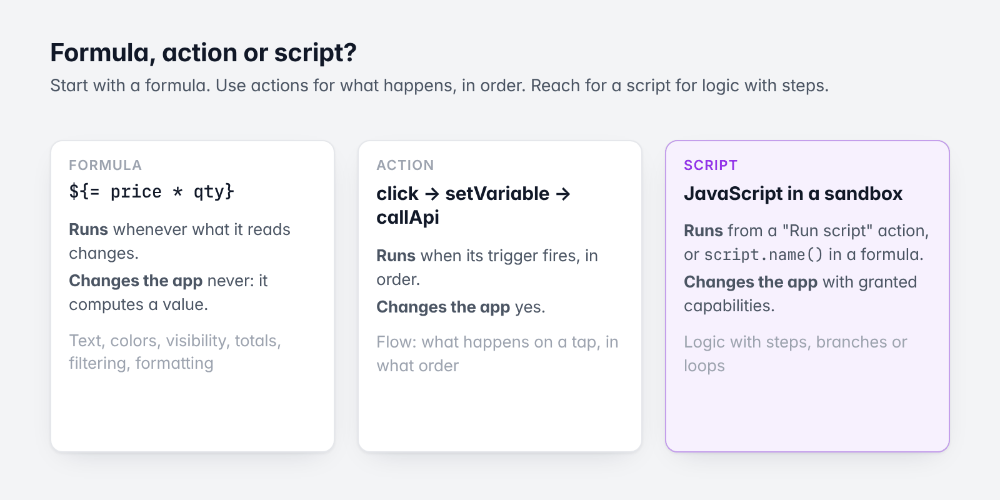
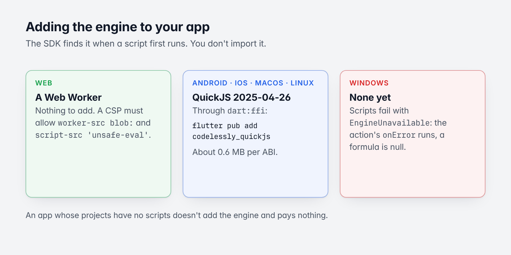
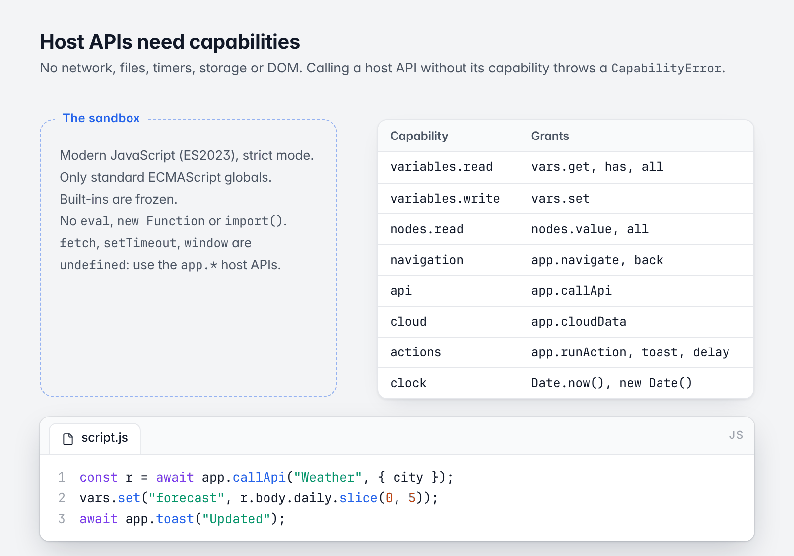
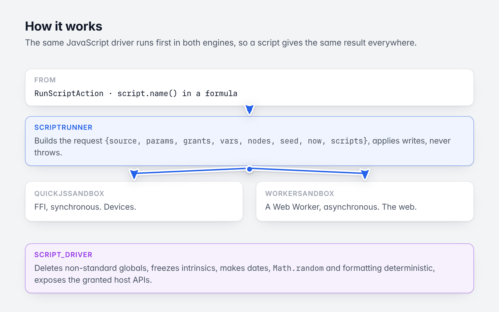

# 10. Scripting

[Guide](README.md) · Previous: [Cloud data and services](09-cloud-data-and-services.md) · Next: [Theming and fonts](11-theming-and-fonts.md)

A Codelessly project can include **scripts**: JavaScript that "Run script" actions and formulas run in a sandbox.
They are for logic that formulas and actions express badly: validation across fields, multi-step calculations,
data shaping, small state machines.



*Start with a formula; reach for a script for logic with steps.*

This chapter has two parts: what an **app developer** does (add an engine), and a reference to the **language and
host API** for whoever writes the scripts.

## Adding the engine to your app



*Which engine runs where.*

| Platform | Engine | What the app needs |
|---|---|---|
| Web | A dedicated Web Worker, made from a Blob URL | Nothing. If the page sets a Content Security Policy, it must allow `worker-src blob:` and `script-src 'unsafe-eval'`. |
| Android, iOS, macOS, Linux | QuickJS 2025-04-26 through `dart:ffi` | `flutter pub add codelessly_quickjs` |
| Windows | None yet | Scripts fail with `EngineUnavailable`. |

```sh
flutter pub add codelessly_quickjs
```

That is all: the SDK finds the native library when a script first runs. You don't import the package. An app whose
projects have no scripts doesn't add it and pays nothing (it adds about 0.6 MB per ABI).

Without an engine, a script fails with an `EngineUnavailable` error that says what to add. The failure is data,
not a crash: the action's `onError` chain runs, and a formula that calls a script is null.

### Replacing or turning off the engine

`Services.scripts` is a `ScriptRunner`. The default, `SandboxScriptRunner`, uses the platform's sandbox.

```dart
// Scripts implemented in Dart instead of JavaScript, by script name: for Windows, or to keep
// sensitive logic in the app.
final codelessly = Codelessly(
  config: CodelesslyConfig(
    slug: 'my-project',
    services: Services(
      scripts: FunctionScriptRunner({
        'loanPayment': (args, host) {
          final principal = (args['principal'] as num).toDouble();
          return principal * 0.05;
        },
      }),
    ),
  ),
);
```

```dart
// No scripts at all: each run fails with `EngineUnavailable`.
final codelessly = Codelessly(
  config: CodelesslyConfig(slug: 'my-project', services: Services(scripts: const NoScriptRunner())),
);
```

## Formula, action or script?

| | **Formula** `${= ...}` | **Action** | **Script** |
|---|---|---|---|
| What it is | One expression, bound to a property, condition or variable | A step a trigger runs | JavaScript with statements, functions and loops, in a sandbox |
| Runs | Whenever what it reads changes | When its trigger fires, in order | When a "Run script" action runs it, or a formula calls `script.name()` |
| Changes the app | Never: it computes a value | Yes | With granted capabilities |
| Best for | Text, colors, visibility, totals, filtering, formatting | Flow: what happens on a tap, in what order | Logic with steps, branches or loops |

Start with a formula. Use actions for what happens, in order. Reach for a script when a formula would need
temporary values or loops, when several fields are checked against each other, when data needs reshaping, or when
the same logic is needed in several places. Don't use a script to set one variable or call one API.

## The language

Scripts are modern JavaScript (ES2023) in strict mode. The same driver runs first in every engine, so a script
gives the same result everywhere.

```js
// Params are variables. Return the result at the top level...
const monthly = rate / 12 / 100;
const n = years * 12;
return Math.round(principal * monthly / (1 - Math.pow(1 + monthly, -n)) * 100) / 100;
```

```js
// ...or from a main function, which is called with the params in order.
function main(principal, rate, years) {
  return { payment: payment(principal, rate, years) };
}
function payment(p, r, y) { /* ... */ }
```

A script can use `await`, functions, classes, closures, generators, `Map`, `Set`, regular expressions,
destructuring, spread and optional chaining.

### A script's anatomy

| Field | What it is |
|---|---|
| `name` | A JavaScript identifier, unique in its scope. Formulas and other scripts call it as `script.<name>(...)`. |
| `params` | Names, in order, each with an optional default. They are variables in the source, and also `params.<name>`. Not allowed: `vars`, `nodes`, `app`, `console`, `fmt`, `script`, `params`, `main`. |
| `source` | The JavaScript. |
| `capabilities` | What the script may do besides computing (below). |
| `timeoutMs` | CPU time limit. Default 1000, at most 30000. |
| `memoryLimitMb` | Memory limit on devices. Default 32. |
| Scope | **Project**: every screen can run it. **Page**: the screens of one Editor page; a page script wins over a project script of the same name. |
| `tests` | Sample runs: `{name, args, vars?, nodes?, expect \| expectError}`. |

Scripts are published inside each layout's document (`scripts`), so they update with a publish like the rest.

### What scripts can't do

- **No network, files, timers, storage or DOM.** `fetch`, `XMLHttpRequest`, `WebSocket`, `setTimeout`,
  `localStorage`, `window`, `document` and `WebAssembly` are `undefined`. Use the `app.*` host APIs.
- **No generating or loading code.** `eval`, `new Function`, `import()` and `import.meta` aren't allowed. Call
  other scripts with `script.name(...)`.
- **Built-ins are frozen.** `Array.prototype.x = ...` and `Math.random = ...` throw a `TypeError`.
- **No `Intl`.** `toLocaleString`, `localeCompare` and `fmt.*` format in a fixed en-US style on every device.

### What makes results repeatable

- **Dates are UTC.**
- **`Date.now()` and `new Date()` need the `clock` capability.** Without it, a result depends only on the inputs.
- **`Math.random()` is seeded per call** from the script and its arguments.
- **`Math.pow(x, n)` with a whole `n`** is computed the same way on every engine. Prefer it over `**` for money.

## Host APIs



*Each host API needs a capability.*

Each host API needs a **capability** granted to the script. Calling one without it throws a `CapabilityError`.

| Capability | Grants |
|---|---|
| `variables.read` | `vars.get`, `vars.has`, `vars.all` |
| `variables.write` | `vars.set` |
| `nodes.read` | `nodes.value`, `nodes.all` |
| `navigation` | `app.navigate`, `app.back` |
| `api` | `app.callApi` |
| `cloud` | `app.cloudData` |
| `actions` | `app.runAction`, `app.toast`, `app.delay` |
| `clock` | `Date.now()`, `new Date()` |

### Variables: `vars`

| API | Result | |
|---|---|---|
| `vars.get(name)` | any | The value of the screen's variable `name` (app and screen variables, computed ones included). A copy. |
| `vars.has(name)` | boolean | Whether the variable exists. |
| `vars.all()` | object | Every variable, by name. |
| `vars.set(name, value)` | value | Sets the variable. Later `vars.get` calls see it. The app applies writes in order, before the next `app.*` call and when the script ends. A computed variable can't be set. |

### Inputs: `nodes`

| API | Result | |
|---|---|---|
| `nodes.value(id)` | any | The value of the input node `id`: a text field's text, a checkbox's state, a slider's number. |
| `nodes.all()` | object | Every input's value, by node id. |

### The app: `app`

Each `app.*` call returns a promise; `await` it. Time spent waiting doesn't count toward `timeoutMs`.

| API | Result | |
|---|---|---|
| `app.navigate(screen, params?)` | `null` | Navigates to `screen` (a name or id) with `params`. |
| `app.back(result?)` | `null` | Goes back, or closes the open modal, handing back `result`. |
| `app.callApi(name, inputs?)` | `{status, ok, body, headers}` | Calls the project's API `name`. A request that didn't complete rejects with a `HostError`. |
| `app.cloudData(request)` | any | Runs a cloud data action from its JSON fields. |
| `app.runAction(action)` | any | Runs any action from its JSON and returns the `${result}` it leaves. |
| `app.toast(text)` | `null` | Shows a toast. |
| `app.delay(ms)` | `null` | Waits, at most 60000 ms. |

```js
const r = await app.callApi("Weather", { city });
if (!r.ok) throw new Error(`Weather failed: ${r.status}`);
vars.set("forecast", r.body.daily.slice(0, 5));
await app.toast("Updated");
```

### Always available

| API | |
|---|---|
| `script.<name>(...args)` | Runs another script of the project in this same run. Returns a promise. |
| `params` | The params by name. |
| `console.log(...)`, `.info`, `.warn`, `.error`, `.debug` | Logs to the run's console. At most 500 lines of 2000 characters. |
| `fmt.number(n, digits?)` | `1234567.891` → `"1,234,567.891"` |
| `fmt.currency(n, code?, digits?)` | `1234.5` → `"$1,234.50"` |
| `fmt.percent(n, digits?)` | `0.256` → `"26%"` |
| `fmt.round(n, digits?)` | Rounds halves up: `fmt.round(2.675, 2)` → `2.68` |
| `fmt.date(value, pattern?)` | Formats ISO text, epoch milliseconds or a Date, in UTC. Default `yyyy-MM-dd`. |
| `fmt.duration(seconds)` | `3725` → `"1:02:05"` |

The SDK's `ScriptCatalog` class holds this reference as data.

## Running scripts

### From actions: "Run script"

```json
{
  "type": "runScript",
  "script": "loanPayment",
  "arguments": { "principal": "${loan.amount}", "years": "30" },
  "resultVariable": "payment",
  "onError": [{ "type": "showToast", "message": "${result.error.message}" }]
}
```

- An argument that is exactly one `${variable}` or `${= formula}` passes its value as is: a list stays a list.
  Other text has its variables filled in, and passes as JSON when it is JSON (`30` is a number).
- Missing arguments take the param's default.
- **On success**, the result is `${result}` for the next actions, and is stored in `resultVariable` when set.
- **On failure**, the `onError` actions run with `${result.error}` = `{type, message, line, column, stack}`.
  Without `onError`, a failure stops the chain and is reported.

### From formulas: `script.name(args)`

```
${= script.loanPayment(loan.amount, loan.rate, 30)}
```

- A formula only reads, so the script runs with just its read capabilities: `variables.read`, `nodes.read` and
  `clock`. `vars.set` and `app.*` throw, and the formula is then null.
- **On devices** the call runs synchronously while the screen builds.
- **On the web** scripts run in a worker: the first evaluation shows null (or the previous result), and the widget
  rebuilds when the result arrives.
- A script that awaits an `app.*` call can't run in a formula; use an action.

## Errors

A script never crashes the app. Every failure is data: `{type, message, line?, column?, stack?}`.

| `type` | When |
|---|---|
| `SyntaxError` | The source doesn't parse, or uses `import`. |
| `TypeError`, `RangeError`, `ReferenceError`, ... | Thrown while running. |
| `Error` or your own | What the script threw. |
| `CapabilityError` | A host API the script wasn't granted. |
| `HostError` | An `app.*` call failed. A script can `catch` it. |
| `EvalError` | The script tried to generate code. |
| `LimitError` | Over a limit: `time`, `memory` (devices only) or `depth`. Can't be caught. |
| `EngineUnavailable` | The app has no script engine. |

## Limits

| Limit | Default | |
|---|---|---|
| CPU time | `timeoutMs` = 1000 | Time awaiting `app.*` calls doesn't count. |
| Memory | `memoryLimitMb` = 32 | Devices. The web enforces time only. |
| Logs | 500 lines × 2000 characters | |
| Script calls | 32 deep | `script.a()` calling `script.b()`... |

## How it works



*One driver, two engines.*

```
RunScriptAction / script.name() in a formula
        │
ScriptRunner ── request {source, params, grants, vars, nodes, seed, now, scripts}
        │                                     ▲ state {status, events, logs, value | error}
ScriptSandbox  ── QuickJsSandbox (FFI, sync)  │
               └─ WorkerSandbox  (Worker, async)
        │
script_driver.dart (the same JavaScript in both engines)
```

- The **driver** is JavaScript that runs before any script. It deletes everything that isn't standard ECMAScript
  from the global object, blocks code generation and `import()`, makes dates, `Math.random`, `Math.pow` and number
  formatting deterministic, freezes every intrinsic, and exposes the granted host APIs. A run reports its variable
  writes and `app.*` calls as events; the host applies them and resumes the run, so neither engine calls back into
  Dart.
- **`QuickJsSandbox`** runs each script in a QuickJS runtime with memory and stack limits and an interrupt
  deadline. A warm runtime is reused; one that hit a limit is thrown away.
- **`WorkerSandbox`** runs scripts in a Web Worker. A step that outruns its CPU budget gets the worker terminated
  and replaced.
- **`ScriptRunner`** builds the request, drives the run, applies writes through a `ScriptHost`, and returns a
  `ScriptRunResult`. It never throws.

## Testing scripts in the SDK repository

`test/scripting/` runs the same tests on the Dart VM, where scripts run in QuickJS
(`flutter test test/scripting`), and in Chrome, where they run in a Web Worker
(`flutter test --platform chrome test/scripting`). The VM run builds QuickJS for the machine with
`tool/build_quickjs.sh` (CMake and a C compiler).

Next: [Theming and fonts](11-theming-and-fonts.md)
