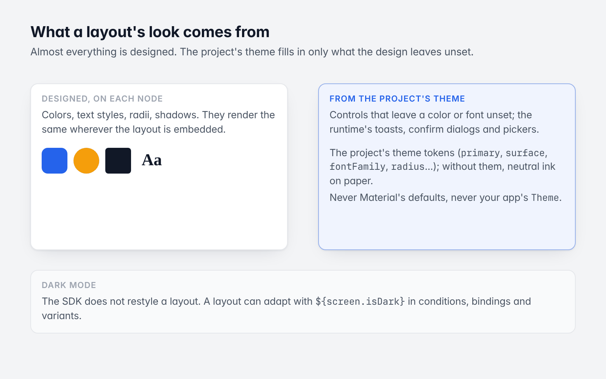
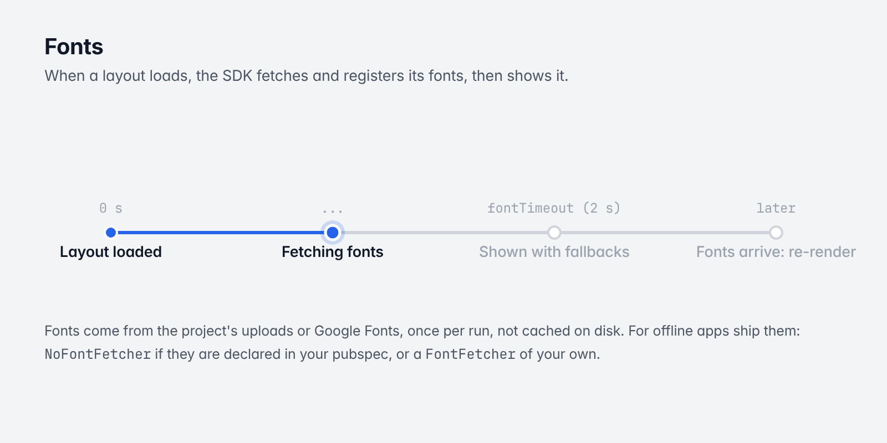

# 11. Theming and fonts

[Guide](README.md) · Previous: [Scripting](10-scripting.md) · Next: [Custom widgets and extending](12-custom-widgets.md)



*Most of a layout's look is designed; the project's theme covers the rest.*

## What a layout's look comes from

Almost everything you see in a layout is designed: each node carries its own colors, text styles, radii and
shadows, and renders with them wherever it is embedded. The project's theme matters only for what the design
leaves unset:

- controls that leave a color, a font or a shape unset (buttons, chips, switches, sliders, text fields,
  pickers, tabs, navigation bars);
- the runtime's own UI: toasts, confirmation dialogs, date and time pickers, menus, tooltips.

Controls take their colors and fonts from the project's theme. Without a theme they are neutral: ink on paper
(near-black on white, near-white on near-black in dark mode) and the greys between, in no font family of their
own. Nothing is inherited from Material's defaults (no purple, no tints, no ripples, no elevation, no Roboto) or
from your app's `Theme`.

## The project's theme

A project has theme tokens, published with it: `primary`, `onPrimary`, `surface`, `onSurface`, `error`,
`success`, `warning`, `fontFamily`, `titleFontFamily`, `radius` and `buttonRadius`. Each `CodelesslyWidget`
wraps its layout in a `Theme` built from them, where every color role is a token or derived from one:

| Role | From |
|---|---|
| surface | `surface`, else paper (white; near-black in dark mode) |
| text and marks on it | `onSurface` when it reads there (3:1), else ink |
| what controls draw on the surface (checks, thumbs, text button labels, focus rings) | `primary` when it reads on the surface, else ink |
| filled buttons, floating action buttons | `primary` as it is (ink without one), labeled in `onPrimary`, else ink or paper, whichever reads |
| selected tints, outlines, disabled states | `primary` or ink at low strength over the surface |
| fonts | `fontFamily`; titles `titleFontFamily` |
| shapes | `buttonRadius` for every kind of button, chip and segmented button; `radius` for dialogs, menus, pickers and the default text field border |

Controls choose their text and marks for what they sit on: an unstyled text button on a dark band of a light
page is labeled light, and one with a fill of its own but no label color gets one that reads on that fill.
Nothing splashes or casts a shadow unless a node asks for it (its `elevation`). Your app's theme is not used
inside the layout and is not changed outside it.

`themeDataOf(tokens)` is that conversion, if you want the same `ThemeData` for your own widgets:

```dart
final theme = themeDataOf(codelessly.publishModel!.theme);
```

## The theme in expressions

Layouts read the project's theme at run time as `theme`, for the current light or dark mode:

| Value | Meaning |
|---|---|
| `theme.primary`, `theme.onPrimary`, `theme.surface`, `theme.onSurface`, `theme.error`, `theme.success`, `theme.warning` | The role colors (from the color styles of those names), as `#AARRGGBB` text |
| `theme.colors.<key>` | Every color style, by its name in camel case: "Brand Blue" is `theme.colors.brandBlue` |
| `theme.text.<key>.<value>` | Every text style's values: `theme.text.title.fontSize`, `theme.text.body.fontFamily` |
| `theme.fontFamily`, `theme.titleFontFamily`, `theme.radius`, `theme.buttonRadius` | The other tokens |
| `theme.isDark`, `theme.brightness` | The mode the colors are for |
| `theme.hasDark` | Whether the project's styles have dark values (without, dark mode reads the light ones) |

A node whose color is bound to one (`${theme.surface}`, `${theme.colors.brandBlue}`) follows the theme: a new
publish of the project's styles, and the device switching between light and dark, update it live. A role or
color the project doesn't have reads as nothing (the node keeps its designed value).

To see what a layout reads, `themeValues(codelessly.publishModel!.theme, dark: true)` gives the map.

## Dark mode

A color style can have a **dark value** beside its light one (published as `ThemeTokens.dark`). In dark mode
`theme.<role>` and `theme.colors.<key>` give the dark value where a style has one, and the light value
elsewhere, so a layout bound to the theme needs no conditions for dark mode. A project whose styles have dark
values also gets a dark theme in dark mode (for its controls and the runtime's dialogs and toasts); one without
stays light, as designed.

Which mode: the device's (`MediaQuery.platformBrightness`, `theme.isDark`), never your app's theme's.
`${screen.isDark}` (also `${screen.dark}`) and `${screen.brightness}` are the device's too. Nodes whose colors are fixed values don't change with the mode;
bind them to the theme, or use `screen.isDark` / `theme.isDark` in conditions and variants.

## Fonts



*Fonts wait up to fontTimeout, then apply when they arrive.*

Each layout lists the fonts its text uses. When a layout loads, the SDK fetches and registers them, then shows the
layout. If they take longer than `CodelesslyConfig.fontTimeout` (2 seconds by default), the layout shows with
fallback fonts and re-renders when they arrive.

The default `HttpFontFetcher` downloads:

- a font uploaded to the project, from its URL;
- any other font from Google Fonts (`fonts.googleapis.com`), by family, weight and style.

Fonts are fetched once per run. They are not cached on disk by the SDK.

### Fonts shipped with the app

For offline apps, or to avoid the first-run download, ship the fonts.

If the families are declared in your `pubspec.yaml` under `flutter: fonts:` with the same family names, turn
fetching off; the engine already has them:

```dart
final codelessly = Codelessly.asset('assets/my_project.json.gz', fonts: const NoFontFetcher());
```

Or serve font files from your assets with a `FontFetcher` of your own:

```dart
class BundledFonts implements FontFetcher {
  const BundledFonts();

  @override
  Future<Uint8List?> fetch(PublishFont font) async {
    final style = '${font.weight}${font.italic ? 'i' : ''}';
    try {
      final data = await rootBundle.load('assets/fonts/${font.family}-$style.ttf');
      return data.buffer.asUint8List(data.offsetInBytes, data.lengthInBytes);
    } catch (_) {
      return null; // The text falls back to the platform's font.
    }
  }
}

final codelessly = Codelessly.asset('assets/my_project.json.gz', fonts: const BundledFonts());
```

`PublishFont` has `family`, `weight` (400, 700, ...), `italic` and `url`. Returning null skips a font.
The fonts a project uses are listed on the loaded model: `codelessly.publishModel!.fonts`.

In tests, always pass `fonts: const NoFontFetcher()` so fonts don't touch the network.

## Text scale

Layouts are designed at fixed sizes, so by default they ignore the platform's text size setting
(`maxTextScaleFactor: 1`). To let text grow for accessibility, raise the cap:

```dart
final codelessly = Codelessly(
  config: const CodelesslyConfig(slug: 'my-project', maxTextScaleFactor: 1.3),
);
```

Text then follows the platform's setting up to 1.3 times. Check your layouts at the largest scale you allow: text
in fixed-size boxes can overflow.

## Icons

Icons are drawn from SVGs fetched over the network when first used, not from icon fonts (this keeps Flutter's
icon font tree shaking working, since a layout names its icons at runtime):

| Icons | From |
|---|---|
| Material Icons, Material Symbols | `https://fonts.gstatic.com` |
| Cupertino icons | `https://icons.codelessly.com` (mirror it and point the SDK at your host with `--dart-define=CODELESSLY_CUPERTINO_SVG_BASE_URL=https://your-host`) |
| Image icons | Their own URL |

A web app with a Content Security Policy must allow those hosts. Offline, an icon that was never fetched leaves
its space empty.

Next: [Custom widgets and extending](12-custom-widgets.md)
