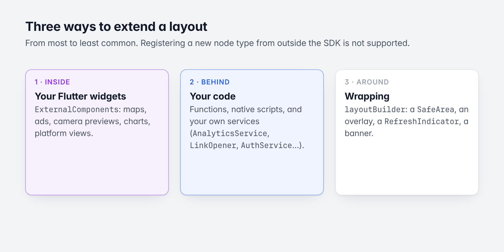
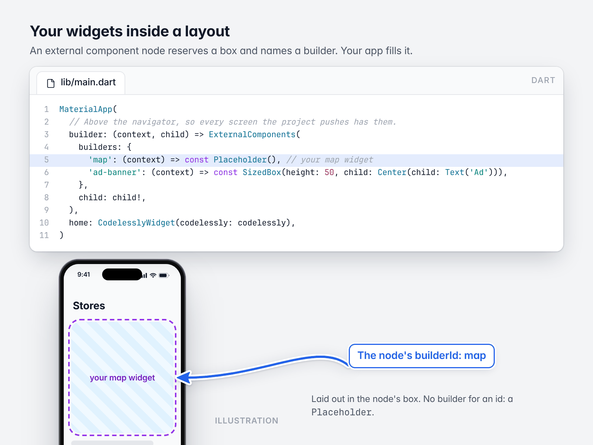
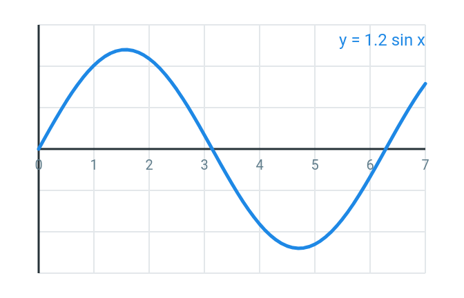
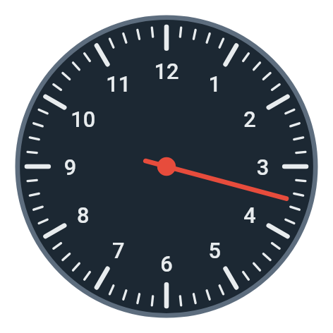
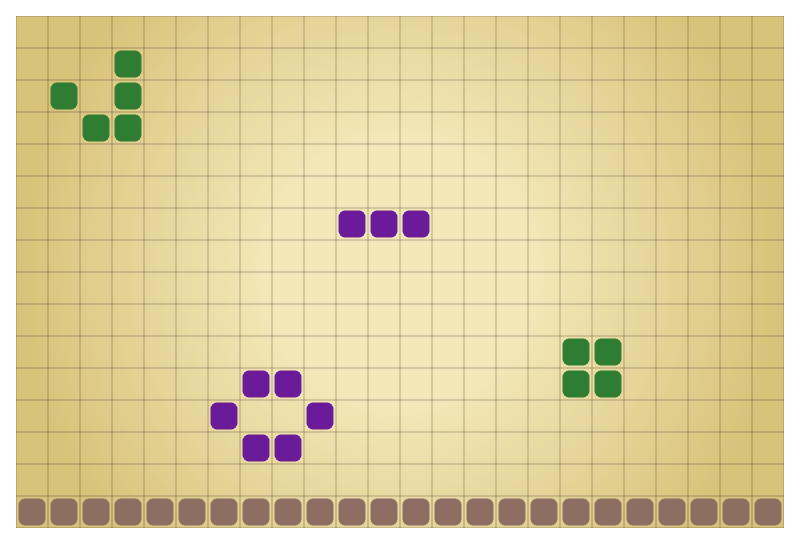

# 12. Custom widgets and extending

[Guide](README.md) · Previous: [Theming and fonts](11-theming-and-fonts.md) · Next: [Publishing and environments](13-publishing-and-environments.md)

Four ways to extend what a layout can do, from most to least common (the fourth,
[your own node and action types](#your-own-node-and-action-types), is below the first three):

1. [Your Flutter widgets inside a layout](#your-widgets-inside-a-layout) (external components).
2. [Your code behind a layout](#your-code-behind-a-layout) (functions, services).
3. [Wrapping a layout](#wrapping-a-layout) (`layoutBuilder`).



*Three ways to extend, from most to least common.*

An app can also define [its own node and action types](#your-own-node-and-action-types). A node type nothing
gives a recipe for still decodes and round-trips, and renders as an empty box of its size; an action type nothing
gives a handler for is skipped.

## Your widgets inside a layout



*An external component node, filled by your widget. The screen is an illustration.*

In the Editor, an **external component** node reserves a box in the layout and names a builder (its
`builderId`). In your app, `ExternalComponents` maps builder ids to widgets:

```dart
MaterialApp(
  // Above the navigator, so every screen the project pushes has them.
  builder: (context, child) => ExternalComponents(
    builders: {
      'map': (context) => const Placeholder(), // your map widget
      'ad-banner': (context) => const SizedBox(height: 50, child: Center(child: Text('Ad'))),
    },
    child: child!,
  ),
  home: CodelesslyWidget(codelessly: codelessly),
)
```

- The widget is laid out in the node's box, with the node's size and fits.
- Put `ExternalComponents` above everything that shows layouts. Screens pushed by navigation actions live under
  the `Navigator`, so placing it in `MaterialApp.builder` (or above `MaterialApp`) covers them; wrapping a single
  `CodelesslyWidget` covers only that widget.
- A builder id with no builder shows a `Placeholder`.
- A builder gets a `BuildContext` only. To give the widget data, read it from your own state (a provider, an
  inherited widget), or have the layout call a [function](06-actions-and-functions.md) that updates that state.
  The node's props are not passed to the builder.

Use this for things that must be native widgets of your app: maps, ads, camera previews, charts from a package,
platform views, or a widget you already have.

## Your code behind a layout

- **Functions** (`CodelesslyConfig.functions`): a layout's "call function" action runs your Dart code and can use
  its result. See [Actions and functions](06-actions-and-functions.md).
- **Native scripts** (`FunctionScriptRunner`): implement a project's scripts in Dart. See
  [Scripting](10-scripting.md#replacing-or-turning-off-the-engine).

### Replacing a service

Every field of `Services` is an interface with a default; implement the interface and pass yours. The ones apps
most often replace:

| Interface | Why replace it |
|---|---|
| `AnalyticsService` | Send screen views, events and action errors to your analytics and crash reporter. |
| `LinkOpener` | Open links in an in-app browser, or route app links yourself. |
| `LocalStorage` | Keep `storage` values and persisted variables in your own store (secure storage, a database). |
| `AuthService` | Use your own accounts instead of Codelessly's. |
| `DocumentBackend` (in a `BackendCloudDatabase`) | Serve "cloud data" from your own backend. |
| `CloudFileStorage` | Upload files to your own storage. |
| `ApiService` | Add headers, logging or a proxy to every API call. |
| `FontFetcher` (on `Codelessly`) | Ship fonts with the app. |
| `PublishLoader`, `PublishCache` (on `Codelessly`) | Load the publish from your own server; cache it on disk. |

```dart
final codelessly = Codelessly(
  config: CodelesslyConfig(
    slug: 'my-project',
    services: Services(analytics: MyAnalytics(), links: InAppLinks()),
  ),
);
```

The SDK ships in-memory and recording implementations of most interfaces (`MemoryLocalStorage`,
`MemoryAuthService`, `MemoryDocumentBackend`, `MemoryFileStorage`, `RecordingAnalytics`, `RecordingLinkOpener`),
which make good starting points and test doubles.

## Your own node and action types

A layout document can hold node types and action types the API doesn't declare. They decode and round-trip as they
are; the app says what they do.

**A node type** gets a recipe, by its type, in `CodelesslyConfig.recipes` (or `NodeTree(recipes:)` for a tree you
build yourself). A recipe appends render objects to the node's chain; `NodeBuilder.island` hosts a Flutter widget,
and `NodeChild` shows a child node inside it. The node's layout, decoration bindings, behaviors and reactions are the
tree's as for any node; its own `props` are `node.props.unknown`.

```dart
void rating(NodeBuilder b, Node n, List<RenderBox> chain) {
  final size = Size(n.layout.width.value, n.layout.height.value);
  chain.add(b.fitBox('fit', n.layout.width.fit, n.layout.height.fit, size));
  chain.add(b.island('rating', (context) => Row(
        mainAxisSize: MainAxisSize.min,
        children: [
          for (var i = 0; i < (n.props.unknown['stars'] as num? ?? 0); i++) const Icon(Icons.star),
          for (final child in n.children) NodeChild(tree: b.tree, id: child, instance: b.instance),
        ],
      )));
}

final codelessly = Codelessly(
  config: const CodelesslyConfig(slug: 'my-project', recipes: {'acme.rating': rating}),
);
```

A recipe for a type the SDK already builds replaces the built-in one. The core layout types (`canvas`, `stack`,
`box`, `row`, `column`, `text`, `icon`, `spacer`, `variance`) are always the tree's own.

**An action type** gets a handler in `CodelesslyActions(handlers:)`. An action whose type the API doesn't declare
is an `UnknownAction`: its fields are `json`, and `enabled`, `nonBlocking` and `when` apply as for any action.

```dart
CodelesslyConfig(
  slug: 'my-project',
  actions: CodelesslyActions(handlers: {
    'acme.track': (action, run) => analytics.log((action as UnknownAction).json['event'] as String),
  }),
)
```

Name your own types with a prefix (`acme.rating`), so a later SDK type can't take the name.

**A feature** packages handlers with the functions and values that go with them: a `CodelesslyFeature`, installed
beside the first-party ones (auth, data, commerce, media and engage are features too:
[Actions and functions](06-actions-and-functions.md#core-and-features)). A handler reaches its own service by type
(`run.service<T>()`, from `Services(extras: [...])` or any `ServiceLocator`), a function gives a `callFunction`
name its result, and a scope gives expressions a value by name.

```dart
const tracking = CodelesslyFeature(
  name: 'tracking',
  actions: {'acme.track': _track},
  functions: {'acme.sessionId': _sessionId},
);

void _track(ActionDef action, ActionRun run) =>
    run.require<Tracker>('Tracking').log((action as UnknownAction).json['event'] as String);

Object? _sessionId(CallFunctionAction action, ActionRun run) => run.service<Tracker>()?.sessionId;

final codelessly = Codelessly(
  config: CodelesslyConfig(
    slug: 'my-project',
    actions: const CodelesslyActions(features: [...kFirstPartyFeatures, tracking]),
    services: Services(extras: [Tracker()]),
  ),
);
```

## Wrapping a layout

`layoutBuilder` wraps the loaded layout with any widgets: a `SafeArea`, an overlay, a `RefreshIndicator`, a
banner.

```dart
CodelesslyWidget(
  codelessly: codelessly,
  layoutId: 'home',
  layoutBuilder: (context, layout) => Stack(
    children: [
      Positioned.fill(child: layout),
      const Positioned(right: 12, bottom: 12, child: Text('beta')),
    ],
  ),
)
```

With `CodelesslyWidget.onGenerateRoute(codelessly, template: ...)`, the template's `layoutBuilder` wraps every
screen.

## Drawing: `customPaint`

Before writing a widget to draw something (a chart, a dial, a game board), try a `customPaint`: Flutter's
`CustomPaint` as data, a behavior any node can carry. Its `painter` list draws behind the node's content (its
decoration and children) and its `foregroundPainter` list over it, each op one `Canvas` call with Flutter's
parameter names and a `paint` with Flutter's `Paint` fields. Values may be expressions, so a drawing follows the
screen's variables:

```json
{"type": "box", "layout": {"width": 220, "height": 220},
 "customPaint": {"viewBox": [200, 200], "painter": [
   {"op": "circle", "c": [100, 100], "radius": 96, "paint": "#FF1C2833"},
   {"op": "repeat", "count": "${ticks}", "ops": [
     {"op": "group", "translate": [100, 100], "rotate": "${= radians(index * 360 / count)}", "ops": [
       {"op": "line", "p1": [0, -90], "p2": [0, "${= index % 5 == 0 ? -76 : -84}"],
        "paint": {"color": "#FFE8ECEE", "style": "stroke", "strokeWidth": "${= index % 5 == 0 ? 3 : 1.5}"}}]}]}],
  "foregroundPainter": [
   {"op": "group", "translate": [100, 100], "rotate": "${= radians(value * 6)}", "ops": [
     {"op": "line", "p1": [0, 14], "p2": [0, -80], "paint": {"color": "#FFE74C3C", "style": "stroke", "strokeWidth": 3}}]}]}}
```

| A function plot | A dial | A board of 384 cells |
|---|---|---|
|  |  |  |

*The three, from `test/fixtures/custom_paint`, each one node.*

How the SDK draws it (`lib/src/render/custom_paint.dart`):

- **One render object** in the node's chain, just outside its content, as Flutter's `RenderCustomPaint`.
  Neither list clips; use `decoration.clip` or a `group`'s `clipRect`.
- **Compiled once** per value: literals are read up front, each expression becomes a closure over the node's
  values (variables, list item...) with `size` and a `repeat`'s `item`, `index` and `count` as names of its own.
- **Repaints only for data.** Each top-level op is recorded into a picture and replayed until a name it reads
  changes, the box changes size or an image it waits for arrives. Nothing ticks: an animated drawing reads a
  changing variable. A 48 × 48 board drawn by one `repeat` records once, and once per generation of its data.
- **Hit regions.** An op with `hit` (`"hit": "cell-${index}"`) is a region: the node's pointer reactions
  (`click`, `pointerDown`/`Up`, `hover`, `drag`...) get `${result.region}` (the topmost region under the
  pointer, else `""`), `${result.x}`/`${result.y}` (in the node), `${result.viewX}`/`${result.viewY}` (in its
  view box) and the region's `${result.item}` and `${result.index}`. An op with `hit` and no `paint` is an
  invisible target.
- **Expressions need values.** A tree without bindings (a bare `NodeTree(source)`) draws the literals only.
- The model's `CustomPaint`, `PaintingStyle`, `PathFillType` and `PointMode` share Flutter's names: this
  library doesn't export them; import `package:codelessly_api/codelessly_api.dart` with a prefix.

The full vocabulary (every op and field, defaults, JSON) is in the API's guide, "Drawing with `customPaint`".

## Lower-level building blocks

The SDK exports its render layer for hosts that show nodes without a publish (an editor's canvas, a preview
tool): `NodeTree` (the render tree of a document), `NodeView` (the widget that shows one of its roots),
`DocumentSource`, and the island interfaces. `NodeView(interactive: false)` draws a design at rest. These are
stable enough for the Codelessly Editor, which is built on them, but they are a lower-level API than
`CodelesslyWidget`: prefer the widget unless you are building tooling.

Next: [Publishing and environments](13-publishing-and-environments.md)
