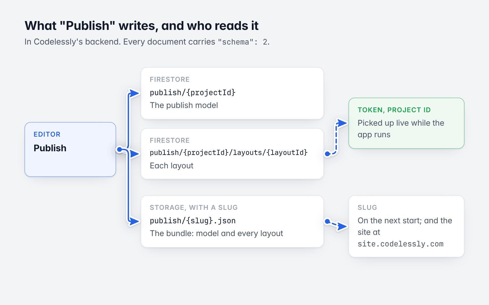
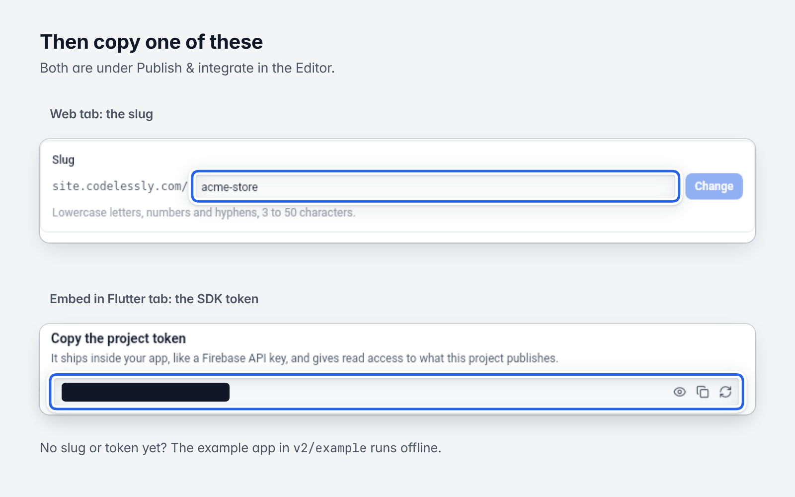
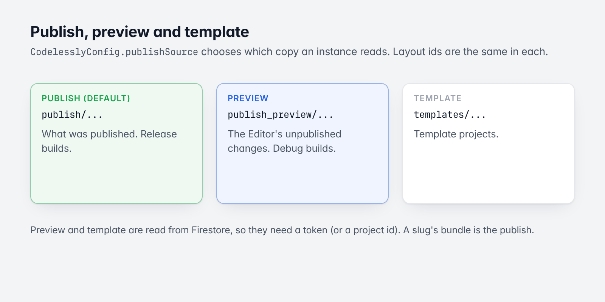
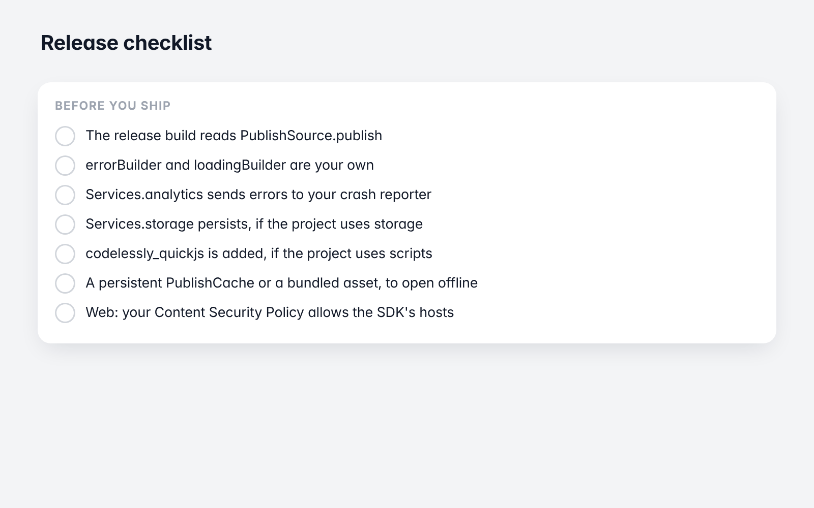

# 13. Publishing and environments

[Guide](README.md) · Previous: [Custom widgets and extending](12-custom-widgets.md) · Next: [Testing](14-testing.md)



*Where a publish goes, and who reads it.*

## What "Publish" does

Pressing **Publish** in the Codelessly Editor writes the project's screens where the SDK reads them:

| What | Where (in Codelessly's backend) | Read by |
|---|---|---|
| The publish model | Firestore document `publish/{projectId}` | Token and project id modes |
| Each layout | Firestore document `publish/{projectId}/layouts/{layoutId}` | Token and project id modes |
| The bundle (model and every layout in one file) | Storage file `publish/{slug}.json`, for a project with a slug | Slug mode, and `site.codelessly.com/<slug>` |

Everything a screen needs travels with it: its nodes, variables, conditions, reactions and scripts, the fonts it
uses, the APIs it calls, the project's theme and breakpoints. Every document carries `"schema": 2`.

A running app on a token picks a publish up live. An app on a slug gets it on its next start.

## What you need from the Editor



*The slug and the token, in Publish & integrate. The token is redacted here.*

| To load by | You need | Notes |
|---|---|---|
| Slug | The project's slug | The name in the project's site address, `site.codelessly.com/<slug>`. Only projects published as a site have one. Set in the Editor under **Publish & integrate → Web**. |
| Token | The project's SDK token | One per project, under **Publish & integrate → Embed in Flutter** in the Editor. |
| Layout | A layout id, custom id or canvas id | Optional: without one a widget shows the entry screen, and `initialScreen` opens a screen by its name or path. |

To list a project's layouts and canvases from code, see
[Embedding and sizing](03-embedding-and-sizing.md#which-screen).

A token is not a secret in the way a server key is: it ships inside your app. It gives read access to that
project's publish (and, through the project's data rules, to its cloud data).

## Publish, preview and template



*The three copies of a project.*

`CodelesslyConfig.publishSource` chooses which copy of the project an instance reads:

| `PublishSource` | Reads | For |
|---|---|---|
| `publish` (default) | `publish/...` | Production: what was published. |
| `preview` | `publish_preview/...` | The Editor's preview of unpublished changes. |
| `template` | `templates/...` | Template projects. A token for a template project reads this automatically. |

A common setup: debug builds follow the preview, release builds the publish.

```dart
final codelessly = await codelesslyWithToken(
  'YOUR_PROJECT_TOKEN',
  config: const CodelesslyConfig(
    publishSource: kDebugMode ? PublishSource.preview : PublishSource.publish,
  ),
);
```

Layout ids are the same in every source, so nothing else changes. With live updates (the default), a preview
instance follows your edits as the Editor saves the preview.

Preview and template are read from Firestore, so they need a token (or a project id). A slug's bundle is the
publish.

To freeze what a release shows regardless of later publishes, ship a bundle
([Loading modes](04-loading-and-caching.md#asset-bundle)) or turn `liveUpdates` off.

## Backends

By default everything talks to Codelessly's production backend, the Firebase project `codeless-app`:

| Constant | Value |
|---|---|
| `CodelesslyFirebaseOptions.*` | The client options of `codeless-app` for web, Android, iOS, macOS and Windows |
| `kCodelesslyStorageBucket` | `codeless-app.appspot.com` (slug bundles) |
| `ProjectAuthConfig.functionsBaseUrl` | `https://us-central1-codeless-app.cloudfunctions.net` (token exchange) |

A project published from another Codelessly backend (a staging Editor) is read by giving that backend's Firebase
app and functions URL:

```dart
// stagingOptions: the FirebaseOptions of that backend.
final app = await codelesslyFirebaseApp(name: 'codelessly-staging', options: stagingOptions);
final codelessly = await codelesslyWithToken(
  'YOUR_PROJECT_TOKEN',
  app: app,
  functionsBaseUrl: 'https://us-central1-<firebase-project>.cloudfunctions.net',
);
```

and for a slug, a loader on that backend's bucket:

```dart
final codelessly = Codelessly(
  loader: HttpPublishLoader.firebaseStorage(projectId: 'my-project', bucket: '<bucket>', bundle: true),
);
```

## Turning a layout off

The publish model can list layouts as disabled. A disabled layout is not shown: naming it gives "No layout
[...]", and navigation to it reports "no such screen".

## App identity

A project's **app identity** (app name, a title template, description, theme color, per-screen titles and
descriptions, icons, social card) is published in the model as `appIdentity`. Sites served by Codelessly use it
for the page's metadata. In your app, `CodelesslyAppIdentityUpdater` keeps the browser tab or task switcher title
in step with the screen shown:

```dart
final updater = CodelesslyAppIdentityUpdater(
  codelessly,
  fallbackName: 'My app',
  onChanged: (identity) => debugPrint('${identity.title}: ${identity.description}'),
)..attach();

// When done:
updater.detach();
```

`CodelesslyAppIdentity.resolve(model, layoutId: ...)` gives a screen's title and description without applying
them. The SDK doesn't set icons, the manifest or meta tags: those belong to the host page or app.

## Release checklist



*The checklist below, at a glance.*

- [ ] The release build reads `PublishSource.publish`.
- [ ] `errorBuilder` and `loadingBuilder` are your own.
- [ ] `Services.analytics` sends errors to your crash reporter.
- [ ] `Services.storage` persists, if the project uses storage or persisted variables.
- [ ] `codelessly_quickjs` is added, if the project uses scripts (not needed on the web).
- [ ] A persistent `PublishCache` or a bundled asset, if the app must open offline.
- [ ] Web: your Content Security Policy allows the hosts the SDK uses (`firebasestorage.googleapis.com`,
      `fonts.googleapis.com`, `fonts.gstatic.com`, `icons.codelessly.com`, Firebase's hosts in token mode) and
      `worker-src blob:` for scripts.

Next: [Testing](14-testing.md)
