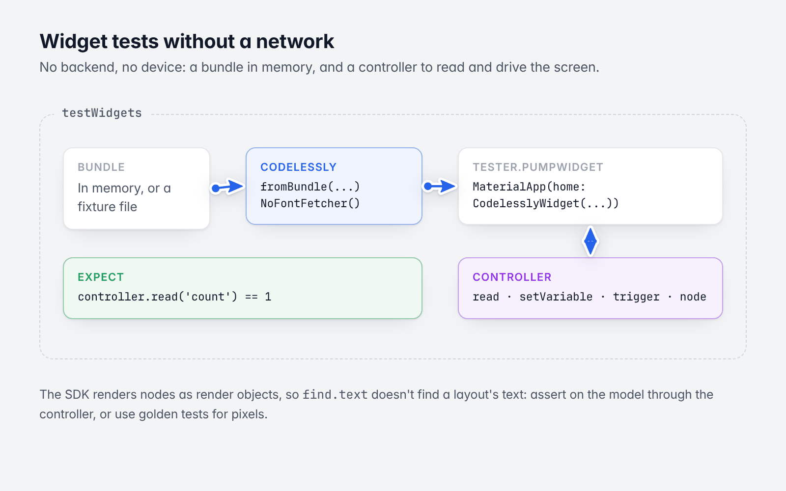
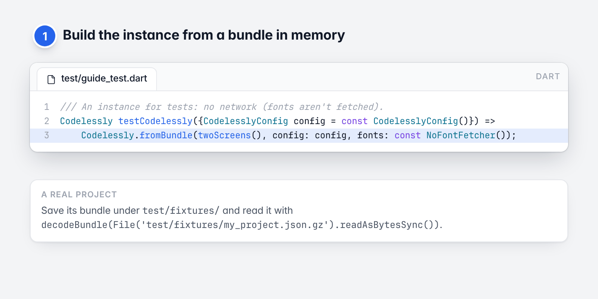
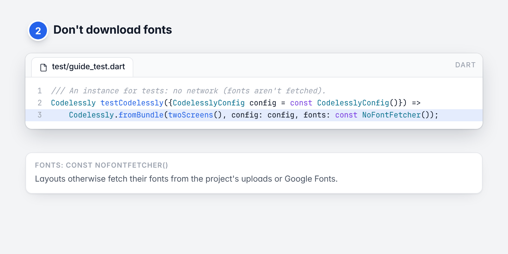
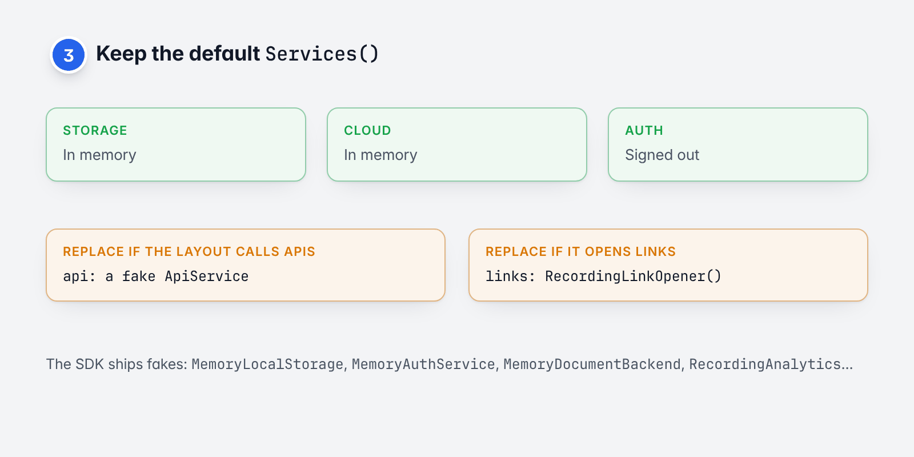
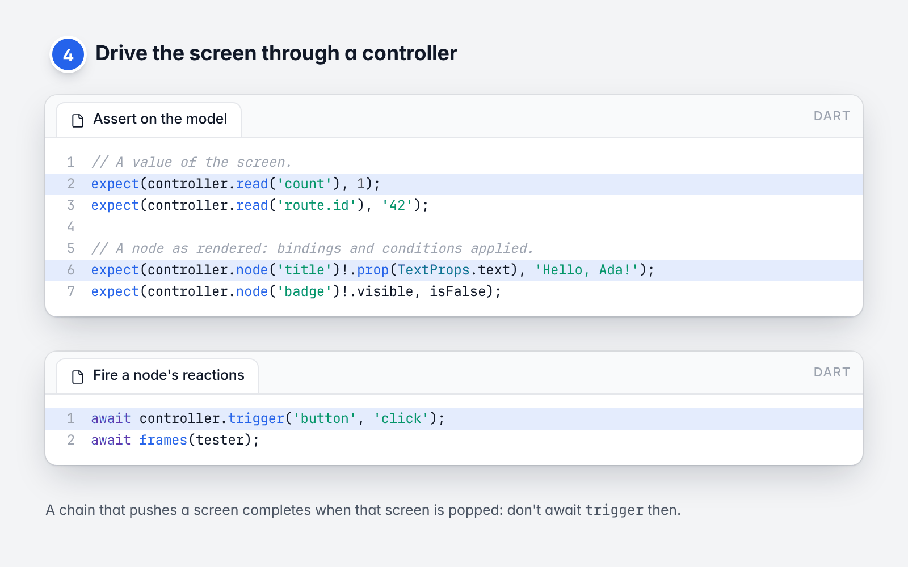
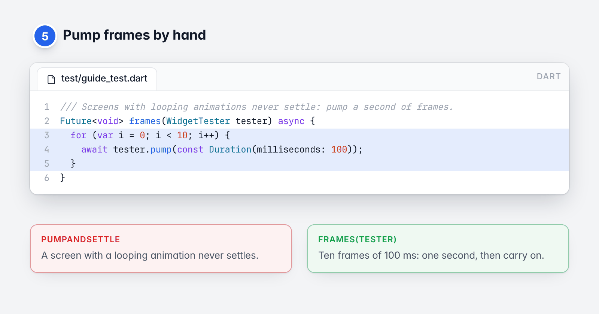

# 14. Testing

[Guide](README.md) · Previous: [Publishing and environments](13-publishing-and-environments.md) · Next: [Troubleshooting and FAQ](15-troubleshooting.md)

Screens that show layouts are widget-testable without a network, a backend or a device. The tests in this chapter
are real: they are in [`example/test/guide_test.dart`](../../example/test/guide_test.dart).



*A layout in a widget test, with no network.*

## The recipe

1. Build the instance from a **bundle in memory** (or a fixture file), so nothing is fetched.

   

   *Step 1: a bundle in memory.*

2. Pass **`fonts: const NoFontFetcher()`**, so fonts aren't downloaded.

   

   *Step 2: no font downloads.*

3. Keep the default **`Services()`**: memory storage, memory cloud data, signed out. Replace `api` and `links`
   with fakes if the layout calls APIs or opens links.

   

   *Step 3: the default services, with fakes where needed.*

4. Drive the screen through a **`CodelesslyWidgetController`**: read values, set variables, fire triggers.

   

   *Step 4: read, assert and trigger through the controller.*

5. **Pump frames by hand** instead of `pumpAndSettle`: a screen with a looping animation never settles.

   

   *Step 5: pump a second of frames.*

```dart
/// An instance for tests: no network (fonts aren't fetched).
Codelessly testCodelessly({CodelesslyConfig config = const CodelesslyConfig()}) =>
    Codelessly.fromBundle(twoScreens(), config: config, fonts: const NoFontFetcher());

/// Screens with looping animations never settle: pump a second of frames.
Future<void> frames(WidgetTester tester) async {
  for (var i = 0; i < 10; i++) {
    await tester.pump(const Duration(milliseconds: 100));
  }
}
```

`twoScreens()` returns a `PublishBundle` decoded from a JSON literal
([see it in full](../../example/test/guide_test.dart)). A real project's bundle works the same way: save one
([where a bundle comes from](04-loading-and-caching.md#where-a-bundle-file-comes-from)) under `test/fixtures/` and
read it with `decodeBundle(File('test/fixtures/my_project.json.gz').readAsBytesSync())`.

## Showing a screen

```dart
testWidgets('shows the entry screen, and a layout by id, custom id or canvas id', (tester) async {
  final codelessly = testCodelessly();
  addTearDown(codelessly.dispose);
  final controller = CodelesslyWidgetController();
  addTearDown(controller.dispose);

  await tester.pumpWidget(MaterialApp(home: CodelesslyWidget(codelessly: codelessly, controller: controller)));
  await frames(tester);
  expect(controller.isLoaded, isTrue);
  expect(controller.layout!.id, 'home');
  expect(controller.canvasId, 'home-canvas');
});
```

Set the screen size to choose the canvas a responsive layout shows:

```dart
tester.view.devicePixelRatio = 1;
tester.view.physicalSize = const Size(390, 844);
addTearDown(tester.view.reset);
```

## Asserting on what a layout shows

The SDK renders nodes as render objects, not widgets, so `find.text` doesn't find a layout's text. (It does find
widgets hosted as islands: text fields, external components.) Assert on the model instead:

```dart
// A value of the screen.
expect(controller.read('count'), 1);
expect(controller.read('route.id'), '42');

// A node as rendered: bindings and conditions applied.
expect(controller.node('title')!.prop(TextProps.text), 'Hello, Ada!');
expect(controller.node('badge')!.visible, isFalse);
```

For pixel checks use golden tests (`matchesGoldenFile`) as for any widget.

## Interacting

Fire a node's reactions directly:

```dart
await controller.trigger('button', 'click');
await frames(tester);
```

or tap where the node is:

```dart
final box = controller.tree!.boxOf('button')!;
await tester.tapAt(box.localToGlobal(box.size.center(Offset.zero)));
await frames(tester);
```

`trigger` completes when the reaction's chain does. A chain that **pushes a screen completes when that screen is
popped**, so don't await it in that case:

```dart
testWidgets('a tap navigates: the next screen reads its params', (tester) async {
  final codelessly = testCodelessly();
  addTearDown(codelessly.dispose);
  final controller = CodelesslyWidgetController();
  addTearDown(controller.dispose);
  await tester.pumpWidget(MaterialApp(home: CodelesslyWidget(codelessly: codelessly, controller: controller)));
  await frames(tester);

  // A push completes when its screen is popped, so the trigger isn't awaited here.
  unawaited(controller.trigger('open', 'click'));
  await frames(tester);
  expect(codelessly.route.value, const CodelesslyRoute('details', 'details-canvas', {'id': '42'}));
});
```

`codelessly.route` tells you which screen is showing.

## Your functions, navigation handler and data

Functions are plain closures, so record their calls:

```dart
final calls = <Map<String, Object?>>[];
final codelessly = testCodelessly(
  config: CodelesslyConfig(functions: {'onTap': (context, params) => calls.add(params)}),
);
```

`onNavigate` likewise:

```dart
testWidgets('onNavigate handles a navigation first', (tester) async {
  final codelessly = testCodelessly();
  addTearDown(codelessly.dispose);
  final controller = CodelesslyWidgetController();
  addTearDown(controller.dispose);
  final requests = <NavigationRequest>[];
  await tester.pumpWidget(MaterialApp(
    home: CodelesslyWidget(
      codelessly: codelessly,
      controller: controller,
      onNavigate: (context, request) {
        requests.add(request);
        return true;
      },
    ),
  ));
  await frames(tester);
  await controller.trigger('open', 'click');
  await frames(tester);
  expect(requests.single.destinationId, 'details-canvas');
  expect(requests.single.params, {'id': '42'});
});
```

Change `data` by pumping the widget again with other data; the screen updates in place.

## Loading and error states

```dart
testWidgets('a layout that does not exist shows the error builder', (tester) async {
  final codelessly = testCodelessly();
  addTearDown(codelessly.dispose);
  await tester.pumpWidget(MaterialApp(
    home: CodelesslyWidget(
      codelessly: codelessly,
      layoutId: 'nope',
      loadingBuilder: (_) => const Text('loading'),
      errorBuilder: (_, error) => Text('failed: ${error is PublishLoadException}'),
    ),
  ));
  expect(find.text('loading'), findsOneWidget);
  await frames(tester);
  expect(find.text('failed: true'), findsOneWidget);
});
```

To test a load failure, give the instance a loader that throws a `PublishLoadException`.

## Fakes the SDK ships

| Fake | For |
|---|---|
| `MemoryPublishLoader` | A bundle in memory. It records its calls (`calls`), to assert what was loaded. |
| `MemoryPublishCache` | A cache you can pre-fill or inspect (`entries`). |
| `NoFontFetcher` | No font downloads. |
| `MemoryLocalStorage` | `storage` values. |
| `MemoryAuthService` | Accounts that sign in and out in memory. |
| `MemoryDocumentBackend` | Cloud data in memory. |
| `MemoryFileStorage` | Uploads in memory. |
| `RecordingAnalytics`, `RecordingLinkOpener` | Record events, errors and opened URLs. |
| `FunctionScriptRunner`, `NoScriptRunner` | Scripts as Dart functions, or no engine. |
| `NoopActionRunner`, `NavigationActionRunner`, `NoopExpressionEngine` | A screen with its runtime turned down. |

## Things that trip tests up

- **Overflow errors.** Flutter's test font is wider than real fonts, so text designed to fit can overflow in
  tests. Filter those errors out, as the SDK's own tests do:

  ```dart
  final original = FlutterError.onError;
  FlutterError.onError = (details) {
    if (!'${details.exception}'.contains('overflowed by')) original?.call(details);
  };
  addTearDown(() => FlutterError.onError = original);
  ```

- **Asset bundles.** `Codelessly.asset` does real I/O; let it run with
  `await tester.runAsync(() => Future<void>.delayed(const Duration(milliseconds: 500)))`, or use
  `Codelessly.fromBundle` in tests.
- **A new `home` doesn't reset the navigator.** Pump `const SizedBox()` between two apps in one test.
- **Scripts.** On the Dart VM, scripts need the QuickJS library built for your machine
  ([Scripting](10-scripting.md#testing-scripts-in-the-sdk-repository)). In most app tests, use
  `FunctionScriptRunner`.
- **Firebase.** Don't use `codelesslyWithToken` in tests: it needs the Firebase plugins. Test with a bundle.

Next: [Troubleshooting and FAQ](15-troubleshooting.md)
