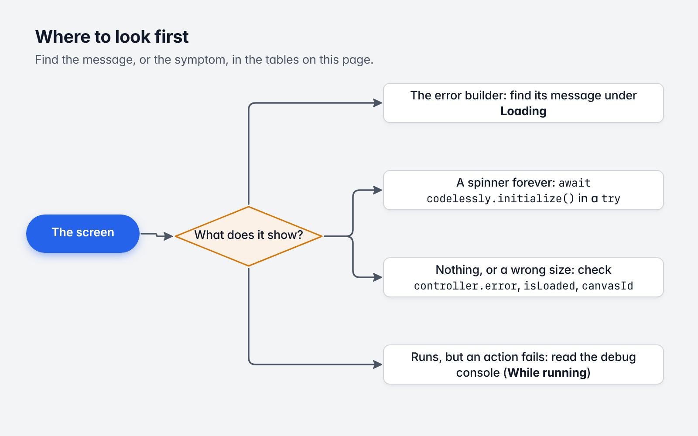

# 15. Troubleshooting and FAQ

[Guide](README.md) · Previous: [Testing](14-testing.md)

*Where to look first.*

## Error messages

A layout that fails to load shows `errorBuilder` with the error. Find its message here.

### Loading

| Message | Cause | Fix |
|---|---|---|
| `No default Codelessly instance: call Codelessly.setDefault, or pass a Codelessly to the widget.` | A `CodelesslyWidget` with no `codelessly`, no `CodelesslyScope` above it and no default. | Pass `codelessly:`, wrap in a `CodelesslyScope`, or call `Codelessly.setDefault`. |
| `No project: configure a projectId, a slug or a loader` | `Codelessly()` with an empty config and no loader. | Give a `slug`, or use `Codelessly.asset` / `codelesslyWithToken`. |
| `A project id or token is read from Firestore: create the instance with codelesslyWithToken or codelesslyOnFirebase ...` | `Codelessly(config: CodelesslyConfig(authToken: ...))`. The plain constructor never uses Firebase. | `await codelesslyWithToken(token)` from `package:codelessly_sdk/firebase.dart`. |
| `GET https://firebasestorage.googleapis.com/...publish%2F<slug>.json?alt=media: 404` | No bundle is published for that slug. | Check the slug's spelling; publish the project as a site; or use a token. On a non-production backend, see [Backends](13-publishing-and-environments.md#backends). |
| `GET ... failed (...)` | The request didn't complete: offline, DNS, a firewall, or CORS on a self-hosted URL. | Check connectivity. For offline starts, see [Caching and offline](04-loading-and-caching.md#caching-and-offline). |
| `... is not in the current format (no "schema": 2) ...` | The document isn't a Codelessly publish in the current format (a hand-made or outdated bundle, say). | Publish the project again from the Editor, and export a fresh bundle if you ship one. |
| `Project [id] has nothing published (publish/<id>)` | The project was never published (or you asked for `preview` and there is no preview). | Publish it. Check `publishSource`. |
| `Could not authenticate the project token (...)` | The token exchange failed. The cause is in the parentheses: `Failed to authenticate the project token.` means the backend refused the token; a `TimeoutException` means the access claim didn't arrive in 30 seconds; a Firebase error means anonymous sign-in failed. | Check the token (copy it again; it belongs to one project on one backend). Check the network. Check that the app can reach `*.googleapis.com` and `us-central1-codeless-app.cloudfunctions.net`. |
| `Could not read publish/<id>` | Firestore refused or failed the read: usually permissions (a project id without a token, on a project whose rules need one) or no network. | Use the token. |
| `No project: the project token named none` | The backend accepted the request but returned no project. | Check the token. |
| `No layout [x] in project [p]` | `layoutId` is not a layout id, custom id or canvas id of this project, or names a disabled layout. | List the ids ([chapter 3](03-embedding-and-sizing.md#which-screen)). Ids are case sensitive. Has the layout been published? |
| `Layout [x] does not exist (...)` / `Layout [x] is not in the bundle` | The model lists the layout but its document is missing. | Publish again. For a bundle, rebuild it. |
| `No layout to show: project [p] has no entry screen` | No `layoutId` or `initialScreen`, and the project has no entry screen. | Pass a `layoutId`. |
| `Could not load bundle asset [path]` | The asset is missing or isn't a bundle. | Declare it under `flutter: assets:`; check the path; check that the file is bundle JSON (`{"model": ..., "layouts": ...}`). |
| `Unsupported operation: Firebase has no linux support ...` | `codelesslyWithToken` on Linux desktop. | Use a slug or a bundle on Linux. |

### While running

These don't replace the screen. They are reported to `Services.analytics.logError` (printed in debug builds).

| Message | Cause | Fix |
|---|---|---|
| `No function named [x]` | A "call function" action names a function you didn't register. | Add it to `CodelesslyConfig.functions`. Names are case sensitive. |
| `Navigation to [x]: no such screen` | A navigate action's destination isn't published (or is disabled). | Publish the destination screen too. |
| `EngineUnavailable: The script engine is missing. Add the codelessly_quickjs package ...` | The project runs a script and the app has no engine. | `flutter pub add codelessly_quickjs`. On Windows there is no engine yet ([Scripting](10-scripting.md)). |
| `CapabilityError` | A script called a host API it wasn't granted. | Grant the capability on the script in the Editor. |
| An API call fails only on the web | CORS. | Allow your origin on the API, or use a proxy ([chapter 9](09-cloud-data-and-services.md#http-apis)). |

## Symptoms

**The widget shows a spinner forever.**
Loading never finished and never failed. Await `codelessly.initialize()` yourself in a `try` to see what it does.
In token mode, the usual cause is a network that blocks Firebase.

**Nothing shows, or the size is not what I expected.**
Check `controller.error` and `controller.isLoaded` first. Then the size: with `CanvasSizing.fill` the canvas fills
a bounded parent and takes its design size on an unbounded axis (a canvas that hugs its content takes its
content's height, which is zero for an empty one). Give the widget a box (`SizedBox`, `Expanded`) to control it,
and check which canvas shows with `controller.canvasId`.

**The wrong canvas shows (mobile on a wide screen).**
The canvas follows the *widget's* width, not the window's. A narrow widget shows the mobile canvas. Force one with
`canvasId` if you need to ([chapter 8](08-conditions-and-breakpoints.md#which-canvas-shows)).

**Text bound to my data is empty.**
- Is the binding `${data.<key>}` and the key spelled the same in `data`?
- Is the expression engine on? `NoopExpressionEngine` shows layouts as designed.
- `data` must be JSON-like (maps, lists, strings, numbers, booleans). An object of your own class reads as null
  fields: pass `toJson()`.

**A variable doesn't follow my `data` any more.**
A variable named like a data key follows the data until the screen changes the variable itself. That is by
design ([chapter 5](05-data-and-variables.md#data-and-variables-of-the-same-name)). Read `data.<key>` in the
layout if it must always follow.

**A tap does nothing.**
- Is the action runner on? `NoopActionRunner` runs nothing; `NavigationActionRunner` only navigates.
- Is there a `Navigator` above the widget? Navigation needs one.
- Watch the debug console: a failing action is printed with its error.

**The app doesn't get my new publish.**
- Slug and self-hosted modes load at start: restart the app (or `reset()` and `initialize()`).
- Token mode updates live when `liveUpdates` is on. A screen already showing reloads when its layout was
  republished.
- A persistent cache opens on the cached copy first and refreshes in the background.
- Are you reading `publish` while editing without publishing? Use `PublishSource.preview` in debug builds.

**Fonts look wrong for a moment, or stay wrong.**
Layouts wait up to `fontTimeout` (2 seconds) for fonts, then show with fallbacks. If fonts never load, the device
can't reach Google Fonts or the font's URL. Ship the fonts ([chapter 11](11-theming-and-fonts.md#fonts)).

**Icons are missing.**
Icons are SVGs fetched from `fonts.gstatic.com` and `icons.codelessly.com`. Check connectivity and, on the web,
your Content Security Policy.

**`storage` values and persisted variables reset at restart.**
The default storage is in memory. Use `PreferencesLocalStorage`
([chapter 5](05-data-and-variables.md#keeping-values-between-runs)).

**Layouts ignore the system's text size.**
By design. Raise `maxTextScaleFactor` ([chapter 11](11-theming-and-fonts.md#text-scale)).

**State is lost on hot reload or rebuild.**
A `Codelessly` created inside `build` is a new instance each time. Create it once (in `main`, a `State`, or your
dependency injection).

**iOS or macOS build fails after adding the SDK.**
The Firebase plugins set a minimum deployment target. Raise yours in Xcode and the Podfile to what the error
names. On macOS, also enable the network client entitlement.

## FAQ

**Do I need a Firebase project?**
No. Slug and bundle modes use no Firebase at runtime. Token mode uses Codelessly's Firebase, which the SDK sets up
from Dart. The Firebase packages are dependencies of the SDK either way, so their native parts are built into the
app.

**Does the SDK conflict with my own Firebase project?**
No. It uses a secondary Firebase app named `codelessly`; your default app is untouched.

**Can I use two projects in one app?**
Yes: one `Codelessly` per project, in any mix of modes. Two *token* projects on the same backend share the
secondary Firebase app and its anonymous user; that combination is not covered by the SDK's tests, so verify it
for your projects, or load one of them by slug or bundle.

**Can I use it without `MaterialApp`?**
Navigation actions need a `Navigator` above the widget. Beyond that, the SDK is tested under `MaterialApp`; other
app shells (`CupertinoApp`, `WidgetsApp`) are not covered by its tests.

**Is server-side rendering or Flutter-less rendering supported?**
No. The SDK renders with Flutter.

**Can a layout be exported as Flutter code?**
Not by the SDK. The SDK shows layouts as data.

**Which platforms run scripts?**
Web, Android, iOS, macOS and Linux. Not Windows yet.

**How big is the SDK?**
It depends on the platform and what your app already includes; measure a release build of your app with and
without it. The script engine, when added, is about 0.6 MB per ABI.

**Where do I report a bug?**
[github.com/Codelessly/CodelesslySDK/issues](https://github.com/Codelessly/CodelesslySDK/issues). Include the SDK
version, the platform, the error text, and if you can a bundle of the project that shows it.
