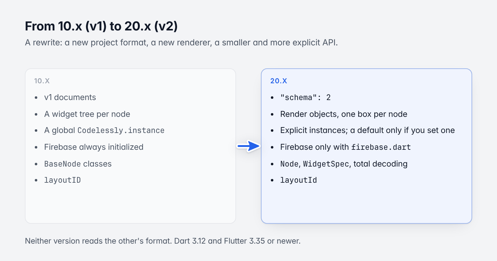
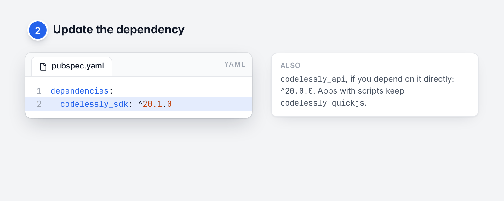
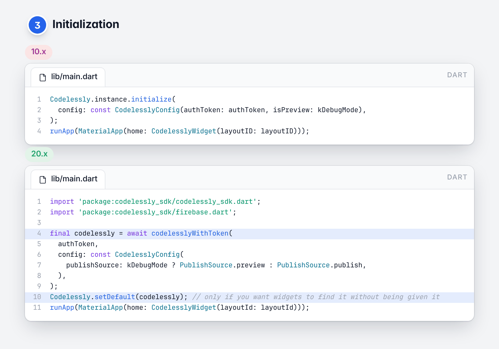
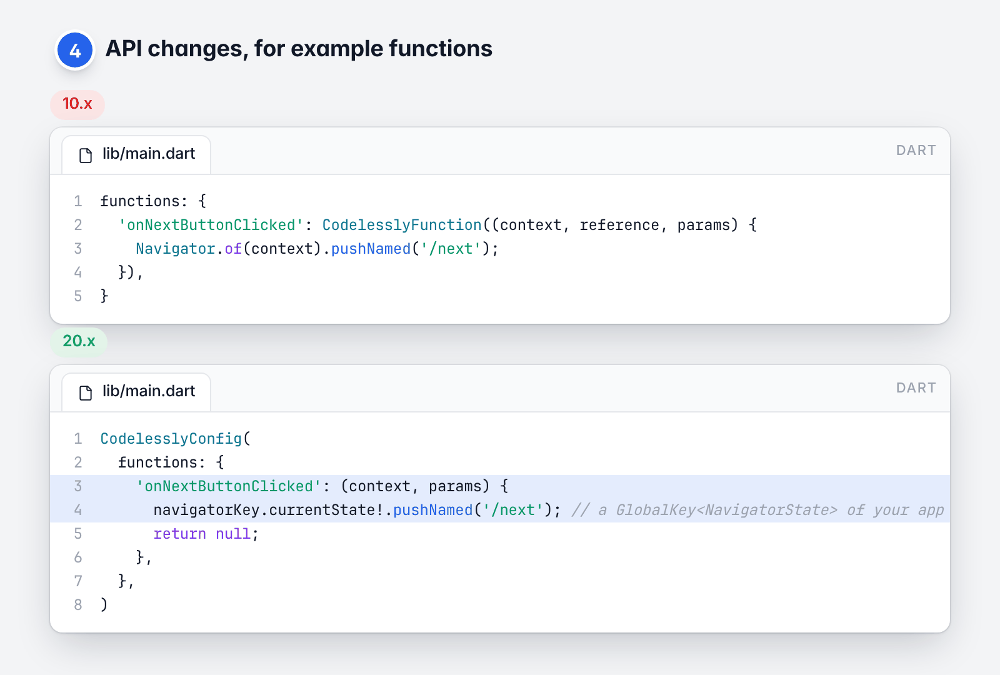
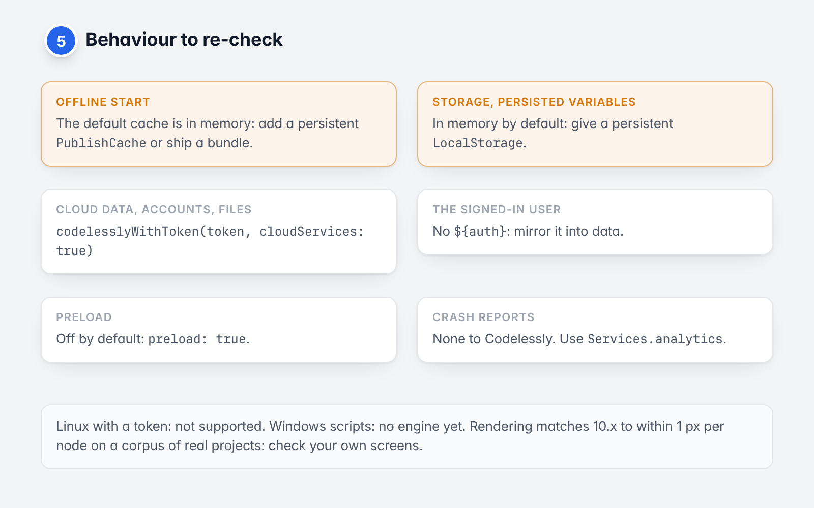
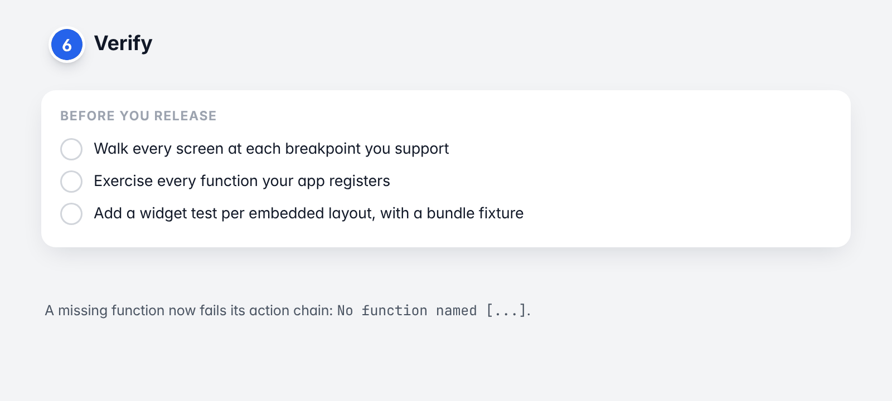

# 16. Migrating from 10.x to 21.x

[Guide](README.md) · Previous: [Troubleshooting and FAQ](15-troubleshooting.md)

SDK 21 is a rewrite. It reads a new project format, renders differently, and has a smaller, more explicit API.
This chapter is the checklist for moving an app from `codelessly_sdk` 10.x (or older) to 21.x.

10.x is no longer in this repository: the repository holds 21.x only. 10.x stays available on pub.dev
(`codelessly_sdk: ^10.0.0`), but it can't load projects any more (below), so there is nothing to gain from staying
on it.



*What changes from 10.x to 21.x.*

## What changed, in short

| | 10.x | 21.x |
|---|---|---|
| Project format | 10.x documents | `"schema": 2` |
| Rendering | A widget tree per node | Render objects, one box per node |
| Instances | A global `Codelessly.instance`, configured in place | Explicit instances; a default only if you set one |
| Firebase | Always initialized by the SDK | Only with `package:codelessly_sdk/firebase.dart` |
| Model package | `codelessly_api` 10.x (`BaseNode`, json_serializable) | `codelessly_api` 21.x (`Node`, `WidgetSpec`, total decoding) |
| Dart / Flutter | | Dart 3.12, Flutter 3.35 or newer |

## 1. Projects are already in the new format

SDK 21 reads `"schema": 2` only, and SDK 10 can't read it. Every Codelessly project has already been converted to
the new format and republished, under the same paths and with the same layout and canvas ids, so the ids in your
code stay valid. Confirm them with the listing in [Embedding and sizing](03-embedding-and-sizing.md#which-screen).

Apps on SDK 10.x or older no longer load converted projects: update them to 21.x. If SDK 21 shows
`... is not in the current format (no "schema": 2)`, the document was never converted (for example a bundle exported from a 10.x app
and shipped in the app): export the bundle again from the current Editor.

## 2. Update the dependency



*Step 2: the dependency.*

```yaml
dependencies:
  codelessly_sdk: ^21.0.0
```

If you depend on `codelessly_api` directly, it must be `^21.0.0` too. Apps with scripts keep
`codelessly_quickjs`.

## 3. Initialization



*Step 3: initialization, before and after.*

```dart
// 10.x
Codelessly.instance.initialize(
  config: const CodelesslyConfig(authToken: authToken, isPreview: kDebugMode),
);
runApp(MaterialApp(home: CodelesslyWidget(layoutID: layoutID)));
```

```dart
// 21.x
import 'package:codelessly_sdk/codelessly_sdk.dart';
import 'package:codelessly_sdk/firebase.dart';

final codelessly = await codelesslyWithToken(
  authToken,
  config: const CodelesslyConfig(
    publishSource: kDebugMode ? PublishSource.preview : PublishSource.publish,
  ),
);
Codelessly.setDefault(codelessly); // only if you want widgets to find it without being given it
runApp(MaterialApp(home: CodelesslyWidget(layoutId: layoutId)));
```

- There is no implicit global. `Codelessly.instance` throws until you call `Codelessly.setDefault`. Prefer passing
  the instance (`CodelesslyWidget(codelessly: ...)`) or a `CodelesslyScope`.
- `initialize()` takes no arguments; configuration goes to the constructor. You rarely call it: widgets do.
- A token needs `codelesslyWithToken` (or `codelesslyOnFirebase`). `Codelessly(config: CodelesslyConfig(authToken:
  ...))` alone fails with a message that says so.
- A slug needs no Firebase: `Codelessly(config: const CodelesslyConfig(slug: 'my-project'))`.

## 4. API changes



*Step 4: functions are plain Dart functions now.*

### `CodelesslyConfig`

| 10.x | 21.x |
|---|---|
| `authToken` (required) | `authToken` (optional; or `slug`, or `projectId`, or a loader) |
| `isPreview: true` | `publishSource: PublishSource.preview` (`isPreview` is now a read-only getter) |
| `preload` | `preload` (now `false` by default) |
| `slug` | `slug` |
| `useHostTheme`, `maxTextScaleFactor`, `debugLog` | The same names (`debugLog` is not read yet) |
| `automaticallySendCrashReports` | Removed. Errors go to `Services.analytics`; send them where you like. |
| `firebaseOptions`, `firebaseInstanceName`, `firebaseProjectId`, `firebaseCloudFunctionsBaseURL`, `baseURL` | Removed from the config. Use `codelesslyFirebaseApp(name:, options:)`, `codelesslyWithToken(app:, functionsBaseUrl:)` ([Backends](13-publishing-and-environments.md#backends)). |
| `clientType` | `ProjectAuthConfig.clientType`, when you build a `FirebaseProjectAuth` yourself |
| | New: `liveUpdates`, `functions`, `services`, `expressions`, `actions`, `fontTimeout` |

### `Codelessly`

| 10.x | 21.x |
|---|---|
| `Codelessly.instance` (always exists) | `Codelessly.instance` after `Codelessly.setDefault(...)`; `Codelessly.maybeInstance` |
| `Codelessly()`, then `configure(...)` / `initialize(config:, data:, functions:, ...)` | `Codelessly(config:, loader:, cache:, fonts:, data:)`, then `initialize()` |
| `data`, `functions` on the instance | `data` on the instance (`setData`); functions on `CodelesslyConfig.functions` |
| `statusStream`, `CStatus` | `status`, and the instance is a `Listenable` (`CEmpty`, `CLoading`, `CLoaded`, `CError`) |
| `authManager`, `dataManager`, `cacheManager` parameters | A `PublishLoader`, a `PublishCache`, and `Services` |
| `reset()` / `dispose()` | `reset({clearCache})` / `dispose()` |

### `CodelesslyWidget`

| 10.x | 21.x |
|---|---|
| `layoutID` | `layoutId` |
| | New: `canvasId`, `params`, `sizing`, `onNavigate` |
| `initialScreen` | `initialScreen` |
| `data` | `data` (same meaning; a variable named like a key still starts at it and follows it) |
| `functions: {'name': CodelesslyFunction(...)}` on the widget | `CodelesslyConfig.functions` on the instance |
| `config`, `publishSource` on the widget | On the instance. For another project or the preview, use another `Codelessly`. |
| `codelessly` | `codelessly` |
| `loadingBuilder`, `errorBuilder`, `layoutBuilder` | The same names. `errorBuilder` is `(context, error)`; `layoutBuilder` is `(context, layout)`. |
| `layoutRetrievalBuilder`, `overlay` | Removed. Use `layoutBuilder`. |
| `externalComponentBuilders` | An `ExternalComponents` widget above the layouts ([Custom widgets](12-custom-widgets.md)) |
| `authManager`, `publishDataManager`, `previewDataManager`, `templateDataManager`, `cacheManager` | Removed. See `Codelessly`. |

### Functions

```dart
// 10.x
functions: {
  'onNextButtonClicked': CodelesslyFunction((context, reference, params) {
    Navigator.of(context).pushNamed('/next');
  }),
}
```

```dart
// 21.x
CodelesslyConfig(
  functions: {
    'onNextButtonClicked': (context, params) {
      navigatorKey.currentState!.pushNamed('/next'); // a GlobalKey<NavigatorState> of your app
      return null;
    },
  },
)
```

- The signature is `(ActionContext context, Map<String, Object?> params)`. There is no `BuildContext` and no
  `CodelesslyContext`: read values with `context.scope.read(path)`, set variables with
  `context.setVariable(name, value)`, and capture a navigator key or your state for UI.
- A function's return value is now `${result}` for the next action.

### Controller

| 10.x | 21.x |
|---|---|
| `CodelesslyWidgetController(layoutID:, config:, ...)` | `CodelesslyWidgetController(layoutId:, codelessly:, params:, data:, builders)` |
| `controller.dataManager`, `publishSource`, `initialize()` | Removed: the instance loads. |
| `codelesslyContext` to read variables | `read(path)`, `setVariable(name, value)`, `trigger(nodeId, trigger)`, `node(id)`, `scope` |

### Navigation

21.x pushes real routes on the nearest `Navigator`, names them by the screens' URL paths, and lets you intercept
with `onNavigate`. A project that is the whole app uses
`CodelesslyWidget.onGenerateRoute(codelessly)` ([Navigation](07-navigation.md)).

### Model types

If your code touches the model (`package:codelessly_api`): `BaseNode` and its subclasses are gone. A node is a
`Node` with a `type` string and typed props (`node.prop(TextProps.text)`). See the
[codelessly_api guide](https://github.com/Codelessly/CodelesslyAPI/tree/master/docs/guide).

## 5. Behaviour to re-check



*Step 5: what behaves differently.*

| Area | 10.x | 21.x |
|---|---|---|
| Offline start | A disk cache (Hive) | The default cache is in memory: add a persistent `PublishCache` or ship a bundle ([chapter 4](04-loading-and-caching.md#caching-and-offline)). |
| `storage` and persisted variables | | In memory by default: kept only with a persistent `LocalStorage` ([chapter 5](05-data-and-variables.md#keeping-values-between-runs)). |
| Cloud data, accounts, files | Set up by the SDK | `codelesslyWithToken(token, cloudServices: true)` ([chapter 9](09-cloud-data-and-services.md)). |
| The signed-in user in layouts | | `CodelesslyWidget` doesn't provide `${auth}`: mirror it into data ([chapter 5](05-data-and-variables.md#the-signed-in-user)). |
| Preload | On by default | Off by default: `preload: true`. |
| Crash reports to Codelessly | Optional | None. Use `Services.analytics`. |
| Linux with a token | | Not supported (no Firebase): slug or bundle. |
| Windows scripts | | No engine yet. |
| Rendering | | Pixel parity with 10.x is tested on a corpus of real projects, to within 1 px per node. Check your own screens, especially custom fonts and text at edge sizes. |

## 6. Verify



*Step 6: verify.*

- Run the app against the project and walk every screen at each breakpoint you support.
- Exercise every function your app registers: a missing one now fails its action chain (`No function named
  [...]`).
- Add a widget test per embedded layout ([Testing](14-testing.md)); with a bundle fixture it runs in CI without a
  network.

Back to the [guide](README.md).
