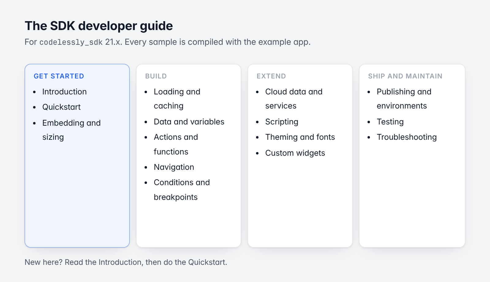

# Codelessly SDK developer guide

For `codelessly_sdk` 20.x (this repository). Every code sample here is compiled with the
[example app](../../example) (`lib/snippets.dart`), and the behaviour the chapters describe is covered by its
tests (`test/guide_test.dart`) or the SDK's own.



*The sixteen chapters, by what you are doing.*

New here? Read [Introduction](01-introduction.md), then do the [Quickstart](02-quickstart.md).

## Contents

| # | Chapter | Read it when you want to |
|---|---|---|
| 1 | [Introduction and concepts](01-introduction.md) | Know what the Editor, a publish, the model and the SDK each do |
| 2 | [Quickstart](02-quickstart.md) | Show a published screen in an app in five minutes |
| 3 | [Embedding and sizing](03-embedding-and-sizing.md) | Put a layout inside your own screens: ids, canvases, sizing, builders, the controller |
| 4 | [Loading modes and caching](04-loading-and-caching.md) | Choose between slug, token and bundles; work offline; self-host |
| 5 | [Data and variables](05-data-and-variables.md) | Pass your app's data in, and read a screen's state out |
| 6 | [Actions and functions](06-actions-and-functions.md) | Know what layouts can do, and call your own code from them |
| 7 | [Navigation](07-navigation.md) | Route between Codelessly screens and your own; deep links |
| 8 | [Conditions and breakpoints](08-conditions-and-breakpoints.md) | Understand conditional UI and responsive canvases |
| 9 | [Cloud data and services](09-cloud-data-and-services.md) | Use Codelessly cloud data, accounts, files and APIs, or plug in your own services |
| 10 | [Scripting](10-scripting.md) | Run a project's JavaScript: engines, the language, the host API |
| 11 | [Theming and fonts](11-theming-and-fonts.md) | Match your app's theme; control fonts and text scale |
| 12 | [Custom widgets and extending](12-custom-widgets.md) | Put your own Flutter widgets in a layout; replace a service |
| 13 | [Publishing and environments](13-publishing-and-environments.md) | Understand publish, preview, templates, sites and app identity |
| 14 | [Testing](14-testing.md) | Write widget tests for screens that show layouts |
| 15 | [Troubleshooting and FAQ](15-troubleshooting.md) | Decode an error message |
| 16 | [Migrating from 10.x to 20.x](16-migrating-from-10.md) | Move an app from SDK 10 (v1) to SDK 20 (v2) |

Related:

- The data model: [`codelessly_api` guide](https://github.com/Codelessly/CodelesslyAPI/tree/master/docs/guide).
- The script engine: [`codelessly_quickjs`](https://github.com/Codelessly/CodelesslyQuickJS).
- For contributors: [`CONTRIBUTING.md`](../../CONTRIBUTING.md) (widget types and the runtime) and the model's
  [`DESIGN.md`](https://github.com/Codelessly/CodelesslyAPI/blob/master/DESIGN.md).

## Conventions

- Imports. Samples assume:

  ```dart
  import 'package:codelessly_sdk/codelessly_sdk.dart';
  import 'package:flutter/material.dart';
  ```

  and, where they use Firebase, `import 'package:codelessly_sdk/firebase.dart';`.
- Package names. The packages are `codelessly_sdk` and `codelessly_api`, the same names on pub.dev and in the
  repositories. 10.x (v1) is no longer in the repositories; it stays on pub.dev.
- `${...}` is the layout's expression syntax, written in the Editor, not Dart.
