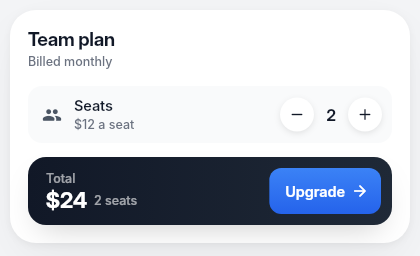

# README opening: draft for the owner's edit

Status: a draft. Nothing in `README.md` has changed. It replaces the text from the title down to the contents list;
the Install, Quickstart and `CodelesslyWidget` sections stay as they are and move below it. Every number comes from
the recorded runs named beside it. What is yours to decide is marked **Decide**.

---

# Codelessly SDK

UI that an AI model writes, drawn by Flutter. A model describes a screen as a few lines of data; the SDK draws it
natively and runs it (state, formulas, actions, lists, navigation), on every platform Flutter reaches. The same
engine shows screens designed in the [Codelessly Editor](https://codelessly.com) and published to running apps
without an app release.

```
state seats=2
ChatCard "Team plan" "Billed monthly"
  Counter "Seats" "$12 a seat" =seats min:1 max:20
  TotalBar "Total" "{seats} seats" amount:"${seats * 12}" cta:"Upgrade" -> emit upgrade seats
```



*Four lines, a designed card; the total follows the counter. The model wrote the lines; the look comes from the design system.*

## Why it looks designed

A model that must draw every box writes slowly and the result looks generic. A model limited to a fixed kit of plain
parts is fast and the result still looks generic. Here the model composes **blocks**: components a design system
supplies as data, already designed, called by name. Three ways to write a screen, one renderer:

| | The model writes | Speed | Look |
|---|---|---|---|
| Plain parts | `Column`, `Text`, `Button`, `Slider` | Fastest | Clean, plain |
| Designed blocks | `PlanHeader`, `Carousel`, `ComparisonTable` | As fast | Designed |
| Full vocabulary | Any node, every property | Slower | Anything |

When a card needs a block the design system lacks, a stronger model designs it once (one to three rounds, looking at
its own render), it joins the library, and the fast model uses it from then on.

Measured on 17 chat-card briefs with the same model, scored by an independent judge on whether it would ship
(1 to 5): A2UI in its own renderer 1.94, plain parts 2.53, designed blocks 3.88. On 8 briefs none of the blocks were
written for: 2.50, 2.88, 3.38. Recordings and renders:
[`examples/showcase`](https://github.com/Codelessly/CodelesslySDK/tree/master/examples/showcase).

## Three ways in

- **A model writes the UI.** `UiSession` takes the notation as it streams and `CodelesslyView` draws it:
  [UI written by an agent](#ui-written-by-an-agent).
- **A designer publishes it.** Design in the Editor, publish, show it with `CodelesslyWidget`:
  [Quickstart](#quickstart).
- **You write the data.** A layout is a JSON document with a published schema and a validator:
  [Developer guide](#developer-guide).

---

## Decide

1. **Which story leads.** The draft leads with model-written UI and moves the Editor to the second sentence. The
   current README leads with the Editor. Leading with the Editor and adding one paragraph on model-written UI is the
   smaller change.
2. **Naming A2UI.** The comparison names A2UI and gives its score. It is recorded and repeatable, and it invites a
   reply. The alternative is "a fixed kit of plain parts" with no name.
3. **The picture.** The card under the example is what those four lines draw with the Cards design system (rendered
   by `tool/render`). A second picture, the same brief in all three arms side by side, would carry the comparison;
   it would be composed from `examples/showcase/renders/head-to-head`.
