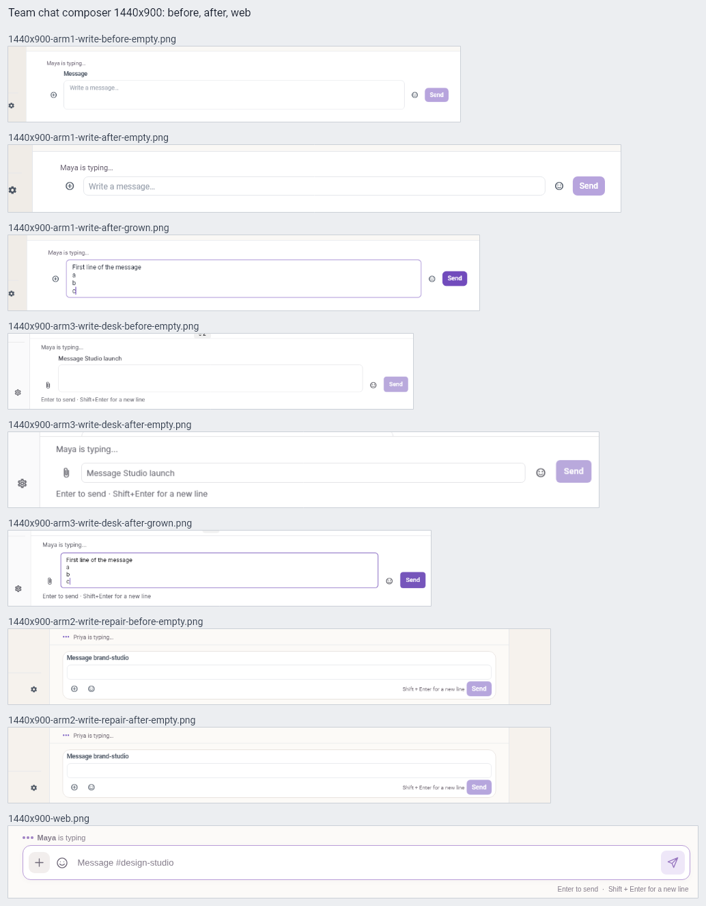
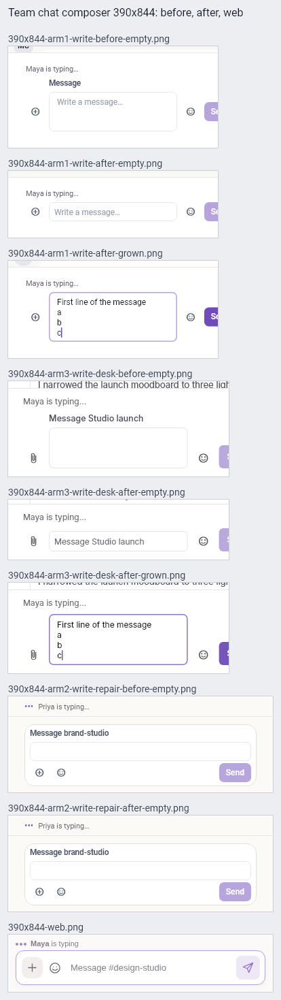
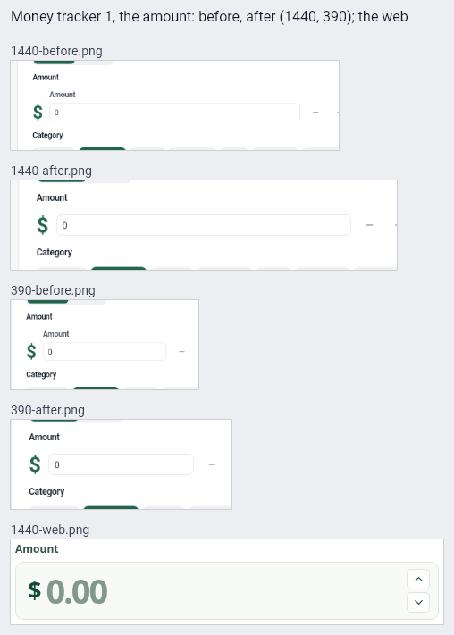
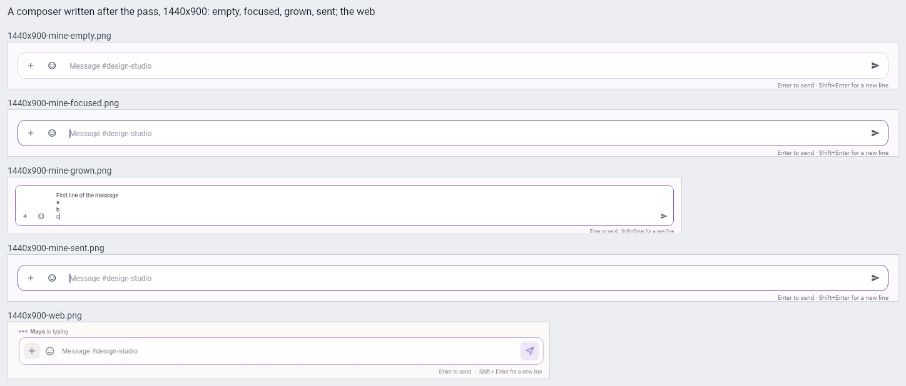
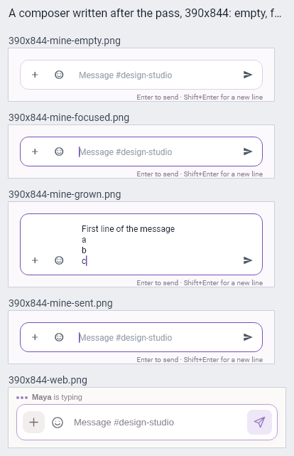
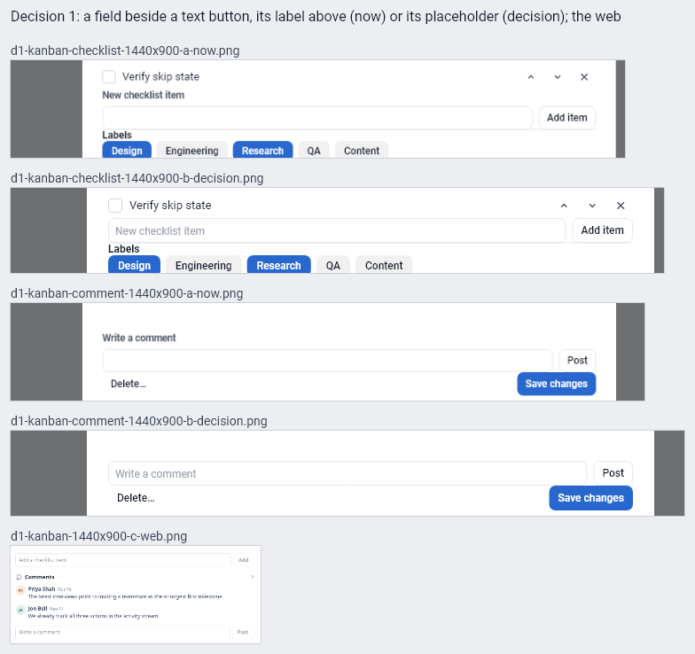
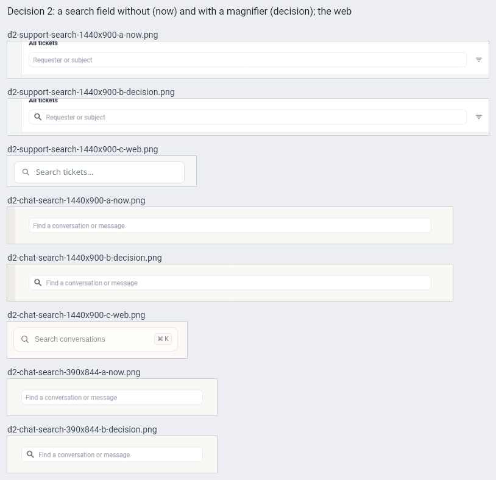

# Text input after round 11

Round 11 had writers build the same 30 briefs in one pass: three arms in the notation (`1-write`, `2-write-repair`,
`3-write-desk`, each knowing only the grammar it was given, `notation.txt`) and a web baseline (`4-web`, React and
Tailwind). The owner's reading of the pictures: text input on the web looks better and is more correct; in the
notation it struggles; only the web has the professional layout. The example was the team chat's message composer.

This note is the survey of every text input the 80 notation builds wrote (three arms for each of the 20 app briefs, two for each of the 10 website briefs, which had no Desk arm), the causes sorted as the owner asked
(a wrong default, a customization path writers do not reach, a missing primitive), what was changed on the
`input-pass` branches of CodelesslyAPI and CodelesslySDK, the decisions left to the owner, and what is still
different from the web. The builds are on the branches `dsl11/<brief>` of CodelesslyEditor,
`experiments/dsl-api-11/<brief>/<arm>/`.

## How it was surveyed

- Every line of the notation arms that writes an `Input` or a word a writer defined over `Input` (526 lines), with
  its parent line and its siblings; the words defined or declared `primitive` over an `Input`.
- Every `textField` the builds expanded to (their `site/*.json`, as the round rendered them): 568 fields in 74 of
  the 80 builds, each placed by where it sits (in a column; in a row, beside icon buttons, text buttons or other
  fields; in a framed row), with its label, hint and lines. Desk's `SearchField` (a component, 16 builds) is
  counted apart.
- The web arm's `<input>` and `<textarea>` for the same parts (`src/*.tsx`).
- The pictures (`out/<screen>@1440x900.png`, `834x1112`, `390x844`) of the team chat (all three arms and the web),
  the kanban board, the support desk, the money tracker, the workout tracker; then ten builds re-expanded and
  re-rendered before and after the change, the team chat's composers in five states (empty, focused, typed, grown
  to four lines, sent).

## The survey

Counts are of expanded fields and of builds (of 80). "Web" is what the web arm drew for the same part.

| Kind | Fields | Builds | The web | The notation drew | Fault | Builds with it |
|---|---:|---:|---|---|---|---:|
| Form field with a label, in a column (`Input "Email" "you@example.com" @email`) | 300 | 69 | label above, placeholder inside | the same | none | 0 |
| Multi-line note in a form (`Input "Note" multiline`) | 93 | 39 | a textarea of 3 or 4 rows, label above | a 3-line box, label above | none | 0 |
| Fields side by side (two-up forms, nutrition grids, a set's weight and reps) | 87 | 23 | labels above, or column heads | labels above each | none (a row of fields is a form's) | 0 |
| Search field, plain `Input "Search …" "hint"` (in a toolbar, a sidebar, a dialog) | 75 | 39 | magnifier icon, placeholder | placeholder; the label already dropped by 36.0.0's rule for `"Search…"`, `"Find…"`, `"Filter…"` | no magnifier | 39 |
| Search field, Desk's `SearchField` | — | 16 | magnifier, placeholder, key cap | the same | none | 0 |
| Composer: a multi-line field beside send and attach buttons | 3 (+1 in a column, see below) | 4 | one rounded box: attach, emoji, a one-line field with its placeholder, send; grows; Enter sends | a label above a 3-line empty box, the buttons outside it | label above, three empty lines, Enter breaks the line, onSubmit never runs | 3 (team chat 1 and 3; the workout tracker's note) |
| Field among icon buttons: a stepper (`IconButton "remove"` / `Input "Reps"` / `IconButton "add"`), a toolbar | 26 | 11 | no label (a `$` prefix and arrows inside the box for the amount; column heads for sets) | a label above the box inside the row; the money tracker's "Amount" twice (a `Text` above and the Input's label) | label above | 10 |
| Inline entry beside a text button: add an item, a checklist step, a comment, a tag, a guest, a promo code, a newsletter email | 52 | 17 | placeholder only ("Add a checklist item", "Write a comment"), the button level with the box | a label above the box ("New checklist item", "Write a comment" as labels) | label above | 17 |
| Composer card: a framed box holding a multi-line field and a row of buttons under it (team chat 2) | 1 | 1 | — | a label above a bordered field inside the bordered box | label above, a bordered field in a bordered box | 1 |
| Reply composer in a column (support desk, label "Message" and a hint) | 3 | 3 | a 3-row textarea with a placeholder under tabs | a 3-line box with the label "Message" above | label only (a writer's choice) | 0 counted |
| Chips or tokens in a field (recipients, invite emails) | 3 | 3 | chips inside the field's box | a declared primitive, a placeholder box | no word | 3 |
| One-time code | 36 (six per build) | 6 | six boxes | six labelled fields ("1" … "6", "Digit 1" …) or a primitive | `CodeInput` exists but the open prompt leaves it out | 6 |

Primitives the writers declared over a text field (a `// comment` saying what needs code), 14 in 11 builds:

| Build | Word | What it said it needs | Class | Now |
|---|---|---|---|---|
| team-chat/1 | `ComposerKeys` (in `ComposerField`) | measures the field up to maxLines, onSend on Enter, a new line on Shift+Enter | primitive (Enter) and default (lines) | base: a composer grows from one line; `onSubmit` on a multi-line field is Enter, Shift+Enter a new line |
| team-chat/3 | `GrowingInput` | grows from one line to maxLines, onSend on Enter, Shift+Enter a new line | the same | the same |
| notes-app/1, notes-app/3 | `WritingField`, `GrowingBody` | a body that grows with its text | customization (`maxLines=0`: no limit, it grows) | as it was: the word exists |
| spreadsheet/1, spreadsheet/3 | `WorkbookTab`, `FormulaInput` | Enter commits, Escape cancels | customization (`onSubmit`, `onKeyDown(key=Escape)`) | as it was |
| admin-console/1, mail-client/1 (and mail-client/2 defined one) | `EmailChips`, `RecipientChips` | chips in a field, split on commas, Enter accepts | primitive (or a definition) | not done (see below) |
| admin-console/3, seat-booking/3 (seat-booking/2 defined one) | `VerificationCode`, `CodeBoxes` | six one-digit boxes, paste, focus moves | customization (`CodeInput`) | not done (see below) |
| money-tracker/3 | `AmountStepper` | arrows step, holding repeats | customization (`NumberInput` / `steppers`) | as it was |
| workout-tracker/3, story-reader/1 | `WeightInput`, `NewsSearch` | unit conversion, fuzzy match | logic, not input | as it was |

What writers did not write: no build put `fill`, `border` or `radius` on an `Input` line (0 of 74), nor
`decoration.…`; they styled no field. What they wrote is the shape (a field in a row of buttons, a label string)
and the words `multiline` and, twice, `minLines=1` / `maxLines`. The fix is in the defaults those shapes get.

## The causes and what was done

| # | Cause | Class | Builds | Fix | Of what kind |
|---|---|---|---:|---|---|
| 1 | `multiline` is three lines tall wherever it is; a composer starts at one | default | 3 | a multi-line field in a row beside a button starts at one line and grows to its `maxLines`; lines the writer wrote are kept | a better default (notation) |
| 2 | An `Input`'s first string is its label, drawn above, also in a composer and in a row of icon buttons | default | 3 + 10 | in a composer, among icon buttons, or in a framed row: the label is the placeholder, or beside a hint the spoken name (`semanticLabel`); a labelled field's extra height goes too | a better default (notation) |
| 3 | `onSubmit` on a multi-line field never ran from the keyboard: Enter only broke the line | default and primitive | 2 (declared) | the notation gives such a field `textInputAction=send`; the renderer, for a multi-line field with an action, takes Enter itself also while the platform's text input is connected: Enter sends, Shift+Enter breaks the line (an IME's Enter is left alone), and `send` keeps the focus for the next message | a default (notation) and renderer code (SDK `editable.dart`, `text_field.dart`) |
| 4 | A bordered field inside the writer's bordered box (the web's composer is one box) | default | 0 in this shape, 1 in another (team chat 2) | a field beside a button in a framed row (a row with a radius and a border or fill, or a box holding that row alone) is bare: no border, no fill | a better default (notation) |
| 5 | A bare field has no focus ring; the web's composer box rings on `:focus-within` | primitive | — | the frame of 4 gets `focused.border` in the accent; the renderer makes a box with a `focused` look focused while a field in it has the focus | a default (notation) and renderer code (SDK `text_field.dart`) |
| 6 | `fill`, `border`, `radius` on an `Input` drew nothing (`radius` was dropped with an issue) | customization | 0 wrote them | they are the field's own box: `fill=` its fill, `border=` its line (`border=none`: none, and no fill unless written), `radius=` its corners; a state's (`focused.fill=`) too; `print` writes them back | an accepted word (notation, printer); the renderer keeps a borderless field's radius for its fill (SDK `field_frame.dart`) |
| 7 | The composer was not taught | customization | 3 | one sentence in the page prompt (below) | the grammar prompt |

The grammar prompt, the page prompt only (the phone prompt is at its 9,000-character budget):

- before: `Input "Password" password hides it; Input "Note" multiline is a text area. Text "…" center aligns it, …`
- after: `Input "Password" password hides it; Input "Note" multiline is a text area. In a Row beside buttons, Input
  "Message #general" @draft multiline grow onSubmit={…} is a composer: its string the placeholder, one line growing as
  it fills, Enter sends and Shift+Enter breaks the line. Text "…" center aligns it, …`

What a form keeps: `Input "Email" "you@example.com" @email` in a column, a multi-line note in a form, a row of
fields, a field beside a text button, a framed row of an icon and a field with no button (a document's search
pill, `examples/showcase/desktop/native/site_landing.json`) draw as they did; tests say so
(`CodelesslyAPI/test/notation_text_input_test.dart`).

How existing documents change (the CHANGELOGs' "Behaviour changes"): every one of the round's 80 builds expanded
again with the branch and compared field by field with the round's own expansion: see "Proof" below.

## Proof on the round's builds

Ten builds re-expanded and re-rendered with the branch and no change to their notation, at 1440x900, 834x1112 and
390x844 (`before/` with the release, `after/` with the branch): team chat 1, 2 and 3, kanban board 2, support desk
2, notes app 3, money tracker 1, magazine 2, admin console 1, spreadsheet 3. The render errors and warnings are the
same before and after in each.







- Team chat 1 (`ComposerField` over `Input "Message" "{hint}" multiline maxLines=5`, in a row of an attach button,
  the field, an emoji button and Send): before, the label "Message" over a three-line empty box, the buttons
  centered on it; after, one line with "Write a message…" inside, level with the buttons, growing to four lines as
  typed, the buttons centered on it as it grows (the writer's `Row … middle`).
- Team chat 3 (Desk; `GrowingInput` declared a primitive over `Input "{hint}" multiline`): before, the bound label
  "Message Studio launch" over a three-line empty box; after, "Message Studio launch" as the placeholder in a
  one-line field that grows, the buttons at its bottom (`Row … bottom`).
- Team chat 2: unchanged (its composer is a different shape: see the decisions).
- Money tracker 1: the amount's label "Amount" no longer drawn a second time inside the row of `$`, the field and
  the minus and plus buttons; the field is level with them.
- Kanban board 2, support desk 2, notes app 3, magazine 2, admin console 1, spreadsheet 3: no field changed (their
  fields are forms, searches the 36.0.0 rule already handled, or rows beside text buttons, which the decisions
  leave as they are).

What changed across the whole round (all 80 builds expanded with the branch, fields compared with the round's own
expansion): 25 fields in 13 builds draw differently, all of them by the causes above and nothing else: 3
composers start at one line (team chat 1 and 3, the workout tracker's exercise note); 22 fields among icon buttons
or in a composer lose the label above (13 keep it as their spoken name beside a hint, 9 show it as the placeholder;
4 of them in Desk builds lose the label's 20 px of height too): the money tracker's amount (3 builds), the clip
editor's start and length steppers, the workout tracker's weight and reps (3 builds), the notes app's tag entry,
the meal planner's timer seconds, the spreadsheets' sheet name and formula bar. No field gained `textInputAction`
(no build wrote `onSubmit` on a multi-line field) and none was made bare (no build wrote the framed composer row).
One more field differs in admin console 1 (a binding's variable), as it does with the release itself: not this
change.

## A composer written after the change

As a writer would write it now (six lines; `Box` around a `Row`, no word beyond the base):

```notation
Box radius=12 border=#FFDCCFE6 fill=#FFFFFFFF pad=7 w=fill
  Row gap=6 bottom
    IconButton "add" tooltip="Attach"
    IconButton "sentiment_satisfied_alt" tooltip="Emoji"
    Input#composer "Message #design-studio" @draft multiline grow onSubmit={messages=append(messages,draft); draft=""}
    IconButton "send" tooltip="Send" onTap={messages=append(messages,draft); draft=""}
```





It is one rounded box with the attach and emoji buttons, a one-line field with its placeholder inside and the send
button on one line; it grows with Shift+Enter to its sixth line, the buttons staying at the bottom; Enter sends,
clears it and keeps the caret; the box's line takes the accent while it is focused. What is still different from
the web's:

- The web's buttons are styled: the attach button sits on a soft square, the send button is a filled accent square
  (pale while there is nothing to send). The notation's are plain icon buttons, as written; a writer would write
  `IconButton.filled` or a `Box` around them, which is the buttons' look, not the field's.
- The web's text is 13 px on a 22 px line, the box 50 px high with 7 px of padding; the notation's field is the
  control step's (12.5 px text, the box 42 px with `pad=7`), so the composer is a little smaller and its text a
  little tighter.
- The bare field keeps the field's own side padding (8 px), so its placeholder starts about 18 px after the emoji
  button where the web's starts about 8 px after it.
- The idle box's line and the focus ring's color are the writer's line and the theme's accent; the web's focus ring
  is a paler violet of its own. With the page's own palette both would be what the writer picks.
- Nothing else that a user sees differs: one box, one line, the placeholder inside, growing to six lines with the
  buttons at its bottom, Enter sends and keeps the caret, Shift+Enter breaks the line.

## Decisions for the owner

Each would change how existing documents draw beyond the correction of an obvious fault, so none is made; each
was tried on a copy (the branch with the change, then put back) to draw the pictures.

### 1. A field beside a text button: its label, or its placeholder (17 builds)

`Row: Input "Write a comment" @comment grow / Button "Post"`, `Input "Promo code" "Enter code" … / Button "Apply"`,
`Input "Email address" "you@example.com" … / Button "Subscribe"`. The web draws the placeholder alone with the
button level with the box ("Add a checklist item" / Add, "Write a comment" / Post); the notation draws the label
above the box. The change would treat a field beside a text button as one beside an icon button: its label the
placeholder, or its spoken name beside a hint, and the label's height dropped. It touches 48 labelled fields in 17
builds (calendar's guests in 3, kanban's checklist and comment in 3, food ordering's promo code in 3, notes' tags in
2, magazine's newsletter in 2, meal planner, property listings, spreadsheet, workout tracker). Against it: a
newsletter or promo form with a visible label is a design some pages choose, and the label is the only visible name
when there is no hint.



### 2. A search field's magnifier (39 builds)

36.0.0 already turns `Input "Search …" "hint"` (also `Find`, `Filter`, or any field in a top bar) into a field with
the placeholder and no label. None of its 75 fields in 39 builds has a magnifier; every web search field has one,
and so has Desk's `SearchField`. The change would give such a field `icon=search` unless it writes an icon. Against
it: a default icon on every search field is a look, not a correction; the icon is the field's ink, not Desk's
lighter outline glyph.



### 3. The composer card (team chat 2)

`Box radius=14 fill border pad=[8,5,8,6]` holding a `Column` of the field (`minLines=1 maxLines=5`) and a `Row` of
the attach and emoji buttons, a hint text and Send under it. It still draws the label above and a bordered field
inside the bordered box (the team chat sheet above, arm 2). Treating "a framed box holding a multi-line field and a
row of buttons under it" as a composer would fix it, but the same shape is a form's last field with its Cancel and
Save row in a card. Left as it is; the writer can now write `border=none` on the field.

### 4. One-time codes (6 builds)

Six builds wrote six `Input "1"` … `Input "6"` (or `"Digit 1"` …) in a `Grid` or a `Row`, or declared a primitive,
because the open prompt leaves `CodeInput` out (it teaches the grammar and the core only). The base has the word
(`CodeInput "Code" @code length=6 digits`). Either teach it, or map what they wrote (six one-character fields in a
row) to it. Not tried.

### 5. Chips in a field (3 builds)

`EmailChips`, `RecipientChips`: chips of what was typed, inside the field's box, split on commas, Enter accepting.
A definition in base words can draw it now (a framed `Row wrap` of `Chip`s and a bare `Input … border=none`
whose `onSubmit` appends), or Desk could carry it as a component. Not written.

## Not done, and not verified

- Enter and Shift+Enter were tested headless (the render tool, and a widget test with Flutter's fake text input
  connected). They were not tried on a real platform (a desktop window, a browser): whether a browser's own
  textarea still types the new line before the field takes Enter is not verified.
- "Before" renders of the team chat's states used the branch's renderer with the release's expansion (the
  renderer changes touch only a field with an action, a borderless field's radius and a box with a focused look,
  none of which those documents have).
- The pictures were looked at for the team chat (three arms, five states, two sizes), the money tracker, the
  kanban board, the support desk, the magazine's and food ordering's rows, the workout tracker (the set rows were
  not on screen in its default state). The one-time-code and chips builds were counted from their lines, not their
  pictures.
- The survey's kinds are placed by structure (where a field sits); a field's meaning (a title edited in place, a
  cell) was not classified further: writers wrote those as labelled fields, and `border=none` is now the word for a
  bare one.
- 834x1112 was rendered for the ten builds; the comparison sheets show 1440 and 390.
