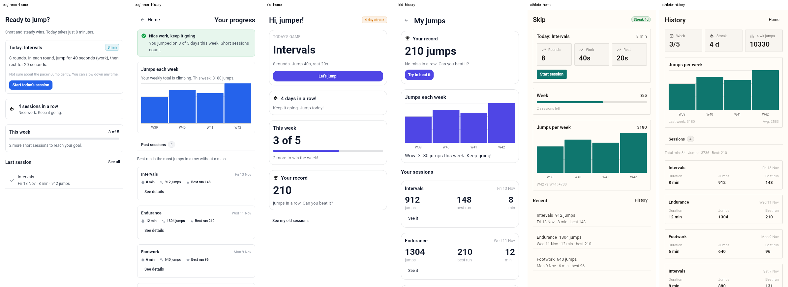
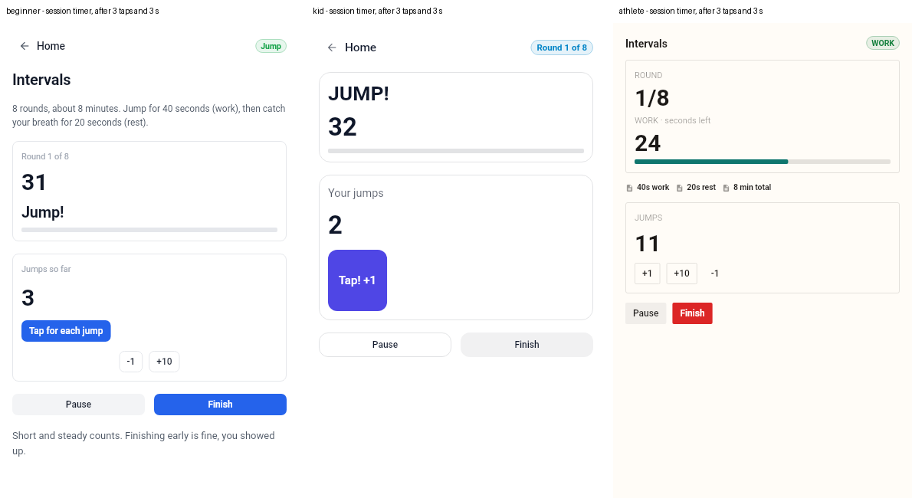
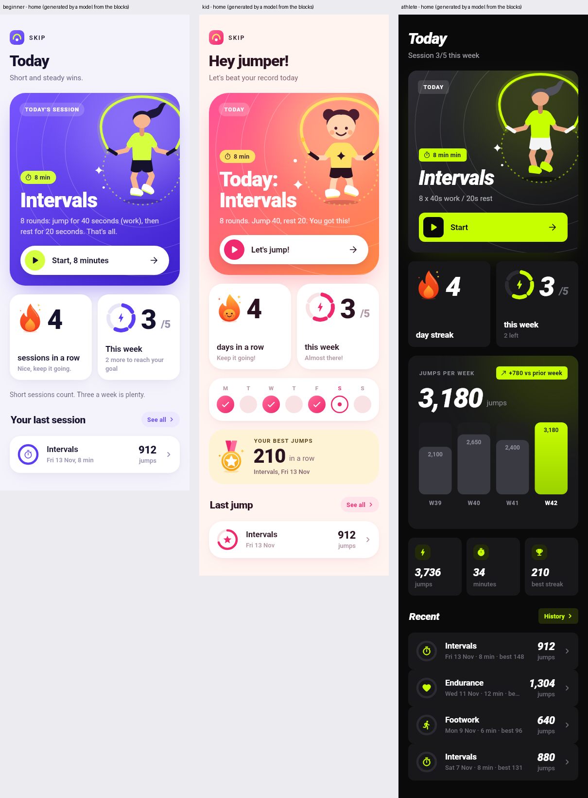
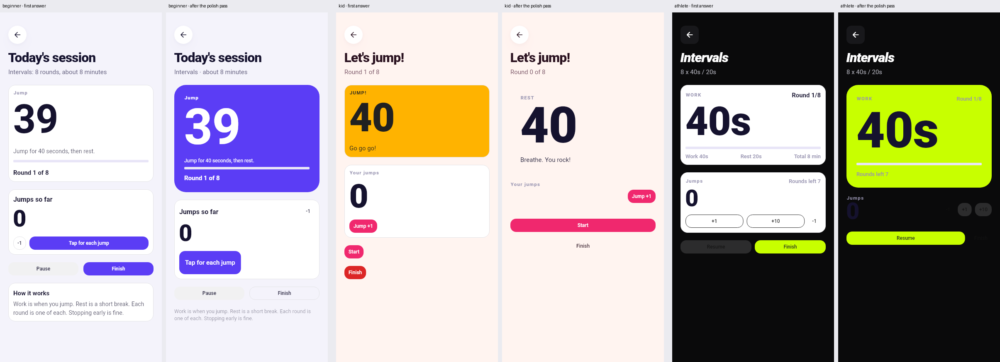

# An app described as prompts (prototype)

The first two steps of codelessly_api's `docs/design/15-the-middle-and-generated-apps.md`, part B: an app whose
screens are prompts, generated for one person at a time.



Left to right: an adult beginner (Soft SaaS UI), a nine-year-old (Harbor), a competitive athlete (Paper). Each
pair is the Home screen and the Training history page of the same app, written by a model from the same two
screen prompts and the same data.

## What is constant and what varies

| File | What it is |
|---|---|
| `app.json` | The constants. The brief; the screens, each one prompt; **the contract** (the variables every screen reads, with sample values, and the actions it may call); the rules every screen keeps |
| `personas/*.json` | The variables: one person's memory (goal, experience, stage, tone, notes on what they stumbled on) and the design system their app is shown in. All three are invented |
| `screens/` | What was generated: per screen and person, the brief sent, the notation the model wrote, the document it expands to; `contract.txt`, the state lines the host puts before every screen; `summary.json`, the numbers |
| `renders/` | Each screen drawn by `tool/render` at 390×844 |

## How a screen is made

```bash
ANTHROPIC_API_KEY=... python3 tool/generate.py [--persona kid] [--only home] [--model claude-sonnet-5-5]
```

For each screen and person, `tool/generate.py` writes a brief (the app, the screen's prompt, the contract, the
rules, the person), and the notation recorder (`examples/stream_chat/tool/record_notation.dart`) sends it with
the notation's instructions and that person's design system. The answer is read with the contract's `state`
lines put before it, validated, and retried once with what was wrong.

## What the first run showed (2026-11-14, claude-sonnet-5-5)

| Screen | Turns | Nodes | Output tokens (all turns) | Seconds (all turns) |
|---|---|---|---|---|
| Home, beginner | 1 | 28 | 554 | 4.1 |
| History, beginner | 1 | 27 | 536 | 4.0 |
| Home, kid | 1 | 28 | 510 | 3.9 |
| History, kid | 1 | 34 | 501 | 3.7 |
| Home, athlete | 2 | 32 | 1,130 | 7.2 |
| History, athlete | 2 | 37 | 1,356 | 8.1 |

All six render with no errors or warnings. Each request read about 11,400 input tokens, most of it the list of
the design system's 160 components.

- **One prompt does give three different, fitting screens.** The beginner's Home explains what an interval is
  and says the session takes 8 minutes; the kid's leads with a big "Intervals", a record to beat and few
  numbers; the athlete's shows rounds, work and rest and the totals with no encouragement.
- **The contract held.** Every screen shows the same streak, sessions and weekly numbers, and calls the same
  actions, though no two are laid out alike.
- **The host should own the contract's state.** When the model was asked to restate the variables, five of six
  first answers left some out. Putting the state lines before the answer fixed that and cut output by about a
  third (from about 820 tokens a screen to about 540).
- **It found three things the notation got wrong**, now fixed there: a string parameter that reads data
  (`value:"{streak} d"`) drew the raw expression; a number given to a text parameter; a stray `:=`.

## The session timer (a screen with behavior)



A third screen prompt, "Session timer", asks for a countdown that alternates work and rest, a round number, a
jump counter, pause and Finish. All three were written in the notation alone, using its `every` line for the
clock, and all three count down and count jumps when driven by the render tool (the image is each one after
three taps and about three seconds).

| Screen | Turns | Nodes | Output tokens (all turns) | Seconds (all turns) |
|---|---|---|---|---|
| Session, beginner | 1 | 23 | 660 | 4.8 |
| Session, kid | 2 | 19 | 1,176 | 7.9 |
| Session, athlete | 1 | 26 | 589 | 4.2 |

- The kid's first answer wrote `size:` on a text, which the notation does not have; the retry fixed it.
- The athlete's started its countdown with `state left=today.work`, which the notation read as the text
  "today.work", so the screen showed NaN. Fixed in the notation: a state started from declared state takes its
  value.
- The athlete's clock loses two seconds a tick: the model wrote `left=left-1` twice in one `every` line. Nothing
  checks a generated screen's logic; that is a job for the review pass.

## Generated on the fly from the app's own blocks (the polish experiment)



The same generator, pointed at the app's own design system (`design_systems/skip`: a brand layer, 13 screen
blocks, vector illustrations) and told only about its blocks:

```bash
ANTHROPIC_API_KEY=... python3 tool/generate.py --design-system skip --blocks-only --out generated_skip
```

Each person's screens are drawn under their token set (default, pink with the child illustrations, athlete).
What was generated is in `screens_skip/`; the sheets are `renders/skip-home.png`, `skip-history.png` and
`skip-session.png`. All nine render with no errors or warnings (claude-sonnet-5-5, one run each).

| | With SSUI's generic parts (above) | With Skip's blocks |
|---|---|---|
| Instructions read per screen | about 11,400 tokens | about 5,000 |
| Output, median | about 540 tokens | 482 (Home and History: 306 to 496) |
| Time, median | about 4 s | 3.7 s (first token after about 0.7 s) |
| Right on the first answer | 4 of 6, then 7 of 9 with the timer | 7 of 9 |
| Lines written for Home | 30 to 40 | 9 to 11 |

- **Home and History come out designed**, at the cost of a plain screen or less: the hero with its illustration,
  the streak and goal tiles, the week strip, the chart card. The person still shapes them: the kid gets a record
  card and the child illustration, the athlete gets the chart, totals and every session on Home.
- **The session timer does not**, and it is the proof of the rule: no block was designed for it, so the model
  fell back to cards and big numbers (`renders/skip-session.png`). A screen is as designed as its blocks.
- **The athlete's timer shows white cards on a black page.** The notation's `Card` writes its fill as a literal
  color, not a token, so it does not follow a token set. The same leak is why the `Screen` block has to paint the
  page itself. This is the layout and style separation the next experiment measures.
- Two things a model wrote that the notation now reads as meant: a field of state as a bare value
  (`minutes:today.minutes`) and a text written as a binding (`value:="{s.jumps}"`). One it still gets wrong: the
  hero's `minutes` given as "8 min" draws "8 min min".

## The polish pass (render, critique, rewrite)



`tool/polish_pass.py` gives a model the screen as drawn (the image), the screen as written, the notation's
instructions and a six-point rubric (one focal point, three steps of hierarchy, the design system's surfaces and
colors, one primary action, steady spacing, no literal colors), and takes back a critique and the screen
rewritten. Run once on each of the three session timers, the weakest screens, since they have no block:

| Screen | Seconds | Output tokens | Its critique of the first answer |
|---|---|---|---|
| Session, beginner | 9.7 | 1,330 | The countdown sits on a plain white card; two filled buttons compete; a repeated explainer adds noise |
| Session, kid | 3.8 | 526 | Two competing big numbers; literal colors on the focal surface; orphan buttons at odd widths |
| Session, athlete | 3.8 | 584 | Two equal white cards compete; the timer is not on a strong surface; no clear primary action |

All three still render with no errors. Looking at them:

- **It does what the rubric asks first.** The beginner's and the athlete's countdown moved onto a brand-colored
  focal surface, secondary buttons went quiet, and the repeated copy went.
- **It also broke things nothing reported.** The kid's lost its colored focal card and its jump count; the
  athlete's count and its small buttons are now dark on the black page and cannot be read. A rewrite needs the
  same checks as a first answer, and a contrast check the render tool does not make here.
- **It did not reach the block-built screens.** Compare with Home above: a pass over a plain screen improves its
  hierarchy; it does not produce an illustration, a designed tile or a chart card. This is one run per screen,
  but it agrees with the playground's lesson: designing the parts whole does more than fixing a draft.

So the pass is worth keeping as a cheap second step for screens without blocks, behind checks, and cached; it
is not the route to a designed screen.

## Not done

- Nothing here runs as an app: the screens are generated ahead and drawn as images. No navigation between them,
  no caching, no generating on demand (step 4 of the design).
- The buttons' actions (`emit start_session`) are not wired to anything.
- The look differs by a whole design system per person. Changing only theme tokens (pink or black) with the
  document untouched, and illustration sets, are not shown.
- The improvement loop (events, a review agent, a changed screen) is not started.
- One run per screen, one model. The retries on the athlete's screens were for a component's parameters
  (a `StatTile` given two strings).
