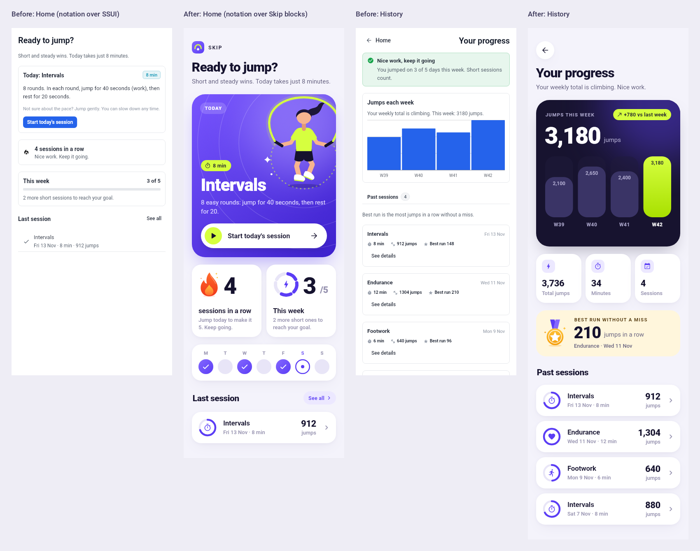
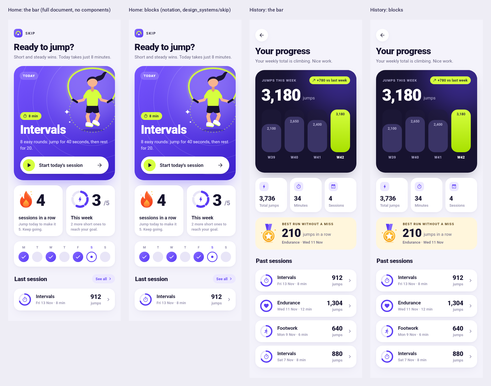
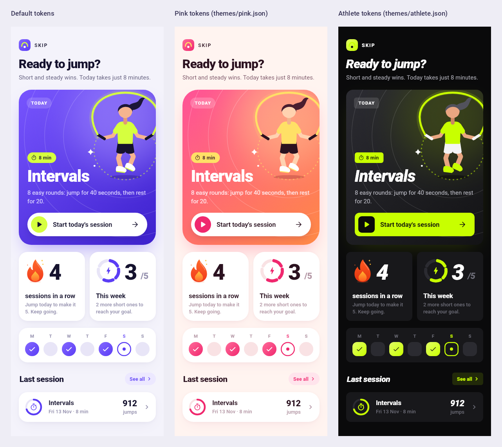

# Polish: a designed Skip, and the blocks that reproduce it

The prototype's screens (`../renders/personas.png`) are correct and personal but read as a SaaS dashboard. This
folder closes that gap in two steps: two screens designed at the full API (the bar), then the same polish packaged
as design-system blocks a fast model calls with one line each.

Everything here is rebuilt by `python3 examples/prompt_app/polish/tool/build.py` (it also rebuilds
`design_systems/skip`). Every site renders with 0 errors and 0 warnings.

## What is here

| Path | What it is |
|---|---|
| `bar/` | Home and Training history as full documents: core nodes only, no component, no design system (the theme is in `bar/site.json`). 140 and 80 nodes (History repeats one row template) |
| `home.blocks.txt`, `history.blocks.txt` | The same two screens in the compact notation, 9 lines each |
| `blocks/` | Those two files expanded and rendered under `design_systems/skip` |
| `variants/default`, `pink`, `athlete` | The one expanded Home (and History) document under three token sets; only `site.json`'s `theme` differs |
| `variants/kid`, `home.kid.blocks.txt` | A child's Home: `audience:"kid"`, the pink set, other copy |
| `gallery/`, `gallery.blocks.txt` | Every block once with other data, and the illustrations large |
| `renders/` | The pictures; `bar-home-r1.png` … `r5` and `bar-history-r1.png` … `r5` are the design rounds |
| `tool/build.py`, `tool/inline.py`, `tool/gallery.py` | The build; the inliner that writes the bar documents |

## Design rationale

- **One focal point per screen.** Home: today's session on the brand gradient, with the jumper, a duration chip
  and the only filled button on the screen. History: this week's jumps in display type on a dark panel, the
  current week the one lit bar.
- **Numbers are the heroes.** Roboto 900 with tight tracking for every figure (56, 42, 40, 32, 22), small caps
  eyebrows over them, soft 15 px body under them. Three sizes of quiet text, no more.
- **Color is spent in three places.** Brand indigo for progress and done marks, the volt accent for the one thing
  to look at (rope, lit bar, duration chip), flame orange for the streak. Everything else is ink on white cards on
  a tinted page.
- **Depth where it earns it.** The hero has a gradient, a blurred glow, concentric hairlines, film grain and a
  brand-colored shadow; cards have one soft tinted shadow; the rest is flat.
- **Drawn, not stock.** A person mid-jump under the rope (cropped by the card's edge, the rope's echo dotted
  underfoot), a two-tone flame, a medal, a rope at rest. All are vector draw lists colored by tokens.
- **The streak is three visuals**: the flame with its count, the segmented goal ring (one segment per session of
  the goal), and the week strip (done, today, to come), all from the contract's data.
- **The chart is drawn for this app**, not a default bar chart: four rounded columns on faint tracks, values
  inside, the latest lit in the accent, the change since last week computed into a chip.
- **Rhythm.** 20 px margins, 18 px between blocks, 12 px between sibling tiles and rows, radii 32 / 24 / 22.
- **Motion.** Every block fades and rises in, 70 ms later per block down the screen
  (`renders/entrance-midflight.png` is a capture with the animation slowed eight times); the jumper bobs.

Rounds (bar): r1 first layout; r2 art enlarged and bled off the card, title cleared of the rope, top bar
restructured, session icons by type; r3 figure lowered so the rope arc reads; r4 number formatting inside blocks,
grain; r5 hero title wraps instead of shrinking.

## The blocks (design_systems/skip)

13 blocks, listed first in the design system, then SSUI's 159 rebranded controls. Call lines as the notation
prompt prints them, then the line used here:

| Block | One-line call |
|---|---|
| Screen | `Screen` (blocks indented under it) |
| TopBar | `TopBar "Ready to jump?" "Short and steady wins." eyebrow:"Skip"` · `TopBar "Your progress" back:true -> emit open_home` |
| HeroSession | `HeroSession "{today.name}" "{today.rounds} easy rounds: …" minutes:"{today.minutes}" cta:"Start today's session" -> emit start_session` |
| StreakFlame | `StreakFlame "sessions in a row" "Jump today to make it {streak+1}." count:=streak` |
| ProgressGoal | `ProgressGoal "This week" "{weeklyGoal-sessionsThisWeek} more to reach your goal." done:=sessionsThisWeek goal:=weeklyGoal` |
| WeekStrip | `WeekStrip done:=map(take(sessions,sessionsThisWeek),s=>s.date) today:"Sat"` |
| SectionTitle | `SectionTitle "Last session" action:"See all" -> emit open_history` |
| SessionRow | `SessionRow "{s.name}" "{s.date} · {s.minutes} min" value:"{s.jumps}" unit:"jumps" share:=… -> emit open_session s.date` |
| ChartCard | `ChartCard "Jumps this week" values:=map(weeks,w=>w.jumps) labels:=map(weeks,w=>w.label)` |
| StatTrio | `StatTrio values:=[sum(sessions,s=>s.jumps),sum(sessions,s=>s.minutes),length(sessions)] labels:["Total jumps","Minutes","Sessions"]` |
| RecordCard | `RecordCard "Best run without a miss" "Endurance · Wed 11 Nov" value:"210" unit:"jumps in a row"` |
| EmptyState | `EmptyState "No sessions yet" "Your first one takes five minutes." cta:"Start a session" -> emit start_session` |
| Illustration | `Illustration role:"hero" audience:"kid" w:200 h:200` (roles: hero, streak, empty, record; audiences: adult, kid) |

Blocks do the work a model gets wrong: they format numbers, compute the chart's headline and change chip from the
values, pick a session's icon from its name, and hide parts whose text is empty.

## Bar against blocks

The build compares the captures: **0.000 % of pixels differ** on both screens. The reason is honest and worth
stating: the bar documents and the blocks come from the same section definitions (`design_systems/skip/tool/
blocks.py`). The design was iterated on the bar renders; `tool/inline.py` writes each bar document by expanding
every call into its core nodes with the arguments written into the expressions, and the page-level layout of the
bar (the screen column, the row of tiles, the session list) is written by hand in `tool/build.py`, separately
from the notation files. So the comparison proves that the component path (parameters by binding, events, nested
components, the notation's sizing and list expansion) loses nothing; it does not prove two independent designs
converged.

## Three token sets, one document

`variants/*/home.json` are byte-identical copies of `blocks/home.json`. The default site names only the design
system; the other two add a `theme` to `site.json` (`design_systems/skip/themes/pink.json`, `athlete.json`), which
the render tool merges over the design system's tokens key by key. Colors, radii, shadows, the italic display
type of the athlete set, and the illustrations all follow. `renders/variants-history.png` is History likewise;
`renders/audiences.png` shows the child's illustration set (a parameter, not a token: see below).

## What limited me (model and renderer)

1. **A theme color's name draws nothing inside a customPaint paint, silently.** `{"op": "circle", "paint":
   "accent"}` and `{"color": "accent", "style": "stroke"}` paint nothing and validation says nothing (0 errors).
   What works: `"${theme.colors.accent}"`. Every illustration color is written that way.
2. **A gradient inside a customPaint cannot name or compute its stops**, unless the whole paint is one expression:
   `"stops": [{"color": "${theme.colors.brand}"}]` draws nothing; `"paint": "${= {'shader': {'type': 'linear',
   'stops': [{'position': 0, 'color': theme.colors.flame}, …]}}}"` works. Used for the flame, medal, lit bar.
3. **A paragraph op's `style.color` takes no expression** (text drew black); its `paint` does.
4. **`${animation.<id>.value}` is documented (animation.md, NodeAnimation) but fails validation**:
   `unknown_name … "animation" is not a declared variable of canvas "card" nor a runtime scope (data, route,
   storage, screen, theme, item, index, …)`. I wanted bars that grow and a count-up driven by the entrance
   animation; the blocks only fade and rise.
5. **`each` directly under a component with children has no gap.** The notation copies the list's spacing from
   the parent node's `props.spacing`, and a component call has none, so rows touched. `Column gap:12` around the
   `each` fixes it (one more line).
6. **The notation writes the canvas fill as a color literal** (the design system's surface), so a document
   expanded from it does not follow a token set at the canvas. The `Screen` block paints the page color by token
   over it; without such a block the three-variant proof would fail at the background.
7. **The notation prompt shows only a component's first sentence and its parameter names**, not the parameters'
   docs. Each block's first sentence therefore carries its usage, and names had to be chosen from the notation's
   positional list (`title`, `detail`, `note`, `label`, `message`).
8. **A component fires only its first event through `->`**, and named slots have no notation: blocks have one
   event (`onPressed`) and no slots except `Screen`'s children.
9. **Two tiles side by side cannot stretch to equal height** in a scrolling column, so StreakFlame and
   ProgressGoal have a fixed height (176) and clamp their note to two lines.
10. **`scaleDown` on a text with `maxLines: 2`** shrank a two-word title to one small line and reported
    `text_clipped`; the hero title wraps instead, so one very long word would be cut with an ellipsis.
11. **No token for a string.** The illustration set (adult or kid) cannot be chosen by the theme; it is the
    `audience` parameter on four blocks, so a child's app changes those lines (design 15's layer 2 wants this to
    be memory, not layout).
12. **Fonts.** Only Roboto is available without shipping a font file; I did not add one (no external assets).
    Roboto Condensed renders in the tool but would not exist in an app, so it is not used.
13. The entrance cannot be seen in a normal capture (the tool settles first); checking it needed a slowed copy.

## Where it still falls short of a top consumer app

- **Type.** Roboto 900 is serviceable but generic. A brand display face is the single largest missing piece.
- **Illustration.** Clean, on-brand and recolorable, but it is geometric flat art drawn by coordinates: stiff
  pose, no faces on the adult, no hands, no texture or lighting. One pose only; a real app has a library
  (session types, celebrations, onboarding). The child set is closer to finished than the adult one.
- **No photography or video**, which is what Nike Training Club or Peloton lead with.
- **Motion is an entrance and a bob.** No bar growth, count-up, ring sweep, press physics or celebration
  (limitation 4 blocks the first three as components).
- **The chart** is strong for four values but has no axis, goal line or touch state; its value labels would
  crowd past about eight bars.
- **No app chrome**: no tab bar, status bar or profile, because the contract has two screens and no such data.
  The top right of Home is empty where an avatar would sit.
- **Dark mode** of the default set borrows the athlete colors; it was not designed.
- **Copy** is mine and thin; the SSUI version's reassurance line for the beginner ("you can slow down any time")
  has no slot in the hero.
- **Only one phone width** was designed and checked (390). Blocks fill the width but the hero art is anchored
  for a card about 350 wide.
- **Does the bar reach "designed from scratch"?** In layout, hierarchy, color and depth, yes, at the level of a
  good indie fitness app. In type, illustration craft and motion, no.

## What I would want from an image model or asset pipeline

- **Illustration sets by role, as SVG or layered PNG with a fixed palette contract** (named swatches mapped to
  tokens), so generated art recolors as the drawn art does. Roles: hero per session type, streak states (cold,
  alive, milestone), empty, record, onboarding, celebration; audiences: adult, child, athlete.
- **A consistent character** across poses (the same person jumping, resting, celebrating): reference-image
  conditioning, transparent background, consistent crop and ground line so a block can anchor it.
- **Short looping motion** (Lottie or a sprite sheet) for the hero and the streak.
- **A pipeline step that checks an asset against the token set** (contrast on `heroA`…`heroB`, palette within
  the contract) and writes it into the design system's manifest under a role and audience, so `Illustration
  role:"hero"` picks it up with no change to a page.
- **A licensed display typeface** shipped in the design system's `fonts`.
- A string-valued token (or a memory value blocks can read) to pick the set.
