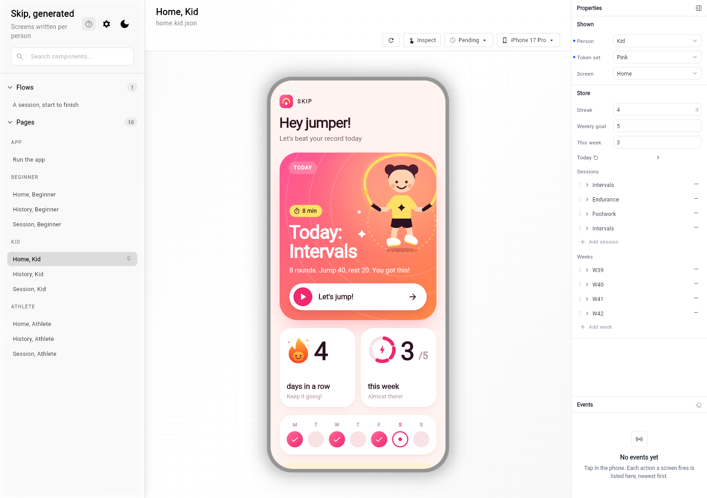
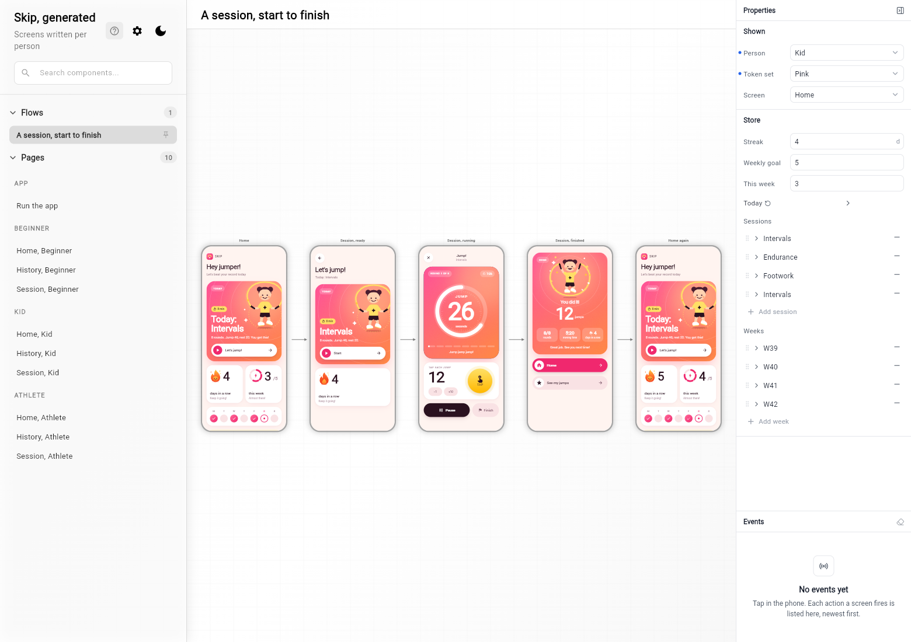
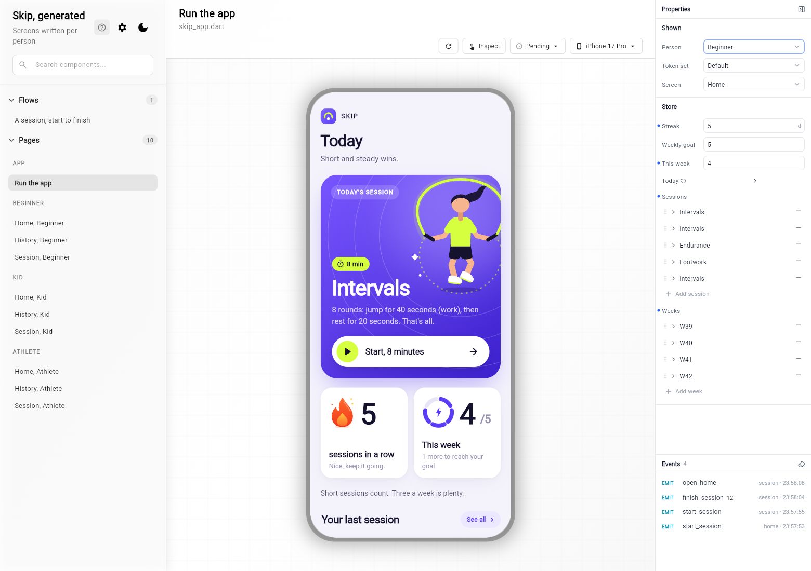
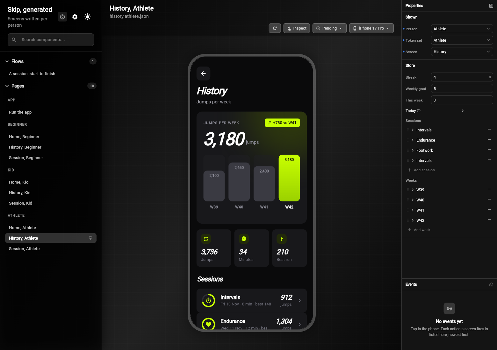

# The storyboard: the generated screens as stories, a flow and a running app



The generated Skip screens (see `../README.md`) in the Storyboard framework CodelesslyEditor's design system
ships with, with every control a row of the dynamic properties panel (DPP).

```bash
./tool_bundle.sh        # copy the Skip design system, its token sets, app.json and the generated screens into assets/
flutter run -d chrome   # or: flutter run -d chrome -t lib/main_storyboard.dart
flutter test

flutter build web --release --no-web-resources-cdn
python3 -m http.server 8080 --directory build/web
```

It needs CodelesslyEditor and OverlookV2 checked out beside this repository (DPP and soft_saas_ui are path
dependencies).

## What is in it

| In the sidebar | What it shows |
|---|---|
| Flows, **A session, start to finish** | Five real screens side by side in the template's flow viewer: Home, the session ready, running and finished, and Home again with the session in the store. It follows the person, the token set and the store |
| Pages, App, **Run the app** | The app running in a phone frame: one store, navigation by the screens' own events, a finished session changes the store |
| Pages, **Beginner / Kid / Athlete** | A story per generated screen: Home, History, Session. A group's header shows that person's three screens side by side (the template's category grouping) |

Beside the viewer, where the Editor has its inspector: **Properties** (Shown: person, token set, screen;
Store: the contract's data) over **Events** (what the screens told the app, newest first).





In the run above, the session fired `finish_session 12`; the app added it to the store, and the panel's
Streak, This week, Sessions and Weeks rows changed with it (the dots mark rows that differ from the contract's
sample values). Editing Streak in the panel changes Home at once, with the screen's own state kept.

## Design note

**Stories are grouped by person.** A person is what varies (their screens were written for them), the three
screens of one person are one app, and the template shows a subcategory's pages side by side when its header
is clicked. Grouped by screen, that view would compare one screen across people, which the panel's Person row
already does in place.

**Model objects** (all the template's own, `lib/storyboard/models`):

| Thing | Object |
|---|---|
| A story | `StoryboardItem` in category `Pages`, `subcategory` the person, `route` `/page_<screen>_<person>`, `filePath` the generated document. The viewer frames a page with `PhoneFrameViewer` and offers its frame selector |
| The running app | `StoryboardItem` in `Pages`, subcategory `App` |
| The flow | `FlowDefinition` with five `FlowStep`s and four `FlowConnection`s, shown by `SingleFlowViewer` in a `StoryboardItem` of category `Flows` |
| Categories and order | `StoryboardCategory('Flows')`, `StoryboardCategory('Pages')`, `getSubcategoryOrder()` |
| Status | `lib/storyboard/data/storyboard_status.json` by route |

**A story is one screen for one person, and only lists what its screen says** (an event from a story is tagged
STORY and nothing navigates). **Run the app** acts on events. Choosing a story chooses its person and screen in
the app, so the panel shows them; choosing another person or screen in the panel goes to that story.

**The panel** is 300 wide on the right (the Editor's `kDefaultRightWidth`), flush, with a hairline. It has two
panes split by `SoftSaaSSplitView`: Properties (36 px `SoftSaaSPanelHeader`, then two `SoftSaaSInspectorSection`s
each holding a `DynamicPropertiesPanel` in the inspector row layout) and Events (header with the count and
Clear, then 28 px rows).

**The schema** (one list, `skipSchema` in `lib/skip/skip_controls.dart`; one `DynamicPropertiesController`):

| Row | Kind | Notes |
|---|---|---|
| `person` | enum: beginner, kid, athlete | Brings that person's token set |
| `tokens` | enum: default, pink, athlete | Changes alone: the same generated screens, restyled |
| `screen` | enum: home, history, session | |
| `streak`, `weeklyGoal`, `sessionsThisWeek` | integer, with bounds | |
| `today` | object: name, rounds, work, rest, minutes | Expands in place |
| `sessions`, `weeks` | array of objects | Editable: DPP's array control adds, removes, reorders and edits items |

Defaults are the contract's sample values from `app.json`, so a row's reset returns to them.

**Both directions.** `SkipControls` listens to the controller's `commits` and turns a row's edit into a call on
the app (`choose`, `restyle`, `open`, `set`). It listens to the app and writes the rows that differ back with
`applyAllSilent`, so the write does not return as a commit. `SkipApp.set` puts the value into every screen on
show with a `vars` edit, so the screen keeps its state.

**States.**

- Loading: a `SoftSaaSLoadingSpinner` and one line in the phone, a spinner in Properties.
- The app could not be read: a borderless `SoftSaaSEmptyState` with Try again, in the phone and in Properties.
- A screen that was not generated: the others still run; its story says which command generates it.
- No events: an empty state in the Events pane.
- Below 1100 wide the panel does not fit beside the sidebar and the viewer: it closes to a 36 px rail with one
  button and opens over the viewer on a scrim. The same button hides and shows it at any width.
- Light and dark: the template's toggle. The frame and the panel follow; the generated screens keep their own
  token set.



## Files

| File | What it is |
|---|---|
| `lib/skip_app.dart` | The kernel, as before, extended: `tokens` and `restyle`, `set` for a store edit, `show`/`put`/`close` for the sessions of stories and flow steps (a store change reaches each), `note` for an event that is only listed, `has`, and a start that survives a missing screen |
| `lib/skip/skip_controls.dart` | The schema and the two-way binding |
| `lib/skip/skip_inspector.dart` | The panel: Properties and Events |
| `lib/skip/skip_screen.dart` | A generated screen in a box (story, flow step, running app), its stand-in states, `SkipScope`, `Detached` |
| `lib/skip/skip_flow.dart` | The flow's definition |
| `lib/skip/skip_storyboard.dart` | The app: the template's sidebar and viewer plus the panel |
| `lib/storyboard/data/` | `storyboard_data.dart`, `storyboard_config.dart`, `storyboard_status.json`: ours. `text_theme_data.dart` and `color_theme_data.dart` are the template's (its driver extension imports them) |
| `lib/storyboard/` otherwise | The template, synced, not edited |

## Conventions followed, and where each came from

| Convention | From |
|---|---|
| An app keeps its storyboard in `lib/storyboard` and starts it from `lib/main_storyboard.dart` (Pattern A); `lib/main.dart` calls it, since this example is its storyboard | `OverlookV2/packages/soft_saas_ui/storyboard/README.md` |
| The template is brought in by `sync_storyboard.dart`, and only `data/` is ours | The same README; the script itself is `OverlookV2/packages/auto_storyboard/storyboard_template/sync_storyboard.dart` |
| Pages are `StoryboardItem`s in `Pages` with a `subcategory`; a flow is a `FlowDefinition` in an item of `Flows`; a page returns a raw widget and the viewer frames it | README "Adding Pages", `data/storyboard_data.dart`, `models/flow_step.dart`, `widgets/storyboard_viewer.dart` |
| A subcategory header shows its pages together | `CATEGORY_GROUPING.md` |
| The app is `ToastificationWrapper` > `MaterialApp` (themes from `StoryboardConfig`) > `Scaffold` > background, sidebar, viewer | `storyboard_app.dart` |
| A properties panel belongs to the right of the viewer, with a schema per item and a builder that reads a `DynamicPropertiesController` | `auto_storyboard/storyboard_template/models/storyboard_item.dart` and `widgets/storyboard_viewer.dart` (the newer template, which cannot be built here; see below) |
| The inspector is the right panel, 300 wide, with a "Hide properties" `SoftSaaSEditorIconAction` (`panel_right_close`) at the end of its header | `CodelesslyEditor/lib/editor/shell/workspace_inspector.dart`, `editor_layout.dart` |
| DPP rows live in a `SoftSaaSInspectorSection`, with `showContainer: false`, `showBreadcrumbs: false`, `rowLayout: DynamicPropertyRowLayout.inline`, `maxInlineDepth: 5` | `CodelesslyEditor/packages/codelessly_properties/lib/src/inspector/section_generated.dart` |
| One controller; a row's edit arrives on `controller.commits` and becomes a host edit; an outside change is written with `applyAllSilent`, only for values that differ | The same file (`_Bound`), and DPP's README "Bidirectional sync" |
| The schema is JSON read by `DynamicPropertyDefinition.listFromJson`: `enumValues` with `enumLabels`, `bounds`, `properties`, `item` | `CodelesslyEditor/packages/dynamic_properties_panel/README.md`, `lib/src/models/dynamic_property_definition.dart` |
| Panes are flush and split by hairlines; headers are 36 px, rows 28 px; icon actions are 24 px with tooltips; colors and type only from tokens | `OverlookV2/packages/soft_saas_ui/STYLE.md`, `SoftSaaSEditorMetrics` |
| A pane's title sits in `SoftSaaSPanelHeader.leading`, expanded, so actions reach the edge; an empty or failed pane is a centered borderless `SoftSaaSEmptyState` with a 36 px icon tile | `CodelesslyEditor/packages/codelessly_studio/lib/src/studio/panel_chrome.dart` (`StudioPanelHeader`, `StudioPanelMessage`) |
| An event row: a short colored uppercase label, the name, the value in mono, the time; newest first; Clear in the header | `../../playground` (its Events tab), after the Editor's `lib/pages/project_apis/widgets/api_sidebar.dart` |
| A side pane that does not fit closes and opens over the page on a scrim | `CodelesslyEditor/lib/editor/shell/editor_shell.dart`, `lib/pages/project_apis/api_builder_view.dart` |

No file written here imports Material except `lib/skip/skip_storyboard.dart`, which needs `MaterialApp`,
`Scaffold`, `ThemeMode` and `Colors` from `package:material_ui` because the template's widgets need a Material
app above them and its background is written in Material colors. `lib/storyboard/data/storyboard_config.dart`
names `ThemeData` for the same reason. Everything else is `flutter/widgets.dart`, soft_saas_ui and DPP.

## The sync script

The README of `soft_saas_ui/storyboard` says to run `dart run storyboard/sync_storyboard.dart`, but that folder
has no such script. The script is in `auto_storyboard/storyboard_template`, and it syncs the folder it sits in
into the project above that folder, so run from there it would have copied the other, larger template (which
needs a `rebound` package that is not on this machine) into `auto_storyboard`.

What was done: the template folder and the script were copied, unchanged, to a temporary
`shell/storyboard_template/`, the script was run as documented, and the copy was removed.

```bash
mkdir storyboard_template
cp -r ../../../../OverlookV2/packages/soft_saas_ui/storyboard/. storyboard_template/
cp ../../../../OverlookV2/packages/auto_storyboard/storyboard_template/sync_storyboard.dart storyboard_template/
dart run storyboard_template/sync_storyboard.dart --target=lib/storyboard
rm -rf storyboard_template lib/storyboard/data/components lib/storyboard/data/component_catalog.dart lib/storyboard/main.dart
```

It copied 64 files and rewrote their imports for a target inside `lib/`. The last line removes what belongs to
soft_saas_ui's own storyboard and the script copies anyway: its component stories, its catalog, and its entry
point (which needs `flutter_driver`). Run again, the script keeps `data/storyboard_data.dart`,
`data/storyboard_config.dart` and `data/storyboard_status.json` and rewrites the rest.

## What does not follow the conventions, and why

- **`StoryboardApp` is not used.** It has no place for a panel and its state is private.
  `lib/skip/skip_storyboard.dart` stands in for it: the same widgets in the same order, plus the panel column
  and the two-way link between the panel and the selection. It does not have the template's driver extension
  (MCP control).
- **The panel is not the template's.** The newer template in `auto_storyboard` has the panel built into its
  viewer (`StoryboardItem.properties`, `propertyBuilder`). The one this example was asked to use does not, so
  the panel is beside the viewer, not under its top bar, and there is no "Properties" toggle in that bar.
- **Each page is drawn in the overlay of its phone frame** (`Detached` in `lib/skip/skip_screen.dart`). One
  second after an item is chosen, and after a resize, the template's viewer walks every render object under
  the page at every point of a 10 px grid to place annotations, whether or not there are any
  (`_refreshAnnotationPositions`). In the browser that froze the tab for over 30 seconds on a story and did not
  end on the flow. With the content in the overlay the walk finds one box (measured after: 0.5 s on a story,
  2.2 s on the flow, which is the five screens being built). The cost: the template's Inspect mode cannot pick
  a widget inside a screen.
- **The first page is chosen after the first frame.** The template's viewer reads an item's status only when
  the item changes, and throws if it is first built with one (`_currentStatus!`).
- **`analysis_options.yaml` leaves the synced template out.** The script writes package imports and this
  repository's rules ask for relative ones (84 of the template's 129 infos). `lib/skip`, `lib/storyboard/data`
  (ours) and `test` are analyzed and clean.
- **`applyAllSilent` is marked internal in DPP.** The Editor calls it with the same `ignore` comment; the public
  `applyAll` sends a commit, and two streams of commits chase each other when a bulk write changes the person
  and the screen together.
- **The event rows are not `SoftSaaSLogEntry`.** That component is a 12 px padded card with a 3 px colored edge
  and a slide-in animation, which is not the dense row STYLE.md asks for in a pane; the rows follow the
  playground's instead.

## Gaps and bugs found in what this builds on

Storyboard template (`soft_saas_ui/storyboard`):

- The sync script its README names is not in it.
- `_refreshAnnotationPositions` (above): the cost is grid points times render objects times depth, on the main
  thread, with no early exit when the item has no annotations.
- `_buildTopBar` uses `_currentStatus!`, which is null if the viewer's first build has an item. On the web,
  where preferences are read without a frame passing, the template's own `StoryboardApp` would hit this when a
  page was remembered.
- `StoryboardViewerState._initServices` calls `setState` after its awaits without checking `mounted`.
- Status and annotations are read with `dart:io`, so on the web every item shows Pending, whatever
  `storyboard_status.json` says (it is read in desktop builds and in the tests).
- `SingleFlowViewer` does not draw `FlowConnection.label`, and its step labels shrink with the flow to 6 px.
- A page is shown at its frame's full size in a scroll view, so in a window under about 1050 px tall the phone
  is cut off and scrolled, not fitted.
- The sidebar is a fixed 320 px, so below about 700 px wide there is no room for a page.
- `services/storyboard_driver_extension.dart` builds only because `data/text_theme_data.dart` and
  `data/color_theme_data.dart` exist with the names it expects; a new project has to supply them.
- 18 uses of deprecated Flutter members.

DPP:

- No public way to write values without a commit (`applyAllSilent` is `@internal`), though the pattern its
  README recommends needs one.
- An object row shows its reset button whenever the row has a value, not only when it differs from its
  default, and its chevron is not at the row's edge.
- An array item is titled by its `name`, so two sessions called Intervals cannot be told apart until opened;
  the schema cannot name the field to use.
- A nested field with no `defaultValue` always shows as modified.

soft_saas_ui:

- `SoftSaaSPanelHeader` gives its title and its spacer equal flex, so with a short title the actions sit in the
  middle of a narrow pane unless the title is moved into `leading`.
- `SoftSaaSLogEntry` (above) does not fit an inspector pane.

## Not done

- The driver extension and MCP control of the storyboard.
- Presets for the panel (DPP has them; the newer template stores them per item).
- A story keeps no state when the person or the token set changes: a new session starts.
- The flow's running step keeps counting, and after its eight rounds it would show the finished state.
- Generating a screen when it is first opened, caching by memory version, back navigation with history
  (as before, see `../README.md`).
- Checked only in a web build under software rendering, at 1560 by 1100 and 1000 by 800, in Chromium.
